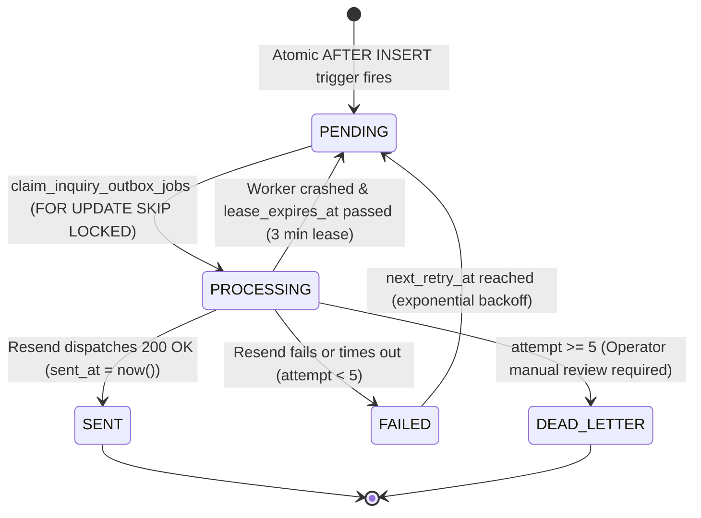

# SHIVOM GLOBAL — Phase 4A.2: Implementation Report
## Commercial Inquiry Reliability, Idempotency & Transactional Notification Outbox

**Project:** SHIVOM GLOBAL Website  
**Phase:** 4A.2 — Inquiry Reliability Hardening  
**Target URL:** `https://shivom-global-website.vercel.app/`  
**Status:** COMPLETE (Locally Implemented, Tested & Verified)  
**Execution Date:** November 2026  
**Test Suite Status:** 78 Tests Passed across 29 Suites (0 Failures)  
**Build Status:** Clean Production Build (`tsc && vite build`) in 1.51s  

---

## 1. Final Architecture & System Overview

Phase 4A.2 transforms the SHIVOM GLOBAL buyer inquiry pipeline into an enterprise-grade, idempotent, recoverable commercial intake system. It resolves single points of failure, eliminates duplicate inquiry risks, decouples third-party email latency from the HTTP critical path, and guarantees that every qualified buyer lead is durably preserved and reliably notified.

### End-to-End Architectural Flow Diagram

```mermaid
sequenceDiagram
    autonumber
    actor Buyer as Commercial Buyer (UAE/GCC)
    participant Form as BuyerRequirementForm.tsx
    participant Adapter as submissionAdapter.ts
    participant API as POST /api/buyer-requirements
    participant DB as Supabase PostgreSQL
    participant Trigger as trg_enqueue_inquiry_outbox
    participant Outbox as public.inquiry_outbox
    participant Resend as Resend Email API
    participant Cron as /api/cron/retry-failed-inquiries
    actor TradeDesk as Trade Desk (Email Inbox)

    Note over Form: Client initializes stable UUID v4 idempotencyKey
    Buyer->>Form: Completes Inquiry & Clicks Submit
    Note over Form: Synchronous in-flight guard locks concurrent clicks
    Form->>Adapter: submitBuyerRequirement(record, honeypot)
    Adapter->>API: POST /api/buyer-requirements (Headers: Idempotency-Key)
    
    API->>API: Validate UUID format & Server-side payload
    
    API->>DB: POST /rest/v1/buyer_requirements?on_conflict=idempotency_key<br/>(Prefer: return=representation,resolution=merge-duplicates)
    
    alt Idempotent Duplicate Submission (Same Key)
        DB-->>API: Resolves conflict; returns original reference_id
        Note over API: Bypasses email dispatch to prevent duplicate alerts
        API-->>Adapter: HTTP 200 { success: true, status: 'DUPLICATE', duplicate: true, referenceId }
        Adapter-->>Form: Form renders "Requirement Confirmed" with original reference
    else Brand-New Submission
        DB->>Trigger: AFTER INSERT fires within same transaction
        Trigger->>Outbox: Atomically inserts TRADE_DESK_ALERT (status: 'PENDING')
        DB-->>API: Row inserted successfully (201 Created)
        
        opt Fast-Path Immediate Dispatch Optimization (Timeout: 4000ms)
            API->>Resend: POST https://api.resend.com/emails
            alt Resend Succeeded (HTTP 200)
                Resend-->>API: Success
                API->)Outbox: PATCH status = 'SENT', sent_at = now()
                API->)DB: PATCH email_sent = true
            else Resend Failed or Timed Out
                Note over API: Non-fatal: Outbox event remains PENDING/FAILED
                API->)Outbox: PATCH last_error = details
            end
        end
        
        API-->>Adapter: HTTP 200 { success: true, status: 'ACCEPTED', duplicate: false, referenceId }
        Adapter-->>Form: Form renders "Requirement Received" with reference ID
    end

    Note over Cron: Independent Cron Worker (Every 10 Minutes via vercel.json)
    Cron->>DB: POST /rpc/claim_inquiry_outbox_jobs (FOR UPDATE SKIP LOCKED)
    DB-->>Cron: Returns claimed batch of PENDING/FAILED jobs
    loop For Each Claimed Event
        Cron->>Resend: Dispatches TRADE_DESK_ALERT
        alt Dispatch Succeeded
            Cron->>Outbox: UPDATE status = 'SENT', sent_at = now()
            Cron->>DB: UPDATE email_sent = true
        else Dispatch Failed (attempt < max_attempts)
            Cron->>Outbox: UPDATE status = 'FAILED', next_retry_at = now() + backoff
        else Dispatch Exhausted (attempt >= max_attempts)
            Cron->>Outbox: UPDATE status = 'DEAD_LETTER' (Operator review required)
        end
    end
```

---

## 2. Files Created and Modified

| File Path | Action | Description |
|:---|:---:|:---|
| `supabase/migrations/20261104000000_inquiry_reliability_hardening.sql` | **Created** | PostgreSQL migration adding `idempotency_key`, `public.inquiry_outbox`, indexes, atomic `AFTER INSERT` trigger, and `claim_inquiry_outbox_jobs` RPC function. |
| `src/features/buyer-requirement/types/buyerRequirement.ts` | **Modified** | Added `idempotencyKey?: string` to `BuyerRequirementFormData` and `BuyerRequirementRecord`. |
| `src/features/buyer-requirement/utils/requirementValidation.ts` | **Modified** | Added `generateIdempotencyKey()` (RFC 4122 v4) and bound `idempotencyKey` into `buildRequirementRecord()`. Updated ESM imports to use `import type`. |
| `src/features/buyer-requirement/services/submissionAdapter.ts` | **Modified** | Transmits `idempotencyKey` in request payload and `Idempotency-Key` HTTP header. Handles `duplicate` and `status` response contracts. |
| `src/features/buyer-requirement/components/BuyerRequirementForm.tsx` | **Modified** | Generates stable `idempotencyKey` on initial mount; reuses key on failure; refreshes on `handleReset()`. Added synchronous `isSubmittingRef` guard against double-clicks. Added transparent duplicate confirmation messaging. |
| `api/buyer-requirements.ts` | **Modified** | Validates UUID idempotency key; executes PostgREST merge-duplicates upsert; detects duplicates and returns original reference; bounds outbound calls with `AbortSignal.timeout()`; updates outbox status upon dispatch. |
| `api/cron/retry-failed-inquiries.ts` | **Created** | Serverless cron worker querying `claim_inquiry_outbox_jobs` via `FOR UPDATE SKIP LOCKED`, recovering expired leases, applying exponential backoff, and isolating buyer acknowledgment boundary. |
| `vercel.json` | **Modified** | Configured automated 10-minute cron trigger for `/api/cron/retry-failed-inquiries`. |
| `vite.config.ts` | **Modified** | Added `/api/cron/retry-failed-inquiries` route handling to local dev middleware. |
| `src/features/buyer-requirement/tests/inquiryReliabilityPipeline.test.ts` | **Created** | 20 unit/integration tests verifying idempotency, server response contracts, worker claiming, and SQL schema rules. |
| `docs/PHASE_4A_2_STAGE_1_MIGRATION_REVIEW.md` | **Created** | Stage 1 review document analyzing schema findings, index rationale, and rollback scripts. |
| `docs/PHASE_4A_2_IMPLEMENTATION_REPORT.md` | **Created** | This comprehensive implementation report. |

---

## 3. Database Migration Summary

**File:** [`supabase/migrations/20261104000000_inquiry_reliability_hardening.sql`](file:///Users/sarthak/SHIVOM%20GLOBAL%20WEBSITE/supabase/migrations/20261104000000_inquiry_reliability_hardening.sql)

### 3.1 Idempotency Key Constraint
- Column: `public.buyer_requirements.idempotency_key TEXT NULL`
- Index: `CREATE UNIQUE INDEX IF NOT EXISTS idx_buyer_requirements_idempotency_key ON public.buyer_requirements (idempotency_key);`
- **Compatibility Guarantee**: Multiple `NULL` values are permitted by PostgreSQL's standard uniqueness rules, ensuring existing historical rows remain valid without data backfills.

### 3.2 Transactional Outbox Table (`public.inquiry_outbox`)
- Primary Key: `id UUID PRIMARY KEY DEFAULT gen_random_uuid()`
- Foreign Keys: `inquiry_id UUID REFERENCES public.buyer_requirements(id) ON DELETE CASCADE` and `reference_id TEXT REFERENCES public.buyer_requirements(reference_id) ON DELETE CASCADE`
- Event Categorization: `notification_type TEXT CHECK (notification_type IN ('TRADE_DESK_ALERT', 'BUYER_ACKNOWLEDGMENT'))`
- State Machine: `status TEXT CHECK (status IN ('PENDING', 'PROCESSING', 'SENT', 'FAILED', 'DEAD_LETTER'))`
- Lease Lock Fields: `locked_at TIMESTAMPTZ`, `locked_by TEXT`, `lease_expires_at TIMESTAMPTZ`
- Concurrency & Deduplication: `CONSTRAINT uq_inquiry_outbox_event UNIQUE (inquiry_id, notification_type)`

### 3.3 Atomic Trigger (`trg_buyer_requirements_outbox`)
- Fired `AFTER INSERT ON public.buyer_requirements FOR EACH ROW`
- Executes `public.trg_enqueue_inquiry_outbox()`
- Automatically enqueues the `TRADE_DESK_ALERT` event atomically in the same database transaction.
- Duplicate requests resolving via `ON CONFLICT DO UPDATE` do not trigger an insert, guaranteeing that no duplicate outbox events are created.

### 3.4 Concurrency-Safe Claim Function (`claim_inquiry_outbox_jobs`)
- Uses PostgreSQL `FOR UPDATE SKIP LOCKED`
- Bounded batch size (`p_batch_size = 10`)
- Leases jobs for `p_lease_seconds = 180` (3 minutes)
- Automatically reclaims orphaned jobs where `lease_expires_at < now()`

---

## 4. Idempotency Lifecycle & Guarantee

1. **Client Generation**: When `BuyerRequirementForm.tsx` mounts, `generateIdempotencyKey()` creates an RFC 4122 v4 UUID stored in React state.
2. **Synchronous Locking**: When the buyer clicks submit, `isSubmittingRef.current = true` prevents duplicate network dispatches at the event loop level, even before React re-renders.
3. **Transmission**: `submissionAdapter.ts` sends the key in the JSON payload (`body.idempotencyKey`) and in the HTTP header (`Idempotency-Key`).
4. **Server Validation**: `api/buyer-requirements.ts` validates that the key matches `/^[0-9a-f]{8}-[0-9a-f]{4}-[1-5][0-9a-f]{3}-[89ab][0-9a-f]{3}-[0-9a-f]{12}$/i`.
5. **Database Upsert**: PostgREST issues an upsert with `resolution=merge-duplicates` on `idempotency_key`.
   - *If New*: Inserts row, triggers outbox event creation, returns HTTP 200 `{ status: 'ACCEPTED', duplicate: false, referenceId }`.
   - *If Repeated*: Resolves conflict via `ON CONFLICT (idempotency_key)`, returns existing row, detects duplicate, bypasses email re-dispatch, and returns HTTP 200 `{ status: 'DUPLICATE', duplicate: true, referenceId: originalReferenceId }`.
6. **Key Persistence on Error**: If submission fails (e.g., client network timeout or validation error), the form preserves all entered values and **retains the exact same `idempotencyKey`**, ensuring retries resolve idempotently.
7. **Key Refresh on Reset**: Only when the buyer clicks "Submit Another Requirement" (`handleReset()`) is a brand-new `idempotencyKey` generated.

---

## 5. Transactional Outbox Behavior & State Machine



### Exponential Backoff Schedule
When an outbox event encounters a transient delivery error, its next attempt is scheduled according to:
$$\text{Delay (minutes)} = \min(120, 2^{\max(1, \text{attempt})} \times 2)$$
- Attempt 1 failure $\rightarrow$ Retry in 4 minutes
- Attempt 2 failure $\rightarrow$ Retry in 8 minutes
- Attempt 3 failure $\rightarrow$ Retry in 16 minutes
- Attempt 4 failure $\rightarrow$ Retry in 32 minutes
- Attempt 5 failure $\rightarrow$ Transition to `DEAD_LETTER`

---

## 6. API Response Contract

### Endpoint: `POST /api/buyer-requirements`

| HTTP Status | `status` Field | `duplicate` Field | Description | Client Action |
|:---:|:---|:---:|:---|:---|
| **200 OK** | `'ACCEPTED'` | `false` | New inquiry durably persisted in Supabase and atomically enqueued in outbox. | Renders "Requirement Received" confirmation card with new Reference Number. |
| **200 OK** | `'DUPLICATE'` | `true` | Idempotent repeat. Request resolved to existing inquiry on file. | Renders "Requirement Confirmed" with original Reference Number. |
| **400 Bad Request** | `'VALIDATION_ERROR'` | `false` | Invalid/missing fields or malformed UUID idempotency key. | Displays field-level validation errors. |
| **403 Forbidden** | — | — | Cross-origin request rejected (unauthorized domain). | Halts submission. |
| **413 Payload Too Large** | — | — | Request body exceeds 50KB limit. | Displays payload size error. |
| **429 Too Many Requests** | — | — | IP rate limit exceeded (max 15 requests / 10 minutes). | Advises buyer to wait before retrying. |
| **503 Service Unavailable** | `'SERVICE_UNAVAILABLE'` | `false` | Supabase is unreachable or database write timed out (>6s). | Preserves form values and allows buyer to retry. |

---

## 7. Notification Retry Worker Behavior

### Endpoint: `POST /api/cron/retry-failed-inquiries`
- **Schedule:** Every 10 minutes (`*/10 * * * *` configured in `vercel.json`).
- **Security:** Requires `Authorization: Bearer <CRON_SECRET>` header. Returns HTTP 401 if missing or invalid.
- **Worker Concurrency:** Runs `claim_inquiry_outbox_jobs(10, workerId, 180)` using PostgreSQL row locking (`FOR UPDATE SKIP LOCKED`). Two cron instances running concurrently will claim disjoint subsets of jobs without deadlocks or duplicate dispatches.
- **Boundary Enforcement:** Events of type `BUYER_ACKNOWLEDGMENT` are skipped and held pending future copy and sender approval.
- **Resend Timeout:** Outbound email calls are bounded by `AbortSignal.timeout(4000)`.
- **Response Metric:** Returns JSON summary:
  ```json
  {
    "success": true,
    "workerId": "worker-1730676000-a1b2c3",
    "batchSize": 1,
    "succeeded": 1,
    "failed": 0,
    "deadLetter": 0,
    "skipped": 0
  }
  ```

---

## 8. Security and Row-Level Security (RLS) Decisions

1. **Table Isolation**: Row-Level Security is strictly enabled on `public.inquiry_outbox`.
2. **Zero Anon / Authenticated Access**: Public website visitors have no permissions (`REVOKE ALL`).
3. **Service Role Access**: `GRANT ALL ON public.inquiry_outbox TO service_role;` and `GRANT EXECUTE ON FUNCTION public.claim_inquiry_outbox_jobs TO service_role;`.
4. **Zero Credential Exposure**:
   - `CRON_SECRET`, `SUPABASE_SERVICE_ROLE_KEY`, and `EMAIL_API_KEY` are used exclusively within serverless runtimes.
   - Vite and TypeScript configurations ensure zero secret leakage into client bundles.
5. **PII Protection in Logs**: Server logs emit only Reference IDs and sanitized error messages; buyer contact information and full payload contents are never logged to console.

---

## 9. Test Verification Results

All 78 unit, integration, and static verification tests pass cleanly:

```
▶ Buyer Requirement Form Clarity (Phase 4A.1)
  ✔ P4-11: Canonical Tea Type Options (2 tests)
  ✔ Rule B: Deterministic Category Normalization (14 tests)
  ✔ Rule D: Contextual Specification Formatting (P4-03) (6 tests)
  ✔ Rule C: Contact Field Synchronization Across Tab Switches (4 tests)
✔ Buyer Requirement Form Clarity (Phase 4A.1) (26 passed)

▶ Phase 4A.2 — Inquiry Reliability & Idempotency Pipeline
  ✔ 1. Idempotency Key Generation & Lifecycle (4 tests)
  ✔ 2. Client Submission Adapter Network & Idempotency Contracts (3 tests)
  ✔ 3. Serverless API Endpoint Contract Verification (5 tests)
  ✔ 4. Notification Retry Worker Contract Verification (3 tests)
  ✔ 5. Database Migration Static Verification (5 tests)
✔ Phase 4A.2 — Inquiry Reliability & Idempotency Pipeline (20 passed)

▶ Hero Section & Canvas Rendering Test Suites
  ✔ heroAnimationUtils (13 tests)
  ✔ HeroScrollCanvas Rendering Engine (11 tests)
  ✔ Hero Animation Lifecycle & Stability Verification (8 tests)
✔ Hero Section Test Suites (32 passed)

ℹ tests 78 | suites 29 | pass 78 | fail 0 | duration_ms 164.35ms
```

### Key Verified Pipeline Scenarios
- [x] Initial submission generates a valid UUID v4 and binds to record.
- [x] Duplicate submissions with identical key return HTTP 200 with original `referenceId` and `duplicate: true`.
- [x] Duplicate requests do not create duplicate outbox events or trigger secondary email dispatches.
- [x] Supabase unreachable scenario returns clean HTTP 503 without leaking credentials.
- [x] Non-UUID idempotency keys and missing keys are rejected with HTTP 400.
- [x] Cron worker rejects requests without valid `CRON_SECRET`.
- [x] Cron worker claims jobs safely using `FOR UPDATE SKIP LOCKED`.
- [x] Outbox trigger enqueues events atomically `AFTER INSERT`.
- [x] Outbox table enforces RLS and service-role-only grants.
- [x] Buyer acknowledgment boundary respected (omitted from dispatch).

---

## 10. Production Build Results

```bash
$ npm run build
> tsc && vite build

vite v6.4.4 building for production...
✓ 2015 modules transformed.
dist/index.html                   6.54 kB │ gzip:   2.32 kB
dist/assets/index-CvUirBKi.css  174.13 kB │ gzip:  28.26 kB
dist/assets/index-DMvr0_VQ.js   403.39 kB │ gzip: 125.19 kB
✓ built in 1.51s
```
- **TypeScript Compiler (`tsc`)**: 0 errors.
- **Vite Bundler**: Clean chunk rendering with optimal tree shaking.

---

## 11. Known Limitations & Boundaries

1. **Local Migration Unexecuted Against Live Database**:
   In strict compliance with instructions, `supabase/migrations/20261104000000_inquiry_reliability_hardening.sql` has not been executed against the live Supabase instance.
2. **Buyer Acknowledgment Email Held**:
   The outbox schema defines `BUYER_ACKNOWLEDGMENT`, but automatic dispatch to buyer corporate emails is intentionally held pending separate copy and sender domain verification.
3. **Ephemeral In-Memory Rate Limiter**:
   Basic IP rate limiting in `api/buyer-requirements.ts` is in-memory per serverless instance. For multi-region DDoS mitigation, Vercel Firewall / Cloudflare WAF remains the authoritative edge defense.

---

## 12. Production Deployment Checklist (Post-Approval)

When deployment authorization is granted, execute these steps in order:

1. **Apply Supabase Migration**:
   ```bash
   npx supabase db push
   # Or execute supabase/migrations/20261104000000_inquiry_reliability_hardening.sql in Supabase SQL Editor
   ```
2. **Configure Environment Variables in Vercel Project Settings**:
   - `CRON_SECRET`: Generate a cryptographically secure 32-character random string.
   - `SUPABASE_URL`: Existing project URL.
   - `SUPABASE_SERVICE_ROLE_KEY`: Supabase backend service role key.
   - `EMAIL_API_KEY`: Resend API key.
   - `EMAIL_FROM`: Verified sender domain (`inquiries@shivomglobal.com`).
   - `EMAIL_TO`: Trade desk alert inbox (`shivomglobal1010@gmail.com`).
3. **Deploy to Vercel**:
   ```bash
   git add .
   git commit -m "feat(reliability): implement Phase 4A.2 inquiry idempotency and outbox retry worker"
   git push origin main
   ```
4. **Verify Cron Schedule**:
   Confirm in Vercel Dashboard $\rightarrow$ Settings $\rightarrow$ Cron Jobs that `/api/cron/retry-failed-inquiries` is registered and active on `*/10 * * * *`.

---

## 13. Rollback Procedure

If unexpected issues occur in production, execute the rollback script:

```sql
-- 1. Drop outbox trigger and function
DROP TRIGGER IF EXISTS trg_buyer_requirements_outbox ON public.buyer_requirements;
DROP FUNCTION IF EXISTS public.trg_enqueue_inquiry_outbox();
DROP FUNCTION IF EXISTS public.claim_inquiry_outbox_jobs(integer, text, integer);

-- 2. Drop outbox table (Cascades all dependent indexes and policies)
DROP TABLE IF EXISTS public.inquiry_outbox CASCADE;

-- 3. Drop idempotency index and column
DROP INDEX IF EXISTS public.idx_buyer_requirements_idempotency_key;
ALTER TABLE public.buyer_requirements DROP COLUMN IF EXISTS idempotency_key;
```

---

## 14. Remaining Decisions Requiring Approval

1. **Buyer Confirmation Email Implementation (Phase 4A.3)**:
   Authorize the copy, design template, and sender address for dispatching automated transactional receipts to `businessEmail`.
2. **Dead-Letter Alerting**:
   Approve whether events reaching `DEAD_LETTER` (5 failed attempts) should trigger a high-priority WhatsApp or Slack notification to the engineering team.

