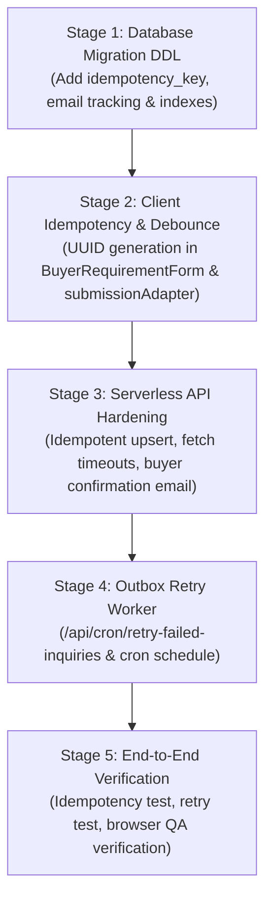

# SHIVOM GLOBAL — Phase 4A.2: Inquiry Reliability Technical Inspection
## End-to-End Buyer Inquiry Pipeline Audit & Resilience Specification

**Project:** SHIVOM GLOBAL Website  
**Phase:** 4A.2 — Step 1: Read-Only Technical Inspection  
**Status:** Complete — Awaiting Implementation Authorization  
**Execution Mode:** Inspection and Documentation Only (Zero Code/DB Modifications)  
**Date:** November 2026  

---

## 1. Executive Summary & Audit Context

The SHIVOM GLOBAL buyer inquiry pipeline is the commercial lifeline of the enterprise. For international tea buyers—specifically commodity importers, distributors, and private-label brand owners in the UAE and GCC—the inquiry intake system represents their primary commercial touchpoint.

This technical inspection conducts a line-by-line architectural and operational audit of the entire inquiry intake pipeline: from client-side capture in `BuyerRequirementForm.tsx`, through network dispatch via `submissionAdapter.ts`, serverless execution and sanitization in `api/buyer-requirements.ts`, relational database persistence in Supabase PostgreSQL (`buyer_requirements` table), to transactional email dispatch via Resend.

### Summary of Key Findings

1. **System of Record Enforcement Is Enforced for Valid Submissions**:
   Legitimate buyer inquiries are protected by a hard gate in `api/buyer-requirements.ts` (lines 602–609). The API will **not** return HTTP 200 if the Supabase database write fails. However, there is zero fallback if Supabase is unavailable: all submissions fail with HTTP 500, dropping commercial opportunities completely.
2. **Absence of True Idempotency**:
   Neither the client nor the backend enforces idempotency. The server generates a random reference ID (`generateServerReferenceId()`) on every request. A buyer retrying after a network stall or double-clicking the submit button will insert duplicate database records and generate duplicate trade desk notifications.
3. **Silent Notification Failure (Supabase Succeeded, Email Failed)**:
   If Supabase insertion succeeds but Resend transactional email fails, the API returns HTTP 200 to the buyer and logs `email_sent: false` in Supabase. However, **no background retry mechanism exists**. The trade desk receives no email notification, and the inquiry remains dormant unless manually discovered via database queries.
4. **Lack of Automated Buyer Transactional Confirmation**:
   The current email dispatch only sends an internal notification to the trade desk (`EMAIL_TO`). No transactional confirmation email is dispatched to the buyer's corporate email address (`businessEmail`).
5. **No Independent Outbox or Dead-Letter Retry**:
   Failed email dispatches cannot be retried independently without manual database intervention.

---

## 2. End-to-End Pipeline Architecture & Request Flow

### 2.1 Current Request Pipeline Diagram

```mermaid
sequenceDiagram
    autonumber
    actor Buyer as Commercial Buyer (Browser)
    participant Form as BuyerRequirementForm.tsx
    participant Adapter as submissionAdapter.ts
    participant API as /api/buyer-requirements (Vercel)
    participant DB as Supabase PostgreSQL (buyer_requirements)
    participant Resend as Resend Transactional Email API
    actor TradeDesk as Trade Desk (Email Inbox)

    Buyer->>Form: Completes Form A or Form B & clicks Submit
    Form->>Form: Client-side validation (validateQuickForm / validateRequirementForm)
    alt Validation Fails
        Form-->>Buyer: Shows inline field errors (No network request)
    else Validation Passes
        Form->>Form: Sets formStatus = 'SUBMITTING' (disables button)
        Form->>Adapter: submitBuyerRequirement(record, honeypot)
        Adapter->>API: POST /api/buyer-requirements (JSON body)
        
        Note over API: CORS Check & In-Memory IP Rate Limiter
        
        alt Honeypot website_hp Present
            API-->>Adapter: Decoy HTTP 200 (Bot trap, no DB write, no email)
            Adapter-->>Form: Decoy Success
            Form-->>Buyer: Displays Success Confirmation Card
        else Valid Buyer Request
            API->>API: Input sanitization & validateServerPayload()
            alt Server Validation Fails
                API-->>Adapter: HTTP 400 Bad Request + field errors
                Adapter-->>Form: Shows validation error alert
            else Server Validation Passes
                API->>API: Generates random referenceId (SG-REQ-YYYYMMDD-XXXX)
                API->>DB: POST /rest/v1/buyer_requirements (Service Role Key)
                
                alt Supabase Down or Config Missing (500)
                    DB-->>API: Network exception or HTTP 5xx
                    Note over API: Hard Gate: No DB insert -> Abort
                    API-->>Adapter: HTTP 500 Internal Server Error
                    Adapter-->>Form: Form error banner displayed
                    Form-->>Buyer: "We could not submit your requirement..."
                else Supabase Insert Succeeded (201 Created)
                    DB-->>API: Row created (email_sent: false)
                    API->>Resend: POST https://api.resend.com/emails
                    
                    alt Resend Succeeded
                        Resend-->>API: HTTP 200 OK
                        API->)DB: PATCH email_sent = true, email_dispatched_at = now()
                    else Resend Failed (Network/Auth/Quota)
                        Resend-->>API: HTTP Error or Timeout
                        API->)DB: PATCH email_sent = false, email_error = details
                        Note over API: Non-fatal: Squelches email failure
                    end
                    
                    API-->>Adapter: HTTP 200 OK + referenceId + message
                    Adapter-->>Form: Success + authoritative referenceId
                    Form->>Form: Sets formStatus = 'SUCCESS'
                    Form-->>Buyer: Displays Reference Card & WhatsApp link
                end
            end
        end
    end
```

### 2.2 Component & Subsystem Inventory

| Subsystem | File Path | Line Range | Key Function / Entity | Primary Responsibility |
|:---|:---|:---|:---|:---|
| **Frontend Form** | `src/features/buyer-requirement/components/BuyerRequirementForm.tsx` | Lines 199–265 | `validateQuickForm`, `handleQuickSubmit` | Form A validation, payload construction, active specification binding, submission dispatch. |
| **Frontend Form** | `src/features/buyer-requirement/components/BuyerRequirementForm.tsx` | Lines 268–312 | `handleDetailedSubmit` | Form B validation, detailed payload assembly, submission dispatch. |
| **Frontend Form** | `src/features/buyer-requirement/components/BuyerRequirementForm.tsx` | Lines 367–434 | Confirmation UI | Renders authoritative reference ID, WhatsApp follow-up CTA, and form reset. |
| **Client Adapter** | `src/features/buyer-requirement/services/submissionAdapter.ts` | Lines 25–80 | `submitBuyerRequirement` | Dispatches HTTP POST to `/api/buyer-requirements`, unwraps payload, handles network failure. |
| **Client Validation** | `src/features/buyer-requirement/utils/requirementValidation.ts` | Lines 30–117, 141–176 | `validateRequirementForm`, `buildRequirementRecord` | Client-side RFC 5322 email regex, international phone validation, string normalization. |
| **Specification State** | `src/features/buyer-requirement/utils/formSpecificationUtils.ts` | Lines 27–120 | `normalizeCategory`, `syncQuickToDetailed` | Six canonical tea categories, bidirectional contact synchronization. |
| **Serverless API** | `api/buyer-requirements.ts` | Lines 45–63 | CORS & Rate Limiting | Domain origin verification, ephemeral IP rate limiting. |
| **Serverless API** | `api/buyer-requirements.ts` | Lines 79–93 | `generateServerReferenceId` | Generates cryptographic server reference ID (`SG-REQ-YYYYMMDD-XXXX`). |
| **Serverless API** | `api/buyer-requirements.ts` | Lines 98–190 | `validateServerPayload` | Server-side validation of 11 required commercial parameters. |
| **Serverless API** | `api/buyer-requirements.ts` | Lines 222–349 | `sendTradeDeskEmail` | Dispatches transactional HTML & plaintext notification to Resend. |
| **Serverless API** | `api/buyer-requirements.ts` | Lines 531–609 | Supabase Insert Gateway | Direct PostgREST HTTP insert; strict enforcement gate (`dbInsertSuccess`). |
| **Serverless API** | `api/buyer-requirements.ts` | Lines 612–653 | Email Status PATCH | Asynchronously updates `email_sent` and `email_error` in database. |
| **Database Schema** | `supabase/migrations/20261021000000_buyer_requirements.sql` | Lines 9–85 | `public.buyer_requirements` | PostgreSQL schema, RLS policies, service role access grants, indices. |
| **Dev Proxy** | `vite.config.ts` | Lines 6–30 | `apiDevPlugin` | Vite dev middleware executing `api/buyer-requirements.ts` locally. |

---

## 3. Deep-Dive Subsystem Inspection

### 3.1 Frontend Subsystem

#### A. Form Validation and Submit Handlers
- **Form A (Quick Enquiry)**:
  - Validated by `validateQuickForm()` (`BuyerRequirementForm.tsx` lines 199–219).
  - Checks: `name` (>=2 chars), `company` (>=2 chars), `email` (RFC format), `phone` (>=7 digits), `country` (>=2 chars). The `message` field is optional.
  - Submits via `handleQuickSubmit()` (lines 222–265).
  - Encapsulates active category and grade:
    ```typescript
    requirementType: activeCategory || 'Assam CTC Black Tea',
    grade: activeGrade || 'BOP / Open to Recommendation',
    volume: 'Trial Batch (Quick Enquiry / Samples)',
    packaging: detailedData.packaging || 'Standard Bulk Export Sacks',
    destinationPort: `${quickData.country.trim()} (Port TBD)`,
    ```
- **Form B (Detailed Tea Requirement)**:
  - Validated by `validateRequirementForm()` in `requirementValidation.ts` (lines 30–117).
  - Validates all 11 fields, including destination port, volume scope, and packaging preference.
  - Submits via `handleDetailedSubmit()` (`BuyerRequirementForm.tsx` lines 268–312).

#### B. API Request Construction & Adapter
- In `submissionAdapter.ts` (lines 25–41):
  ```typescript
  const payload = {
    ...record,
    website_hp: honeypot || '',
  };
  const res = await fetch('/api/buyer-requirements', {
    method: 'POST',
    headers: { 'Content-Type': 'application/json' },
    body: JSON.stringify(payload),
  });
  ```
- **Defect Identified**: The `record` constructed by `buildRequirementRecord()` includes a client-generated `referenceId` (line 172). However:
  1. This client reference ID is completely discarded by the server (`api/buyer-requirements.ts` line 527 generates its own server ID).
  2. The client reference ID is **not** an idempotency key.
  3. No HTTP header (e.g., `Idempotency-Key` or `X-Client-Submission-Id`) is attached.

#### C. Loading, Success, and Error States
- State transitions:
  - `IDLE` -> `SUBMITTING` -> `SUCCESS` or `SUBMISSION_ERROR`.
- While `SUBMITTING`:
  - Buttons have `disabled={formStatus === 'SUBMITTING'}`.
  - Spinner icon `<RefreshCw className="animate-spin" />` is displayed.
- On `SUCCESS`:
  - `formStatus` switches to `'SUCCESS'`.
  - Replaces the form view with the confirmation screen displaying `submittedRecord.referenceId`.
  - One-click WhatsApp CTA pre-populates the reference ID into the message text.
  - "Submit Another Requirement" button invokes `handleReset()` to restore clean state.
- On `SUBMISSION_ERROR`:
  - Shows top-level banner error alert `<div className="form-banner-error" role="alert">`.
  - In Form B, field-level errors returned by server (`response.details`) are merged into `errors` state (lines 302–304).
  - **Minor Defect**: In Form A (`handleQuickSubmit`, lines 257–260), `response.details` is **not** mapped to field errors if the server rejects a field.

#### D. Duplicate Submission Prevention
- The submit button is disabled while React renders `formStatus === 'SUBMITTING'`.
- **Vulnerability**: React state updates are asynchronous. A rapid double-click before the next event cycle or a double-tap on a mobile device can dispatch two concurrent HTTP POST requests. Because the server generates unique random IDs for every request, both requests succeed and persist two identical leads.

---

### 3.2 Serverless API Subsystem (`api/buyer-requirements.ts`)

#### A. Execution Environment & Middleware
- Runs as a Vercel Serverless Function (Node.js runtime) and through Vite SSR middleware (`apiDevPlugin`) in local development.
- CORS policy:
  - Validates `req.headers['origin']` against `ALLOWED_ORIGIN_PATTERNS` (lines 46–52).
  - Supports Vercel preview URLs, production domains, and localhost.
- In-Memory Rate Limiting (lines 54–58, 195–217):
  - Limits each client IP to 15 submissions per 10-minute window.
  - **Operational Reality**: In Vercel serverless lambdas, memory is ephemeral across instances. While this offers basic flood protection for rapid bursts against a warm instance, it is **not** a globally distributed rate limiter.

#### B. Honeypot Anti-Bot Mechanism (lines 487–498)
```typescript
const honeypotVal = sanitizeString(body.website_hp, 100);
if (honeypotVal.length > 0) {
  const fakeRef = generateServerReferenceId();
  console.warn(`[HONEYPOT_TRIGGERED] Discarded automated submission from IP ${clientIp}. Decoy Ref: ${fakeRef}`);
  sendJsonResponse(200, {
    success: true,
    referenceId: fakeRef,
    message: 'Your requirement specification has been received for commercial evaluation.',
  });
  return;
}
```
- Legitimate security pattern: Returns a decoy HTTP 200 with a fake reference ID to bots. No database write occurs, and no email is dispatched.

#### C. Request Validation & Sanitization (lines 501–525)
- Server-side sanitization strips ASCII control characters (`\u0000-\u0008\u000B-\u000C\u000E-\u001F\u007F`) and truncates inputs to predefined limits.
- `validateServerPayload()` validates lengths, regexes for corporate email and international phone numbers, and required commercial parameters. Returns structured HTTP 400 with field details if validation fails.

#### D. PostgREST Supabase Interaction (lines 577–609)
- Calls PostgREST REST API directly:
  `${supabaseUrl.replace(/\/+$/, '')}/rest/v1/buyer_requirements`
- Headers:
  ```http
  apikey: <SUPABASE_SERVICE_ROLE_KEY>
  Authorization: Bearer <SUPABASE_SERVICE_ROLE_KEY>
  Content-Type: application/json
  Prefer: return=representation
  ```
- **Strict Hard Gate** (lines 603–609):
  ```typescript
  if (!dbInsertSuccess) {
    sendJsonResponse(500, {
      success: false,
      error: 'We could not submit your requirement at this time. Please try again.',
    });
    return;
  }
  ```
  The server **never** returns HTTP 200 to a legitimate buyer unless Supabase insert succeeds.

#### E. Timeout & Latency Risks
- Neither the Supabase `fetch()` nor the Resend `fetch()` specifies an `AbortSignal.timeout()`.
- If Supabase REST or Resend stalls, the request hangs until Vercel's serverless timeout threshold (typically 10s to 15s) is reached, triggering an unhandled 504 Gateway Timeout on the client.

---

### 3.3 Database System of Record (`public.buyer_requirements`)

#### A. Table Schema & Constraints
```sql
CREATE TABLE IF NOT EXISTS public.buyer_requirements (
  id UUID PRIMARY KEY DEFAULT gen_random_uuid(),
  reference_id TEXT NOT NULL UNIQUE,
  submitted_at TIMESTAMPTZ NOT NULL DEFAULT timezone('utc'::text, now()),
  
  -- Buyer Identity
  company_name TEXT NOT NULL,
  contact_name TEXT NOT NULL,
  corporate_email TEXT NOT NULL,
  phone TEXT NOT NULL,
  buyer_country TEXT NOT NULL,
  
  -- Commercial Specifications
  requirement_type TEXT NOT NULL,
  tea_category TEXT,
  grade TEXT NOT NULL,
  quantity TEXT NOT NULL,
  packaging_requirements TEXT NOT NULL,
  target_market TEXT NOT NULL,
  application TEXT,
  additional_requirements TEXT,
  
  -- Lifecycle & Pipeline
  source TEXT NOT NULL DEFAULT 'WEBSITE',
  status TEXT NOT NULL DEFAULT 'NEW',
  
  -- Email Dispatch State Machine
  email_sent BOOLEAN NOT NULL DEFAULT false,
  email_dispatched_at TIMESTAMPTZ,
  email_error TEXT,
  
  -- Audit & Metadata
  ip_address TEXT,
  user_agent TEXT,
  created_at TIMESTAMPTZ NOT NULL DEFAULT timezone('utc'::text, now()),
  updated_at TIMESTAMPTZ NOT NULL DEFAULT timezone('utc'::text, now())
);
```

#### B. Indexing and Performance
- `idx_buyer_requirements_reference_id` on `reference_id` (Unique).
- `idx_buyer_requirements_status` on `status`.
- `idx_buyer_requirements_created_at` on `created_at DESC`.
- `idx_buyer_requirements_email` on `corporate_email`.

#### C. Row-Level Security (RLS) & Access Control
- RLS is explicitly enabled (`ALTER TABLE public.buyer_requirements ENABLE ROW LEVEL SECURITY`).
- `REVOKE ALL ON public.buyer_requirements FROM anon, authenticated;`
- Full access granted exclusively to `service_role`.
- Anonymous public users cannot query or tamper with buyer commercial specifications.

#### D. Schema Gaps Identified
1. **No `idempotency_key` column**: No deduplication key exists to prevent identical duplicate submissions.
2. **No `buyer_confirmation_sent` column**: Tracking exists only for internal trade desk email (`email_sent`), not for buyer acknowledgment emails.
3. **No retry attempt counter**: No `email_retry_count` or `last_retry_at` fields to support an automated background retry outbox.

---

### 3.4 Email Notification Subsystem (Resend)

#### A. Dispatch Configuration (lines 222–236)
- Endpoint: `POST https://api.resend.com/emails`
- Sender: `process.env.EMAIL_FROM || 'SHIVOM GLOBAL Inquiries <inquiries@shivomglobal.com>'`
- Recipient: `[process.env.EMAIL_TO || 'shivomglobal1010@gmail.com']`
- `reply_to`: Set to buyer's `businessEmail`.

#### B. Failure Handling & State Machine (lines 614–653)
- If Resend returns HTTP 200:
  Executes `PATCH /rest/v1/buyer_requirements?reference_id=eq.${ref}` with:
  `{ email_sent: true, email_dispatched_at: now() }`.
- If Resend returns HTTP 4xx/5xx or network throws:
  Executes `PATCH /rest/v1/buyer_requirements?reference_id=eq.${ref}` with:
  `{ email_sent: false, email_error: sanitizeString(error, 255) }`.
- **Architectural Reality**:
  - The API does **not** fail the HTTP 200 response to the buyer when email dispatch fails.
  - This is intentionally designed to reflect that the lead has been durably captured in Supabase.
  - **However**: Because SHIVOM GLOBAL does not have a CRM integration or live Supabase dashboard alerting, trade desk operators rely 100% on email notifications. If email dispatch fails, the lead is functionally invisible until an engineer checks the database.

---

### 3.5 Security, Environment & Operations

#### A. Secrets Management
- All secrets (`SUPABASE_URL`, `SUPABASE_SERVICE_ROLE_KEY`, `EMAIL_API_KEY`) are accessed strictly within serverless functions (`api/buyer-requirements.ts`).
- Secrets are **never** bundled into the client-side JavaScript bundle (`vite.config.ts` loads them via `loadEnv` into `process.env` solely for the server middleware).

#### B. Logging & Data Sanitization
- Logs emitted by `api/buyer-requirements.ts`:
  - `console.warn` on rate limits and honeypots (includes client IP and decoy reference ID).
  - `console.error` on Supabase insert failure (includes HTTP status and PostgREST error body; PostgREST error bodies do not leak buyer credentials or API keys).
  - `console.error` on email exceptions.
- Client responses contain sanitized error strings (`"We could not submit your requirement at this time. Please try again."`), preventing internal database schema or stack trace leakage to the buyer.

---

## 4. Point-by-Point Answers to the 10 Reliability Questions

### 1. Can the API return HTTP 200 when the inquiry has not been durably stored?
**Answer: For legitimate buyer inquiries: NO.**  
**Evidence:** In `api/buyer-requirements.ts` (lines 589–609):
```typescript
if (dbRes.ok) {
  dbInsertSuccess = true;
}
...
if (!dbInsertSuccess) {
  sendJsonResponse(500, {
    success: false,
    error: 'We could not submit your requirement at this time. Please try again.',
  });
  return;
}
```
The endpoint enforces a strict check: if Supabase PostgREST returns anything other than an HTTP 2xx status, `dbInsertSuccess` remains `false`, triggering an immediate HTTP 500 response.  
*Edge Case / Bot Trap Exception*: Automated bots triggering the honeypot (`website_hp`) receive a decoy HTTP 200 without database persistence (lines 487–498).

---

### 2. What happens if Supabase is unavailable?
**Answer: The inquiry fails immediately with HTTP 500. No inquiry data is retained, and no email is dispatched.**  
**Evidence:**
- Missing environment variables or failed network connections to `${supabaseUrl}/rest/v1/buyer_requirements` abort the handler at lines 542–546 or lines 603–609.
- `sendTradeDeskEmail()` is located at line 612, which is positioned *after* the database gate.
- Consequently, if Supabase suffers downtime or configuration errors, email dispatch is never attempted.
- The buyer sees the error: `"We could not submit your requirement at this time. Please try again."`
- The lead is completely lost unless the buyer manually retries or contacts via WhatsApp.

---

### 3. What happens if Supabase succeeds but Resend fails?
**Answer: The inquiry is stored in Supabase and the buyer receives HTTP 200 (Success), but the trade desk receives NO notification.**  
**Evidence:**
- In lines 612–653, when `sendTradeDeskEmail` fails, the error is trapped in a `catch` block and recorded in Supabase via `PATCH` (`email_sent: false`, `email_error: error`).
- Execution then proceeds directly to line 656, returning HTTP 200 (`success: true`) to the buyer.
- **Silent Lead Accumulation**: Because there is no background retry worker or live monitoring on `buyer_requirements WHERE email_sent = false`, the trade desk does not know the inquiry exists unless someone manually inspects the database.

---

### 4. Can a buyer accidentally create duplicate inquiries?
**Answer: YES.**  
**Evidence:**
1. *Client Double-Click*: React's `formStatus === 'SUBMITTING'` disables the submit button, but rapid double-clicking before the React re-render can dispatch multiple concurrent POST requests.
2. *Network Disconnect Retry*: If a buyer's network stalls after Supabase insert succeeds, the browser fetch may time out and display a network error. When the buyer clicks submit again, a second complete inquiry is created.
3. *Server Generation of Reference IDs*: Every request invokes `generateServerReferenceId()` (lines 79–93, 527), generating a unique ID. Because the database uniqueness constraint is solely on `reference_id`, Supabase treats each retry as a distinct commercial inquiry.

---

### 5. Is there an idempotency mechanism?
**Answer: NO.**  
**Evidence:**
- The frontend adapter does not generate or transmit an idempotency key (e.g., `Idempotency-Key` header or UUID `idempotency_key` field).
- The server does not inspect headers for idempotency tokens.
- The `buyer_requirements` table has no `idempotency_key` column or composite unique constraint (e.g., `(corporate_email, requirement_type, grade, created_at)`).
- Submitting the same form payload 5 times in 5 seconds generates 5 distinct database rows with 5 different reference IDs and dispatches 5 emails.

---

### 6. Can failed email notifications be retried independently?
**Answer: NO.**  
**Evidence:**
- There is no retry loop or exponential backoff in `api/buyer-requirements.ts`.
- There is no scheduled cron job, Supabase Edge Function, or outbox worker querying records where `email_sent = false`.
- There is no administrative API endpoint or script to trigger re-dispatch of un-emailed inquiries.

---

### 7. Does the frontend distinguish inquiry acceptance from email delivery?
**Answer: NO.**  
**Evidence:**
- `submissionAdapter.ts` (lines 45–56) only checks `res.ok && data?.success`.
- The server response payload is simply:
  `{ success: true, referenceId: string, message: string }`.
- The frontend confirmation card states: `"Requirement Received. Our trade desk will review the requirement and follow up using the contact details provided."`
- The UI provides no indication whether the trade desk notification succeeded, failed, or was delayed.

---

### 8. What happens when the buyer loses connection during submission?
**Answer: Dependent on connection drop timing:**  
- **Scenario A (Disconnection before request reaches Vercel)**:
  `fetch('/api/buyer-requirements')` throws a network error. `submissionAdapter.ts` catches it (lines 70–79) and returns `{ success: false, error: 'Network connection issue. Please try again.' }`. Form status switches to `SUBMISSION_ERROR`. Form inputs remain intact. No record is written.
- **Scenario B (Disconnection while server is processing)**:
  The request reaches Vercel. Supabase insert succeeds. Resend email dispatches. However, the connection drops before HTTP 200 reaches the browser. The browser catch block fires, displaying a network error to the buyer. When the buyer retries, a duplicate record is created.

---

### 9. Are any success messages misleading?
**Answer: YES, in failure/degradation scenarios.**  
**Evidence:**
- If Supabase insert succeeds but Resend fails, the buyer sees:
  `"Your commercial requirement has been received by the SHIVOM GLOBAL trade desk."`
  and:
  `"Our trade desk will review the requirement and follow up using the contact details provided."`
  In reality, the trade desk received zero notification, and nobody is aware of the inquiry.
- *Honeypot Decoy*: Automated bots receive a fake success message (intentional defensive measure).

---

### 10. What changes are necessary to make the pipeline reliable?
**Answer: Five structural architectural improvements:**
1. **Client & Server Idempotency**:
   Generate a client-side UUID `idempotency_key` when the form loads/edits. Pass it in headers or payload. Add `idempotency_key TEXT UNIQUE` to `buyer_requirements`. Use Postgres `ON CONFLICT (idempotency_key) DO UPDATE` to ensure duplicate clicks return the existing reference ID without duplicate emails.
2. **Explicit Fetch Timeouts**:
   Attach `AbortSignal.timeout(8000)` to all outbound calls in `api/buyer-requirements.ts` to prevent serverless execution hangs.
3. **Outbox Retry Mechanism**:
   Implement a lightweight, scheduled cron worker (e.g. `/api/cron/retry-failed-inquiries` protected with `CRON_SECRET`) that queries `buyer_requirements WHERE email_sent = false` and retries email dispatch.
4. **Buyer Transactional Confirmation Email**:
   Send an automated confirmation email to `sanitized.businessEmail` with inquiry specifications, authoritative reference ID, and trade desk contact details.
5. **Decoupled Status in API Response**:
   Return `{ success: true, referenceId, emailDispatched: boolean }` so the frontend can transparently adapt messaging if email delivery is delayed.

---

## 5. Confirmed Defects vs. Potential Risks Matrix

| ID | Subsystem | Classification | Defect Description | Buyer / Commercial Impact | Severity |
|:---|:---|:---|:---|:---|:---|
| **DEF-01** | API / Database | **Confirmed Defect** | Lack of idempotency mechanism. Duplicate submissions generate duplicate database records and duplicate notification emails. | Clutters trade desk queue; confuses buyers if multiple reference numbers are generated for one inquiry. | **HIGH** |
| **DEF-02** | API / Email | **Confirmed Defect** | Silent failure when Resend fails. Database write succeeds and HTTP 200 is returned, but no background retry exists. | Trade desk never notified of lead; high buyer abandonment when nobody follows up. | **CRITICAL** |
| **DEF-03** | API / Email | **Confirmed Defect** | Absence of automated transactional confirmation email to buyer (`businessEmail`). | Procurement officers have no written paper trail or reference confirmation in their inbox. | **HIGH** |
| **DEF-04** | API | **Architectural Risk** | Unbounded outbound `fetch()` requests without `AbortSignal.timeout()`. | Potential Vercel 504 Gateway Timeouts under network latency or third-party service stalls. | **MEDIUM** |
| **DEF-05** | API | **Architectural Risk** | In-memory IP rate limiter (`isRateLimited`) is non-persistent across serverless instances. | Ephemeral rate limit can be bypassed across concurrent lambda container cold starts. | **LOW** |
| **DEF-06** | Frontend | **Minor Defect** | Form A (`handleQuickSubmit`) does not map server-side validation error details (`response.details`) to form fields. | If server rejects a specific field in Form A, the buyer only sees a generic banner error. | **MEDIUM** |
| **DEF-07** | Frontend | **Minor Defect** | Submit buttons lack microsecond-level event debouncing prior to React state update. | Rapid double-taps on mobile devices can trigger duplicate network requests. | **MEDIUM** |

---

## 6. Recommended Target Architecture

### 6.1 Target Pipeline Sequence Diagram

```mermaid
sequenceDiagram
    autonumber
    actor Buyer as Commercial Buyer
    participant Form as BuyerRequirementForm.tsx
    participant API as POST /api/buyer-requirements
    participant DB as Supabase PostgreSQL
    participant Resend as Resend Email API
    participant Cron as /api/cron/retry-failed-inquiries
    actor TradeDesk as Trade Desk Team

    Note over Form: Form generates unique idempotencyKey (UUID v4)
    Buyer->>Form: Clicks Submit
    Form->>API: POST /api/buyer-requirements (Payload + idempotencyKey)
    
    API->>API: Sanitize & Validate Payload
    API->>DB: UPSERT INTO buyer_requirements ON CONFLICT (idempotency_key)
    
    alt Duplicate Request Detected (idempotency_key already exists)
        DB-->>API: Returns existing record & reference_id
        API-->>Form: HTTP 200 { success: true, referenceId, duplicate: true }
        Form-->>Buyer: Displays existing Confirmation Card
    else New Unique Request Inserted
        DB-->>API: Row created (email_sent: false)
        
        par Parallel Email Dispatch
            API->>Resend: Dispatch Trade Desk Alert (EMAIL_TO)
            API->>Resend: Dispatch Buyer Confirmation (businessEmail)
        end
        
        alt Both Emails Succeeded
            API->)DB: UPDATE buyer_requirements SET email_sent = true
            API-->>Form: HTTP 200 { success: true, referenceId, emailStatus: 'sent' }
        else One or Both Emails Failed
            API->)DB: UPDATE buyer_requirements SET email_sent = false, email_error = details
            API-->>Form: HTTP 200 { success: true, referenceId, emailStatus: 'queued' }
        end
        
        Form-->>Buyer: Displays Confirmation Card with Reference ID
    end

    Note over Cron: Scheduled Outbox Worker (Every 15 Minutes)
    Cron->>DB: SELECT * FROM buyer_requirements WHERE email_sent = false AND created_at > now() - interval '24 hours'
    loop For Each Pending Inquiry
        Cron->>Resend: Retry Email Dispatch
        alt Retry Succeeded
            Cron->>DB: UPDATE email_sent = true, email_error = null
        else Retry Failed
            Cron->>DB: UPDATE email_retry_count = count + 1, email_error = new_error
        end
    end
```

### 6.2 Architectural Design Principles
1. **Supabase Remains Authoritative System of Record**:
   No inquiry is accepted without durable PostgreSQL persistence.
2. **Strict Idempotency by Design**:
   The database enforces uniqueness on `idempotency_key`. Multiple submissions with the same key safely return the original reference ID.
3. **Outbox Pattern for Decoupled Email Resilience**:
   Email delivery is inherently asynchronous and prone to transient third-party outages. Inquiries are stored first; failed emails are retried automatically by an outbox worker.
4. **Two-Way Communication**:
   Both the internal trade desk and the international buyer receive clear transactional communication.

---

## 7. Proposed Technical Contracts & Specifications

### 7.1 Database Migration Specification

Target migration file: `supabase/migrations/20261104000000_inquiry_reliability_hardening.sql`

```sql
-- ==============================================================================
-- SHIVOM GLOBAL — Inquiry Reliability & Idempotency Hardening
-- Migration: 20261104000000_inquiry_reliability_hardening.sql
-- ==============================================================================

-- 1. Add idempotency_key with unique constraint
ALTER TABLE public.buyer_requirements 
  ADD COLUMN IF NOT EXISTS idempotency_key TEXT UNIQUE;

-- 2. Add buyer confirmation tracking columns
ALTER TABLE public.buyer_requirements 
  ADD COLUMN IF NOT EXISTS buyer_email_sent BOOLEAN NOT NULL DEFAULT false,
  ADD COLUMN IF NOT EXISTS buyer_email_dispatched_at TIMESTAMPTZ,
  ADD COLUMN IF NOT EXISTS buyer_email_error TEXT;

-- 3. Add outbox retry tracking columns
ALTER TABLE public.buyer_requirements 
  ADD COLUMN IF NOT EXISTS email_retry_count INTEGER NOT NULL DEFAULT 0,
  ADD COLUMN IF NOT EXISTS last_retry_at TIMESTAMPTZ;

-- 4. Create performance indexes for outbox retry queries
CREATE INDEX IF NOT EXISTS idx_buyer_requirements_outbox 
  ON public.buyer_requirements (email_sent, buyer_email_sent, created_at)
  WHERE email_sent = false OR buyer_email_sent = false;

CREATE INDEX IF NOT EXISTS idx_buyer_requirements_idempotency 
  ON public.buyer_requirements (idempotency_key);
```

### 7.2 Proposed API Request & Response Contracts

#### A. Request Payload Extension
```typescript
interface ExtendedBuyerPayload {
  // Existing fields
  companyName: string;
  contactPerson: string;
  businessEmail: string;
  phoneWhatsApp: string;
  country: string;
  requirementType: string;
  grade: string;
  volume: string;
  packaging: string;
  destinationPort: string;
  qualitySpecs?: string;
  website_hp?: string;
  
  // New Idempotency Field
  idempotencyKey: string; // Client-generated UUID v4
}
```

#### B. API Response Contract
```typescript
interface ApiResponseSuccess {
  success: true;
  referenceId: string;
  message: string;
  emailStatus: 'sent' | 'queued' | 'partial';
  isDuplicate?: boolean;
}

interface ApiResponseError {
  success: false;
  error: string;
  details?: Record<string, string>;
}
```

### 7.3 Email Retry Strategy (Outbox Worker)

A serverless cron handler at `api/cron/retry-failed-inquiries.ts`:
- Invoked via Vercel Cron or external webhook every 15 minutes.
- Secured with `Authorization: Bearer ${CRON_SECRET}`.
- Logic:
  1. Query:
     ```sql
     SELECT * FROM public.buyer_requirements 
     WHERE (email_sent = false OR buyer_email_sent = false)
       AND email_retry_count < 5
       AND created_at > NOW() - INTERVAL '24 hours'
     ORDER BY created_at ASC 
     LIMIT 20;
     ```
  2. Attempts dispatch via Resend for pending trade desk and buyer emails.
  3. Updates `email_sent`, `buyer_email_sent`, `email_retry_count`, and `last_retry_at`.
  4. If `email_retry_count >= 5`, marks row status as `NOTIFICATION_FAILED` for administrative inspection.

---

## 8. Comprehensive Test Plan

### 8.1 Unit Tests (`src/features/buyer-requirement/tests/`)
1. **Idempotency Key Generation**: Verify that opening the form generates a valid UUID v4; verify that submitting does not regenerate the key unless explicitly reset.
2. **Form A Error Mapping**: Verify that server-returned field errors (`details`) properly populate Form A field errors.
3. **Debounce / In-Flight Locking**: Verify that calling the submit handler repeatedly within 200ms only dispatches one network call.

### 8.2 Integration & API Mock Tests
1. **Supabase Down / 500 Simulation**: Mock Supabase network failure; verify endpoint returns clean HTTP 500 without leaking secrets or schema.
2. **Resend Down / 500 Simulation**: Mock Resend failure after Supabase succeeds; verify inquiry is recorded with `email_sent: false`, error is captured, and API returns HTTP 200 with `emailStatus: 'queued'`.
3. **Idempotency Verification**: Submit identical payload with same `idempotencyKey` twice; verify second call returns HTTP 200 with original `referenceId` and `isDuplicate: true`, without inserting duplicate database rows.
4. **Honeypot Trigger**: Submit with `website_hp = 'bot'`; verify decoy 200 returned, zero DB writes, zero emails dispatched.

### 8.3 Browser End-to-End Tests (Chrome DevTools MCP)
1. **Happy Path Submission**: Submit Form A and Form B; verify confirmation screen, reference number rendering, and WhatsApp link composition.
2. **Network Offline Simulation**: Toggle browser offline; submit form; verify graceful error banner and preservation of user inputs.

---

## 9. Controlled Implementation Sequence

Following approval, Phase 4A.2 implementation should proceed in four strictly isolated stages:



---

## 10. Inventory of Files Requiring Modification

| File Path | Type | Planned Modification |
|:---|:---|:---|
| `supabase/migrations/20261104000000_inquiry_reliability_hardening.sql` | Migration (New) | Adds `idempotency_key`, `buyer_email_sent`, `email_retry_count`, and outbox indices. |
| `src/features/buyer-requirement/components/BuyerRequirementForm.tsx` | Frontend (Modify) | Generates `idempotencyKey`, adds click debouncing, binds Form A server errors. |
| `src/features/buyer-requirement/services/submissionAdapter.ts` | Frontend (Modify) | Transmits `idempotencyKey` in request payload and updates response types. |
| `src/features/buyer-requirement/types/buyerRequirement.ts` | Types (Modify) | Adds `idempotencyKey` and `emailStatus` to type definitions. |
| `api/buyer-requirements.ts` | Backend API (Modify) | Idempotent upsert logic, `AbortSignal.timeout(8000)`, buyer transactional email dispatch. |
| `api/cron/retry-failed-inquiries.ts` | Cron Worker (New) | Outbox worker querying un-notified inquiries and retrying Resend dispatch. |
| `vercel.json` | Configuration (Modify) | Configures cron schedule for `/api/cron/retry-failed-inquiries`. |
| `src/features/buyer-requirement/tests/buyerRequirementForm.test.ts` | Test Suite (Modify) | Unit and integration tests for idempotency, debouncing, and error handling. |

---

## 11. Conclusion & Awaiting Explicit Approval

This technical inspection confirms that while SHIVOM GLOBAL's inquiry pipeline correctly enforces durable database persistence as a prerequisite for success, it currently lacks:
1. True idempotency protection against duplicate submissions.
2. Automatic retry mechanisms for failed email dispatches.
3. Transactional confirmation emails to buyers.
4. Outbound request timeout safeguards.

All architectural recommendations, database migration scripts, API contracts, and test plans are fully specified above. In strict compliance with instructions, **zero code or database modifications have been made during Step 1**.

**Next Step**: Await user authorization before proceeding to implementation.

