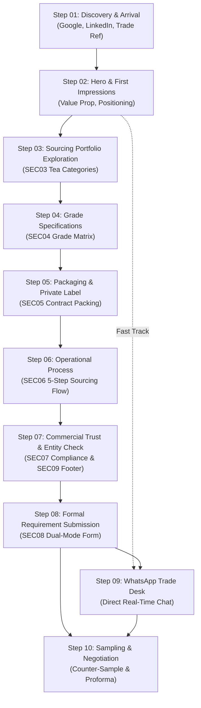

# SHIVOM GLOBAL — Phase 4: B2B Buyer Journey & Conversion Mapping
## Comprehensive 10-Step Journey Analysis for UAE & International Tea Importers

> **Document Status**: Complete & Authoritative  
> **Target Market**: UAE (Dubai, Sharjah, JAFZA, Abu Dhabi), GCC, and International B2B Tea Buyers  
> **Audited Platform**: `https://shivom-global-website.vercel.app/`  
> **Baseline Date**: 2026-11-03  
> **Reference Protocol**: `docs/WEBSITE_PHASE_4_AUDIT.md`

---

## 1. Executive Context & Buyer Personas

The SHIVOM GLOBAL website targets four distinct commercial buyer personas in the Arabian Gulf and international trade:

1. **The Karak Chai Institutional Blender & Distributor (Dubai / Sharjah)**:
   - *Profile*: Sources high volumes (10–50 MT/month) of high-density Assam CTC (PD, D1, PF, BP).
   - *Primary Need*: Maximum briskness, instant deep red liquoring with milk holding capacity, competitive CIF Jebel Ali pricing, and consistent container lots.
   - *Friction*: Sourcing desks that do not understand dust grades or milk reactivity.

2. **The Private-Label Supermarket & FMCG Brand Creator (JAFZA / Al Quoz / GCC)**:
   - *Profile*: Developing retail tea bags, premium loose-leaf tins, or stand-up barrier pouches for Gulf retail chains (Lulu, Carrefour, Spinneys, Union Coop).
   - *Primary Need*: End-to-end packaging coordination, compliance with ESMA / Dubai Municipality bilingual (Arabic/English) labeling, food-grade materials, and low trial MOQs.
   - *Friction*: Suppliers who only sell raw uncleaned bulk sacks with zero packaging assistance.

3. **The Traditional Commodity Wholesaler & Re-Exporter (Al Ras Wholesale Market, Deira)**:
   - *Profile*: Decades-old trade operations trading multi-origin teas for re-export into Saudi Arabia, Iraq, Iran, and East Africa.
   - *Primary Need*: Spot availability, accurate grading, competitive FOB Mundra/Kolkata or CIF Jebel Ali terms, fast shipping documents, and trade credit / DP / LC terms.
   - *Friction*: Complex websites that hide phone/WhatsApp contact or require lengthy registration forms.

4. **The Specialty Tea Purveyor & Hospitality Supplier (Downtown Dubai / Abu Dhabi)**:
   - *Profile*: Luxury boutique blenders, luxury hotel suppliers, and premium tea salons.
   - *Primary Need*: Single-estate Darjeeling flushes, whole-leaf Upper Assam Orthodox (TGFOP/FTGFOP), high-grade Green Teas, organoleptic pedigree, and authentic geographical indications.
   - *Friction*: Bulk commodity traders pushing low-grade dust with zero sensory cupping data.

---

## 2. Comprehensive 10-Step Buyer Journey Map



---

### Step 01: Discovery & Arrival

| Dimension | Audit Finding & Detailed Analysis |
|---|---|
| **Buyer Mindset & Questions** | "Who is SHIVOM GLOBAL? Are they an actual Indian tea source or an unverified intermediary? Can they deliver to Jebel Ali?" |
| **Information Available on Site** | Title tag and metadata: *Indian Tea Sourcing & Export Desk*. Static pre-rendered shell provides instant textual summary. |
| **Missing Information / Gaps** | No explicit geographic proximity callout in search snippets linking Gujarat export ports (Mundra/Kandla) to the UAE (3–5 days transit). |
| **Friction Points** | Organic search landing on mobile loads a 398KB JS bundle; while fast on fiber, 4G roaming buyers may experience a 1.2s delay before full hydration. |
| **Commercial Risk** | High-intent buyers bounce back to Google if search result fails to signal Middle East delivery or specific grades. |
| **Recommended Improvements** | Target Gulf search queries: *Assam CTC tea exporter to UAE*, *Karak tea dust bulk supplier Dubai*, *Indian tea CIF Jebel Ali*. Enrich structured data with regional trade terms. |

---

### Step 02: Hero & First Impressions (Section 01 & Section 02)

| Dimension | Audit Finding & Detailed Analysis |
|---|---|
| **Buyer Mindset & Questions** | "What does this company actually sell? Can I reach them right now on WhatsApp? Are they pushing speculative stock or sourcing to my spec?" |
| **Information Available on Site** | H1: *Source the Indian Tea You Need*. Plain B2B narrative stating zero inventory push. Dual action buttons: "Tell Us What Tea You Need" and "WhatsApp Trade Desk". Direct contact strip with phone and email. 3 trust indicators. |
| **Missing Information / Gaps** | Transit time to Middle East is absent. The right-column visual is a 100% CSS 3D composition; while technically impressive, it is an illustrative rendering rather than authentic photography of export warehouses or palletized tea containers. |
| **Friction Points** | The primary CTA "Tell Us What Tea You Need" jumps directly to the bottom of the page (`#requirement-form`), bypassing the products, grades, and credibility sections if clicked prematurely. |
| **Commercial Risk** | Skeptical buyers who mistrust CSS illustrations might doubt physical handling capability. Premature jump to form can feel demanding before value is established. |
| **Recommended Improvements** | Add a subtle Gulf logistics callout: *"Direct 3–5 Day Transit from Gujarat Ports to Port Jebel Ali"*. Anchor primary CTA to `#our-teas` (Explore Sourcing) while keeping "Request a Quote" in sticky header. |

---

### Step 03: Tea Sourcing Portfolio Exploration (Section 03 — Atelier Baseline)

| Dimension | Audit Finding & Detailed Analysis |
|---|---|
| **Buyer Mindset & Questions** | "Do they have authentic Assam CTC for Karak chai? What about whole-leaf Orthodox or Darjeeling? Can I see real dry leaf and liquor characteristics?" |
| **Information Available on Site** | 4 distinct terroirs: Assam CTC, Assam Orthodox, Darjeeling, Green Tea. Intrinsic 640×478 responsive WebP photography. Sensory cupping profiles, indicative liquor swatches, and 4 specific grade selectors per category. Direct WhatsApp link with pre-filled category. |
| **Missing Information / Gaps** | In Assam CTC, the 4 visible grade buttons are BOP, BOPSM, BP, PF. The critical Middle East dust grades (**PD** and **Dust/D1**) are not exposed as primary buttons in the console (though mentioned in copy). |
| **Friction Points** | None in layout (Phase 3B completed). However, buyers seeking dust grades must scroll to Section 04. |
| **Commercial Risk** | A Dubai cafeteria supplier looking specifically for PD (Pekoe Dust) might assume SHIVOM GLOBAL only sources broken leaf if they do not scroll further. |
| **Recommended Improvements** | In Phase 4B/5, consider including PD and D1 directly in the Assam CTC grade selector buttons or providing an explicit "Chai / Karak Grades" filter tag. |

---

### Step 04: Grade Specifications & Technical Fit (Section 04)

| Dimension | Audit Finding & Detailed Analysis |
|---|---|
| **Buyer Mindset & Questions** | "What are the exact manufacturing cuts? Can they match my custom sieve or benchmark blend? What are the typical commercial applications?" |
| **Information Available on Site** | 5-column table with 8 grades (6 CTC + 2 Orthodox). Typical commercial applications. "Specify" action button syncing with Form B. Contextual WhatsApp inquiry button. Clear organoleptic disclaimer. Custom specification matching banner. |
| **Missing Information / Gaps** | **Darjeeling and Green Tea grades are completely absent** from this table despite being prominent in Section 03! Particle size is described editorially without standard mesh sieve ranges. Typical moisture content (<7.5%) and bulk density (g/cc) are omitted. |
| **Friction Points** | Disconnect between Section 03 (which has 4 categories) and Section 04 (which only filters CTC and Orthodox). Table requires horizontal scrolling on mobile viewports. |
| **Commercial Risk** | Specialty buyers interested in Darjeeling FTGFOP1 or Green Tea assume the specification table is incomplete and lose technical confidence. |
| **Recommended Improvements** | Add Darjeeling (FTGFOP1, TGFOP) and Green Tea (Traditional Pan-Fired, Fine Cut) rows to Section 04. Add indicative bulk density and standard export moisture parameters. |

---

### Step 05: Packaging & Private Label Assessment (Section 05)

| Dimension | Audit Finding & Detailed Analysis |
|---|---|
| **Buyer Mindset & Questions** | "Can they pack into 25kg multi-wall paper sacks for container export? Can they pack branded 500g pouches or pyramid tea bags for my Dubai brand? What is the MOQ?" |
| **Information Available on Site** | 3 format tiers: Bulk Export Packaging (standard sacks), Custom Bulk Packing (flexible containers), Private Label Support (pouches, tins, tea bags). Discussion banner for destination packaging requirements. |
| **Missing Information / Gaps** | **No concrete MOQ figures**: All cards state "Quantities discussed on requirement". No mention of UAE food packaging regulatory standards (ESMA, Dubai Municipality, Arabic labeling, FoodWatch). No packaging photography. |
| **Friction Points** | The lack of baseline volume expectations leaves buyers wondering if SHIVOM GLOBAL accepts 100kg trial batches or requires 20 MT minimums. |
| **Commercial Risk** | High-volume private-label brand creators bounce because they assume the company is strictly a bulk raw leaf supplier without commercial packaging facilities. |
| **Recommended Improvements** | Provide realistic commercial brackets: *"Bulk Export: Minimum 1 Pallet / ~1 MT (Trial) or 1x20ft FCL (~10–12 MT); Private Label Pouches: From 2,500 units; Tea Bags: From 50,000 envelopes"*. Reference UAE bilingual labeling support. |

---

### Step 06: Operational Credibility & Process Understanding (Section 06)

| Dimension | Audit Finding & Detailed Analysis |
|---|---|
| **Buyer Mindset & Questions** | "How does the commercial transaction work? Can I cup a physical sample before paying? Who pays for sample courier? What are the payment terms?" |
| **Information Available on Site** | 5-stage sequential pathway: 1. Share Requirement -> 2. Sourcing Match -> 3. Counter-Sample -> 4. Buyer Cupping -> 5. Commercial Discussion & Export. Sample evaluation policy ribbon. |
| **Missing Information / Gaps** | **No operational timelines or SLAs**: How fast is sample dispatch? (Typically 3–5 working days). What courier is used? (DHL/FedEx/Aramex). What payment terms are accepted? (e.g. 100% Irrevocable LC at sight, TT with deposit, CAD). Courier cost responsibility policy is not defined. |
| **Friction Points** | Step 05 mentions "payment milestones" vaguely without specifying standard commercial instruments, which can trigger suspicion of upfront cash demands. |
| **Commercial Risk** | Serious importers hesitate to engage if they fear dealing with an operator that demands 100% advance wire transfers before sample approval. |
| **Recommended Improvements** | Clarify sampling SLA: *"Representative counter-samples dispatched within 3–5 working days via international courier"*. Explicitly list accepted payment terms: *"Irrevocable LC at sight, TT (30% deposit, 70% against BL copy), or CAD for established buyers"*. |

---

### Step 07: Commercial Trust & Entity Verification (Section 07 & Section 09)

| Dimension | Audit Finding & Detailed Analysis |
|---|---|
| **Buyer Mindset & Questions** | "Who is behind SHIVOM GLOBAL? Are they legally registered in India? Can they provide Phytosanitary and Origin certificates? Where are they based?" |
| **Information Available on Site** | Statutory compliance console (Section 07): Phytosanitary Certificate, Certificate of Origin (Chamber of Commerce), Customs Shipping Bills, Ocean B/L. Loading ports: Mundra, Kandla, Kolkata, JNPT. Footer (Section 09): Full legal disclosure (Proprietorship: Sarthak Sarvaiya, Bhavnagar, Gujarat; Udyam MSME: `UDYAM-GJ-05-0105835`; GSTIN: `24KWEPS2703C1ZQ`). |
| **Missing Information / Gaps** | No mention of the **India-UAE Comprehensive Economic Partnership Agreement (CEPA)**, which grants preferential zero customs duty on Indian tea into the UAE when supported by a valid Certificate of Origin! No mention of Tea Board of India registration. |
| **Friction Points** | The business is a sole proprietorship based in Bhavnagar, Gujarat. Some corporate institutional buyers prefer knowing bank references or export licensing details (IEC). |
| **Commercial Risk** | Minimal entity risk due to radical transparency of GSTIN and Udyam numbers. However, failure to highlight CEPA tariff benefits misses a major financial incentive for UAE buyers. |
| **Recommended Improvements** | Add an explicit CEPA benefit note: *"Consignments supported by statutory Chamber of Commerce COO qualifying for preferential tariff treatment under India-UAE CEPA"*. Highlight proximity to Gujarat's container ports (Mundra, Kandla, Pipavav). |

---

### Step 08: Formal Requirement Submission (Section 08)

| Dimension | Audit Finding & Detailed Analysis |
|---|---|
| **Buyer Mindset & Questions** | "Can I quickly ask for a sample without filling out a 20-field questionnaire? If I have detailed specs, can I submit volume, port, and target price?" |
| **Information Available on Site** | Dual-mode form: Form A (Quick Enquiry / Samples — 5 required fields) vs Form B (Detailed Tea Requirement — 9 required fields). Immediate visual validation, honeypot protection, server reference ID generation, and WhatsApp handoff. |
| **Missing Information / Gaps** | **Form A hides the pre-selected grade**: If a buyer clicks "Specify BOP" in Section 04 and scrolls to Form A, the pre-selected grade is submitted silently in the payload but is not visible in the UI! No file upload for lab reports or target sample photos. Country field is free-text without auto-complete. |
| **Friction Points** | Form B has a "Tea Type" dropdown mixing botanical categories (`Assam CTC`) with packaging formats (`Private Label Retail Product`). Destination port field is a free-text input without auto-suggestions for major Gulf ports (Jebel Ali, Sharjah, Dammam). |
| **Commercial Risk** | In Form A, buyers may worry their clicked grade was lost and re-type it manually into the message box. If backend DB write fails, error message is generic. |
| **Recommended Improvements** | In Form A, add a clear visual tag: *"Inquiring for: [Assam CTC — BOPSM]"* with a button to change it. Clean up Form B dropdowns. Add Gulf port quick-select pills (`Jebel Ali`, `Sharjah`, `Dammam`, `Kolkata`, `Other`). |

---

### Step 09: Direct WhatsApp Trade Desk Engagement (Section 10 & Floating Buttons)

| Dimension | Audit Finding & Detailed Analysis |
|---|---|
| **Buyer Mindset & Questions** | "I want to message someone right now on WhatsApp and get a quotation in 5 minutes. Is the trade desk responsive?" |
| **Information Available on Site** | Floating WhatsApp button with brand SVG. In-section WhatsApp buttons in Hero, SEC03, SEC04, and Form success screen. Contextual pre-filled WhatsApp URLs that incorporate grade, category, and reference ID. |
| **Missing Information / Gaps** | No indication of trade desk operating hours or response time expectations in Gulf Standard Time (GST). Floating button has a generic message and does not carry contextual grade state. |
| **Friction Points** | On mobile devices, the floating button can hover over form input fields or the submit button. |
| **Commercial Risk** | A buyer messaging outside Indian business hours might assume the trade desk is inactive if no response time SLA is stated. |
| **Recommended Improvements** | Add a small operational badge near WhatsApp links: *"Trade Desk Active: 09:00 – 19:00 GST • Typical Response < 30 Mins"*. Ensure floating button hides when form inputs are focused on mobile. |

---

### Step 10: Post-Submission Trade Negotiation & Sampling

| Dimension | Audit Finding & Detailed Analysis |
|---|---|
| **Buyer Mindset & Questions** | "I submitted my inquiry. What happens next? Did they receive it? When will I receive a proforma quote or sample tracking number?" |
| **Information Available on Site** | Instant confirmation card displaying the formal Reference ID (`SG-REQ-YYYYMMDD-XXXX`). WhatsApp button to initiate instant trade desk discussion with that reference ID. |
| **Missing Information / Gaps** | **No automated buyer confirmation email**: The backend notifies the trade desk via Resend, but does not send an automated receipt email to the buyer! The buyer has no written record in their corporate inbox unless they write down the reference ID. |
| **Friction Points** | If the buyer closes the tab without clicking WhatsApp or writing down the reference number, they are entirely dependent on SHIVOM GLOBAL's outbound follow-up. |
| **Commercial Risk** | High risk of lead decay if trade desk response is delayed by > 24 hours and the buyer has no inbox confirmation. |
| **Recommended Improvements** | Implement an automated transactional buyer acknowledgment email dispatched to `businessEmail` with inquiry summary and reference ID. |

---

## 3. Comparative Summary: Buyer Journey Conversion Friction Summary

```
[Arrival] ──> [Hero] ──> [Catalog] ──> [Grades] ──> [Packing] ──> [Process] ──> [Trust] ──> [Form/WA] ──> [Outcome]
   │             │            │           │            │            │          │           │              │
   ▼             ▼            ▼           ▼            ▼            ▼          ▼           ▼              ▼
Missing Gulf  Illustrative   Missing    Missing      No MOQs;     Missing    Missing    Form A hides    No buyer
Logistics &   CSS Visual;   Dust/Karak  Darjeeling &  No ESMA /   Timelines   CEPA zero   selected      receipt
Transit Info  premature CTA   Grades    Green rows   Regulatory    & Payment  duty note   grade; no     email
                            in Buttons                 Details      Terms               port pills    auto-sent
```

This 10-step journey reveals that while SHIVOM GLOBAL has an exceptionally strong foundation in design, accessibility, and statutory transparency, **commercial conversion is primarily hindered by missing B2B trade specifics (logistics transit, dust grade prominence, packaging MOQs, payment terms, and automated buyer email confirmation)**. Addressing these gaps will dramatically increase conversion of qualified UAE trade inquiries.

