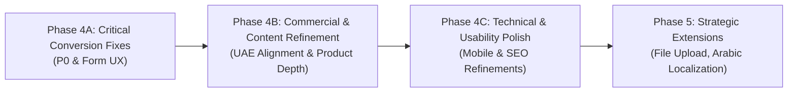

# SHIVOM GLOBAL — Phase 4: Implementation Roadmap
## Phased Remediation, Commercial Refinement & Conversion Optimization

> **Document Status**: Complete & Authoritative  
> **Target Market**: UAE (Dubai, Sharjah, JAFZA), GCC, and International B2B Buyers  
> **Platform**: `https://shivom-global-website.vercel.app/`  
> **Baseline Date**: 2026-11-03  
> **Reference Documents**: `docs/WEBSITE_PHASE_4_AUDIT.md`, `docs/PHASE_4_ISSUE_REGISTER.md`, `docs/PHASE_4_BUYER_JOURNEY.md`

---

## 1. Roadmap Architecture & Execution Principles

All website enhancements follow strict engineering and commercial protocols:
1. **Incremental Implementation**: One controlled change at a time; audit before implementation.
2. **Architecture Preservation**: Maintain React, Vite, TypeScript, and Vanilla CSS architecture (`tokens.css`, `index.css`).
3. **Protected Baseline**: Preserve Section 03 (`#our-teas` / Phase 3B) baseline intact.
4. **Integrity Rule 12**: Never invent unverified facilities, Dubai warehouse claims, or fake testimonials.
5. **Dual-Gate Verification**: Full production build (`npm run build`) and Chrome DevTools MCP browser QA across desktop (1440px), tablet (768px), and mobile (390px/375px) viewports before sign-off.

---

## 2. Phased Implementation Timeline Overview

| Phase | Focus Area | Issue Scope | Target Duration | Risk Level | Status |
|---|---|---|---|---|---|
| **Phase 4A.1** | Form UX & Specification Clarity | `P4-03` (Pill), `P4-11` (6 Tea Types) | Complete | Low | **COMPLETED & VERIFIED** |
| **Phase 4A.2** | Inquiry Reliability & Idempotency | `P4-01` (Pipeline Hardening, Outbox, Worker) | Complete | Medium | **COMPLETED LOCALLY** |
| **Phase 4A.3** | Buyer Transactional Receipt Email | `P4-02` (Buyer Confirmation) | Sprint 1 | Medium | Pending Copy Approval |
| **Phase 4B** | UAE Commercial Content & Catalog Depth | `P4-04`, `P4-05`, `P4-06`, `P4-07`, `P4-08`, `P4-10` | Sprint 2 | Low | Scheduled |
| **Phase 4C** | Header, Mobile UX, SEO & Accessibility | `P4-12`, `P4-13`, `P4-14`, `P4-15`, `P4-16`, `P4-17` | Sprint 3 | Low | Scheduled |
| **Phase 5** | Strategic International Enhancements | `P4-18` (Attachments), Arabic Localization, Tools | Future Roadmap | High | Future |

---

## 3. Detailed Phase Breakdown

---

### Phase 4A — Critical Inquiry Pipeline & Form Conversion Fixes

**Objective**: Ensure zero lost inquiries, deliver instant buyer email confirmation, and resolve cognitive friction in Form A and Form B.

#### Work Packages

1. **WP-4A-1: Resilient Backend Inquiry Fallback (`P4-01`)**
   - *Target*: `api/buyer-requirements.ts`.
   - *Changes*:
     - If Supabase environment variables are missing or database connection throws an exception, do NOT return HTTP 500 immediately.
     - Attempt direct email dispatch to trade desk via Resend with an alert flag `[STORAGE_FALLBACK: EMAIL_ONLY]`.
     - Generate server Reference ID (`SG-REQ-YYYYMMDD-XXXX`) and return controlled HTTP 200 to the client so the buyer is informed their inquiry was safely received.
   - *Acceptance Criteria*: Inquiries succeed even if Supabase is temporarily unreachable; trade desk receives email with complete buyer parameters.

2. **WP-4A-2: Automated Transactional Buyer Acknowledgment Email (`P4-02`)**
   - *Target*: `api/buyer-requirements.ts`.
   - *Changes*:
     - In addition to notifying the trade desk, dispatch a branded, professional HTML confirmation email to `sanitized.businessEmail`.
     - Email includes: Formal reference ID, submitted grade/port specifications, stated 24-hour response SLA, and direct WhatsApp trade desk link.
   - *Acceptance Criteria*: Valid email submission triggers two emails: one internal to trade desk, one external to buyer inbox.

3. **WP-4A-3: Form A Contextual Grade Confirmation Pill (`P4-03`)**
   - *Target*: `src/features/buyer-requirement/components/BuyerRequirementForm.tsx`.
   - *Changes*:
     - When a buyer clicks "Specify [Grade]" anywhere on the site, render a prominent contextual indicator in Form A:
       `Inquiry Specification: Assam CTC — BOPSM [Change Specification]`.
     - Clicking "Change Specification" switches the tab to Form B.
   - *Acceptance Criteria*: Pre-selected grade is visually confirmed in Form A; buyer never wonders if their selection was captured.

4. **WP-4A-4: Form B "Tea Type" Ontological Cleanup (`P4-11`)**
   - *Target*: `src/features/buyer-requirement/components/BuyerRequirementForm.tsx`.
   - *Changes*:
     - Remove "Bulk Tea Supply" and "Private Label Retail Product" from the botanical Tea Type dropdown.
     - Categorize options cleanly into: `Assam CTC Black Tea`, `Assam Orthodox Black Tea`, `Darjeeling Specialty Black Tea`, `Indian Green Tea`, `Commercial Blended Formulation`, `Other / Custom Specification`.
   - *Acceptance Criteria*: Dropdown options represent actual tea manufacturing categories; packaging remains in the dedicated packaging dropdown.

---

### Phase 4B — UAE Commercial Alignment & Product Depth

**Objective**: Explicitly address the requirements of UAE importers, blenders (Karak chai), and private-label buyers; integrate logistics and trade agreement advantages.

#### Work Packages

1. **WP-4B-1: Karak Chai Sourcing Prominence & CTC Dust Expansion (`P4-04`)**
   - *Target*: `src/features/tea-catalog/components/GradeSpecificationTable.tsx`, `src/features/buyer-requirement/components/BuyerRequirementForm.tsx`.
   - *Changes*:
     - Expand descriptions for `PD (Pekoe Dust)` and `Dust / D1` in SEC04 to detail Karak chai brewing characteristics (instant color extraction within 60s, heavy liquor density, milk stability).
     - Annotate Form B grade dropdown: `PD — Pekoe Dust (Karak Chai Blends)`, `Dust / D1 (High-Yield Foodservice)`.
   - *Acceptance Criteria*: Karak chai blenders find explicit technical parameters matching their cafeteria supply requirements.

2. **WP-4B-2: Expand SEC04 Grade Matrix with Darjeeling & Green Tea (`P4-05`)**
   - *Target*: `src/features/tea-catalog/components/GradeSpecificationTable.tsx`.
   - *Changes*:
     - Add Darjeeling rows: `FTGFOP1` (First Flush Himalayan Muscadel), `TGFOP` (Second Flush / Autumnal).
     - Add Green Tea rows: `Traditional Pan-Fired Whole Leaf`, `Fine Cut / Fannings (Green Tea Bags)`.
     - Update tab filters to accommodate the complete 4-category portfolio.
   - *Acceptance Criteria*: All 4 categories from SEC03 have corresponding technical specification rows in SEC04.

3. **WP-4B-3: Western Logistics Corridor Speed Highlight (`P4-06`)**
   - *Target*: `src/features/hero/components/HeroSection.tsx`, `src/features/company/components/WhyShivomGlobal.tsx`, `src/components/layout/SiteFooter.tsx`.
   - *Changes*:
     - Add explicit logistics copy: *"Direct Western Freight Corridor: Fast 3–5 Day Ocean Transit from Gujarat Ports (Mundra/Kandla) to Port Jebel Ali, UAE."*
   - *Acceptance Criteria*: Buyers immediately grasp the significant transit time advantage of Gujarat ports over South India, East India, Kenya, or Sri Lanka.

4. **WP-4B-4: Private Label MOQ Brackets & UAE Regulatory Support (`P4-07`)**
   - *Target*: `src/features/private-label/components/PrivateLabelSection.tsx`.
   - *Changes*:
     - Replace generic "Quantities discussed" with commercial baseline brackets:
       - Bulk: From 1 Pallet / ~1 MT (Trial) to 1x20ft FCL (~10–12 MT).
       - Retail Pouches / Tins: From 2,500 units per SKU.
       - Tea Bags: From 50,000 envelopes.
     - Add statement on destination compliance support (ESMA, Dubai Municipality, Arabic bilingual labeling).
   - *Acceptance Criteria*: Private label buyers see concrete starting volumes and regulatory support.

5. **WP-4B-5: Operational Turnaround SLAs & International Payment Terms (`P4-08`)**
   - *Target*: `src/features/export-process/components/HowItWorksSection.tsx`.
   - *Changes*:
     - Step 03: Add sampling turnaround: *"Counter-samples dispatched within 3–5 working days via international air courier (DHL/FedEx/Aramex)"*.
     - Step 05: Explicitly list accepted payment terms: *"Irrevocable Letter of Credit (LC) at sight, Telegraphic Transfer (TT: 30% advance deposit, 70% against Bill of Lading copy), or Documents Against Payment (CAD/DP) for established trading partners"*.
     - Clarify sample courier policy: *"Sample tea is provided complimentary for qualified commercial inquiries"*.
   - *Acceptance Criteria*: Clear commercial rules eliminate buyer hesitation regarding payment security.

6. **WP-4B-6: India-UAE CEPA Preferential Zero-Duty Note (`P4-10`)**
   - *Target*: `src/features/company/components/WhyShivomGlobal.tsx`.
   - *Changes*:
     - Highlight that Chamber of Commerce Certificate of Origin qualifies Indian tea for preferential tariff treatment under India-UAE CEPA.
   - *Acceptance Criteria*: Clear 5% customs duty savings incentive articulated for UAE importers.

---

### Phase 4C — Technical, Mobile & Usability Polish

**Objective**: Maximize mobile conversion, streamline desktop contact access, and enhance semantic search crawlability.

#### Work Packages

1. **WP-4C-1: Gulf Port Fast-Select Pills in Form B (`P4-12`)**
   - *Target*: `src/features/buyer-requirement/components/BuyerRequirementForm.tsx`.
   - *Changes*: Render 1-click pills below the Destination Port input: `[ Jebel Ali (UAE) ]`, `[ Hamriyah / Sharjah (UAE) ]`, `[ Dammam (KSA) ]`, `[ Other ]`.
   - *Acceptance Criteria*: Tapping a pill fills the input field instantly.

2. **WP-4C-2: Desktop Header Direct WhatsApp & Contact Link (`P4-13`)**
   - *Target*: `src/components/layout/SiteHeader.tsx`.
   - *Changes*: Add compact WhatsApp badge and phone number to the header utility row.
   - *Acceptance Criteria*: WhatsApp contact is immediately accessible without scrolling.

3. **WP-4C-3: Mobile Floating WhatsApp Keyboard Conflict Fix (`P4-14`)**
   - *Target*: `src/components/layout/WhatsAppFloat.tsx`, `src/styles/index.css`.
   - *Changes*: Add scroll-aware or focus-aware positioning to prevent the floating button from obstructing input fields or submit buttons on mobile screens.
   - *Acceptance Criteria*: Smooth typing on 375px/390px screens without accidental button taps.

4. **WP-4C-4: Structured Data (JSON-LD) Product Catalog Enrichment (`P4-15`)**
   - *Target*: `index.html`.
   - *Changes*: Add schema.org `ItemList` and `Product` models for core Indian tea categories.
   - *Acceptance Criteria*: Validates cleanly on Google Rich Results Test without errors.

5. **WP-4C-5: Trade Desk Operating Hours in Gulf Standard Time (`P4-16`)**
   - *Target*: `src/components/layout/SiteFooter.tsx`, `src/constants/contact.ts`.
   - *Changes*: Add timezone notice: *"Trade Desk Intake: Mon – Sat, 08:30 – 19:00 GST / IST"*.
   - *Acceptance Criteria*: Explicit operating hours visible in the footer.

6. **WP-4C-6: Interactive Pillar Cards Keyboard Accessibility (`P4-17`)**
   - *Target*: `src/features/company/components/WhyShivomGlobal.tsx`.
   - *Changes*: Add `onKeyDown` handlers for `Enter` and `Space` to expand pillar details.
   - *Acceptance Criteria*: Full keyboard navigation compliance (WCAG 2.1.1).

---

### Phase 5 — Future Strategic Extensions (Roadmap Backlog)

1. **Client-Side Specification / COA File Attachment (`P4-18`)**:
   - Allow buyers to upload technical PDF lab reports or target blend benchmark photos (<5MB) with automatic virus scanning and cloud storage.
2. **Arabic Language Toggle (Bilingual English / Arabic)**:
   - Provide high-quality localized Arabic UI copy with proper RTL direction for regional procurement managers in the UAE, Saudi Arabia, and Kuwait.
3. **Interactive Container Loading & Freight Estimation Calculator**:
   - Allow buyers to calculate 20ft FCL vs 40ft HC packaging sack counts, tare weights, and estimated ocean transit to their specific port of discharge.

---

## 4. Dependencies, Risk Matrix & Verification Protocols

| Work Package | Technical Dependencies | Commercial Risk | Mitigation Strategy |
|---|---|---|---|
| **WP-4A-1** (Resilient API) | Node runtime, Resend API key | Low | Non-breaking async try/catch fallback |
| **WP-4A-2** (Buyer Email) | Resend API, Verified domain | Medium (Spam filters) | DKIM/SPF verification on sending domain |
| **WP-4A-3** (Context Pill) | React state in Form A | Low | Fallback to default if no grade selected |
| **WP-4B-1** (Karak Positioning) | Copywriting only | Low | Fact-checked commercial descriptions |
| **WP-4B-2** (SEC04 Expansion) | `GradeSpecificationTable.tsx` | Low | Follows existing table layout & motion |
| **WP-4B-3** (Logistics Speed) | Copywriting only | Low | Factual sailing schedules (Mundra->Jebel Ali) |
| **WP-4B-4** (Private Label MOQs)| Sarthak Sarvaiya commercial sign-off | Medium (Must reflect actual partner capacity) | Baseline brackets clearly marked as indicative |
| **WP-4B-5** (Payment Terms) | Sarthak Sarvaiya commercial sign-off | Medium (Banking capability) | List accepted standard instruments |

---

## 5. Acceptance Checklist for Phase 4 Implementation

Before any phase is marked complete:
- [ ] TypeScript compilation passes cleanly (`tsc --noEmit`).
- [ ] Production build passes without errors or warnings (`npm run build`).
- [ ] Chrome DevTools MCP visual inspection across 1440px, 768px, 390px, and 375px viewports.
- [ ] Form submission verified in both Form A and Form B modes.
- [ ] Supabase record insertion verified.
- [ ] Resend email receipt confirmed in recipient inboxes.
- [ ] WhatsApp deep-linking tested with correctly encoded URL parameters.
- [ ] Zero invented business claims, facilities, or certifications (Rule 12).
- [ ] Section 03 Phase 3B baseline verified untouched.

