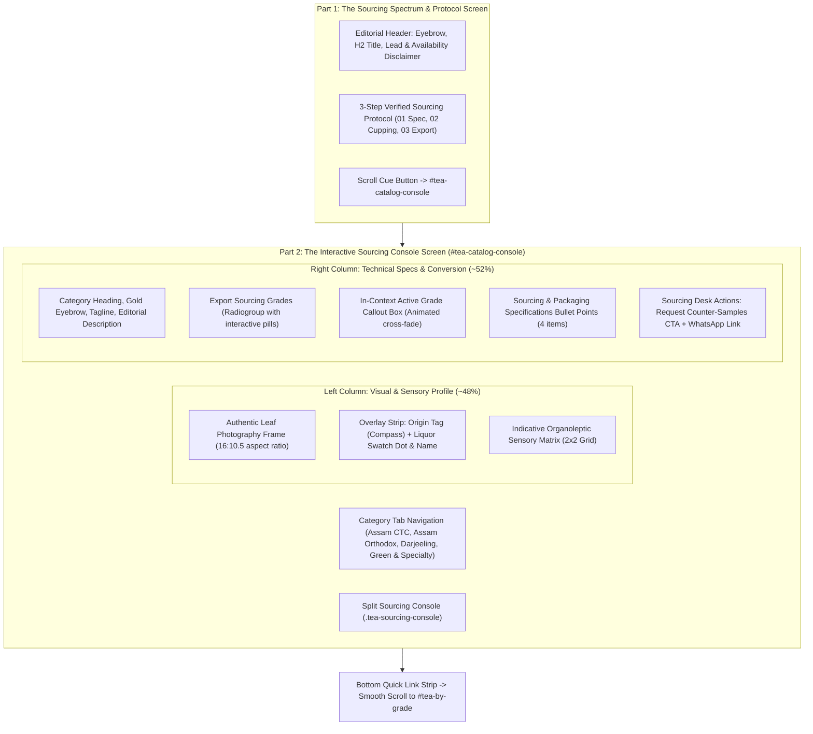

# SEC-03 Tea Origin Atelier — Codebase Audit & Architectural Analysis

**Document Status**: Phase 0 Complete — Audit Only  
**Target Section**: Section 03 / `#our-teas` (`<section id="our-teas" className="tea-categories-section">`)  
**Scope**: Comprehensive evaluation of current architecture, assets, styles, accessibility patterns, and technical constraints for the approved **Tea Origin Atelier** redesign.  
**Date**: 2026-11-03  

---

## 1. Executive Summary

The current implementation of Section 03 (`TeaCategoriesSection.tsx`) serves as SHIVOM GLOBAL's core product sourcing showcase. While functionally robust—featuring recent WAI-ARIA APG compliance upgrades (SEC03-01), dynamic terroir ambient color themes, and direct integration with the Buyer Requirement Form—the visual and spatial layout remains structured as a conventional split card console.

The approved redesign direction, **Tea Origin Atelier**, elevates this section from a transactional list into a world-class, immersive B2B sensory and geographical sourcing experience. It integrates four conceptual pillars:
1. **Tea Origin Atelier**: High-authority editorial storytelling rooted in authentic Indian estate terroir.
2. **3D Tea Laboratory**: Multi-planar visual depth, dimensional cupping presentation, and authentic liquor refraction.
3. **Indian Tea Origin Map**: Geographic storytelling illustrating the regional origins of Assam, Darjeeling, and High-Elevation terroirs.
4. **B2B Procurement Console**: Institutional-grade technical specifications, particle cut sizing, and instant counter-sample procurement.

This audit establishes the technical baseline, catalogs all existing assets and dependencies, and details the constraints governing the redesign.

---

## 2. Existing Architecture & Component Breakdown

### 2.1 File Location & Component Tree
- **Primary Component**: [`src/features/tea-catalog/components/TeaCategoriesSection.tsx`](file:///Users/sarthak/SHIVOM%20GLOBAL%20WEBSITE/src/features/tea-catalog/components/TeaCategoriesSection.tsx) (647 lines)
- **Sibling Table Component**: [`src/features/tea-catalog/components/GradeSpecificationTable.tsx`](file:///Users/sarthak/SHIVOM%20GLOBAL%20WEBSITE/src/features/tea-catalog/components/GradeSpecificationTable.tsx) (Section 04 / `#tea-by-grade`)
- **Parent Container**: [`src/pages/HomePage.tsx`](file:///Users/sarthak/SHIVOM%20GLOBAL%20WEBSITE/src/pages/HomePage.tsx) (rendered directly beneath `HeroSection` and above `GradeSpecificationTable`)

### 2.2 Current Internal Structure of `TeaCategoriesSection.tsx`

### 2.3 Existing Sourced Tea Categories & Grade Data Structures
The component encapsulates a strongly-typed data array `TEA_CATEGORIES: TeaCategoryData[]`:

| Category ID | Display Name | Origin Region | Default Grade | Commercial Grades Available | Liquor Profile & Swatch |
|---|---|---|---|---|---|
| `assam-ctc` | Assam CTC (Crush, Tear, Curl) | Brahmaputra Valley, Assam | `BOP` | `BOP`, `BOPSM`, `BP`, `PF`, `PD`, `Dust / D1` | Deep Amber to Bright Red (`#8B2500` / `var(--color-liquor-ctc)`) |
| `assam-orthodox` | Assam Orthodox Whole Leaf | Upper Assam Terroirs | `TGFOP` | `FTGFOP1`, `TGFOP`, `FBOP`, `BOPF` | Golden Amber with Bright Rim (`#C27803` / `var(--color-liquor-orthodox)`) |
| `darjeeling` | Darjeeling Black Tea | Darjeeling Himalayan Foothills | `Second Flush TGFOP` | `First Flush FTGFOP1`, `Second Flush TGFOP`, `Autumnal Harvest` | Pale Golden to Ripe Amber (`#D99B26` / `var(--color-liquor-darjeeling)`) |
| `green-wellness` | Indian Green & Wellness Teas | High-Elevation Terroirs, India | `Whole Leaf Green` | `Whole Leaf Green`, `Green Tea Fannings`, `Herbal Cut` | Clear Pale Green to Light Jade (`#4E8A3C` / `var(--color-liquor-green)`) |

Each category object contains:
- `organoleptic`: 4 quantitative parameters (`liquor`, `body`, `aroma`, `milk`).
- `specs`: 4 packaging, estate accreditation, and export compliance parameters.
- `grades`: Array of `{ code, name, application }`.

---

## 3. Existing Styles, Design Tokens & Colour Architecture

### 3.1 CSS Rules & Files
- Core styles reside in [`src/styles/index.css`](file:///Users/sarthak/SHIVOM%20GLOBAL%20WEBSITE/src/styles/index.css):
  - **Lines 2324–2401**: Base `.tea-categories-section` container, header, and bottom CTA strip.
  - **Lines 7500–8203**: Part 1 protocol banner, scroll cue, Part 2 category navigation tabs, `.tea-sourcing-console` grid, dynamic terroir ambient theme gradients (`.tea-console-theme-*`), organoleptic matrix, grade selection pill wrap, active grade callout, action buttons, and responsive breakpoints.
- Central design tokens reside in [`src/styles/tokens.css`](file:///Users/sarthak/SHIVOM%20GLOBAL%20WEBSITE/src/styles/tokens.css).

### 3.2 Active Token Alignment (Option B Active)
The project currently has Option B ("Modern Obsidian & Champagne Gold") set as the default `:root` token set, while maintaining backwards-compatible selectors for baseline and Option A:

| Token Variable | Computed Active Value | Baseline Fallback | Usage in Section 03 |
|---|---|---|---|
| `--color-primary` / `--color-primary-green` | `#0A281E` | `#0D3829` | Active category tab, active grade chip, check icons |
| `--color-primary-dark` / `--color-primary-forest` | `#061811` | `#072218` | Section titles, console headings, protocol numbers |
| `--color-gold` / `--color-accent-gold` | `#D4AF37` | `#C59B27` | Eyebrow badges, taglines, organoleptic labels, focus rings |
| `--color-accent` / `--color-accent-amber` | `#C48228` | `#CC5500` | Sourcing badges, amber highlights |
| `--bg-page` | `#FDFCFA` | `#FBFBFA` | Section background |
| `--bg-surface` | `#FFFFFF` | `#FFFFFF` | Console card background, grade pills, sensory items |
| `--bg-surface-subtle` | `#F7F8F6` | `#F5F1E8` | Sensory matrix background panel |
| `--color-liquor-ctc` | `#8B2500` | `#8B2500` | CTC liquor indicator swatch |
| `--color-liquor-orthodox` | `#C27803` | `#C27803` | Orthodox liquor indicator swatch |
| `--color-liquor-darjeeling` | `#D99B26` | `#D99B26` | Darjeeling liquor indicator swatch |
| `--color-liquor-green` | `#4E8A3C` | `#4E8A3C` | Green tea liquor indicator swatch |

### 3.3 Dynamic Ambient Terroir Themes
The current console features dynamic theme switching based on active category:
- `.tea-console-theme-assam-ctc`: Amber terroir glow (`linear-gradient(145deg, #FFFFFF 0%, #FFFDF9 45%, #FEF7EC 100%)`).
- `.tea-console-theme-assam-orthodox`: Golden harvest malt glow (`linear-gradient(145deg, #FFFFFF 0%, #FFFDF7 45%, #FAF2DF 100%)`).
- `.tea-console-theme-darjeeling`: Himalayan muscatel glow (`linear-gradient(145deg, #FFFFFF 0%, #FFFDF9 45%, #F8F3EA 100%)`).
- `.tea-console-theme-green-wellness`: Botanical jade glow (`linear-gradient(145deg, #FFFFFF 0%, #F9FDF9 45%, #EEF8F1 100%)`).

---

## 4. Existing Assets & Media Audit

### 4.1 Image Assets in `public/images/`
The repository contains four dedicated high-resolution photographs representing the tea categories:

| File Path | Dimensions / Type | File Size | Visual Subject | Status in Section 03 |
|---|---|---|---|---|
| `/images/assam-ctc-spotlight.jpg` | 1200x800 JPEG | 822 KB | Authentic granular Assam CTC leaf with brewed liquor cup | Currently active |
| `/images/assam-orthodox.jpg` | 1200x800 JPEG | 725 KB | Whole rolled black tea leaves with golden tippy leaf | Currently active |
| `/images/darjeeling-single-origin.jpg` | 1200x800 JPEG | 762 KB | Himalayan single-origin loose leaf with light muscatel cup | Currently active |
| `/images/indian-green-tea.jpg` | 1200x800 JPEG | 765 KB | Unoxidized whole green tea leaf with clear jade infusion | Currently active |
| `/images/indian_tea_landscape_hero.jpg`| 1920x1080 JPEG | 956 KB | Panoramic lush Indian tea estate rolling hills | Used in Hero; available for terroir backdrop |
| `/images/private-label-packaging.jpg` | 1200x800 JPEG | 712 KB | Retail tea pouches, tins, and pyramid bags | Used in Private Label section |

### 4.2 SVG & Vector Assets
- Brand logos: `/public/Shivom_Global_Logo.svg` and `/public/Shivom_Global_Header_Logo.svg`.
- Vector Icons: Handled via `lucide-react` (`Flame`, `Award`, `Sparkles`, `Leaf`, `Compass`, `Droplet`, `Check`, `ArrowRight`, `MessageCircle`, `ChevronDown`).
- **Gaps Identified**:
  - There are currently **no SVG topographic contours** or **geographic map vectors of India's tea belts**.
  - There are **no 3D asset files or models** (e.g., glTF/GLB).

---

## 5. Existing Functionality & Accessibility Baseline (SEC03-01)

The following behaviors were audited, enhanced in task SEC03-01, and **must be strictly preserved** in the Atelier redesign:

1. **WAI-ARIA APG Tabs Pattern**:
   - Container has `role="tablist"` with `aria-label="Tea categories selector"`.
   - Each tab has `role="tab"`, unique `id`, `aria-controls`, and `aria-selected`.
   - **Roving tabindex**: Active tab has `tabIndex={0}`; inactive tabs have `tabIndex={-1}`.
   - **Full keyboard navigation**: `ArrowRight`, `ArrowLeft`, `Home`, `End` with focus wrapping and synchronous category activation.
2. **Grade Selection Radiogroup Pattern**:
   - Container has `role="radiogroup"` with `aria-labelledby="tea-grades-heading"`.
   - Mutually exclusive pills have `role="radio"`, `aria-checked={isSelected}`, and roving `tabIndex={isSelected ? 0 : -1}`.
   - Multidirectional arrow navigation: `ArrowRight` / `ArrowDown` (next), `ArrowLeft` / `ArrowUp` (previous), `Home` (first), `End` (last).
3. **Visual Focus Indicators**:
   - Explicit `.tea-category-tab:focus-visible` and `.tea-grade-badge-interactive:focus-visible` states using `outline: 2px solid var(--color-accent-gold); outline-offset: 2px;`.
   - Full support for `@media (prefers-reduced-motion: reduce)`.
4. **B2B Form & External Integrations**:
   - `handleCategorySampleRequest(category, gradeCode)`: Invokes `onSelectCategory` passed from `HomePage.tsx`, updating `formRequirementType`, `formGrade`, and `formIntent='sample'`, followed by smooth scroll to `#requirement-form`.
   - Contextual WhatsApp link: Generates deep-link with buyer category and grade prefilled via `CONTACT_INFO.whatsapp.getLink()`.
   - Secondary navigation: Smooth jump to Grade Specification Table (`#tea-by-grade`).

---

## 6. Technical Constraints & Performance Boundaries

1. **Zero External 3D Dependencies**:
   - `three`, `@react-three/fiber`, or WebGL runtimes would introduce >600 KB of uncompressed JavaScript, degrading initial load time and risking WebGL context crashes on low-end mobile devices.
   - **Constraint**: All 3D depth, perspective, and glassmorphic liquor effects must be achieved purely with **CSS 3D transforms** (`perspective: 1000px`, `transform-style: preserve-3d`, `translateZ`, `rotateX/rotateY`), multi-stop radial lighting, and layered SVG.
2. **Framework & Architecture Integrity**:
   - React 18.3, Vite 6.0, TypeScript 5.6, and Vanilla CSS.
   - Preserves 8px spacing grid and existing Three-Tier CSS token architecture.
3. **Performance & Core Web Vitals**:
   - Cumulative Layout Shift (CLS) must remain `< 0.02`. Switching categories or grades must not cause content jumping.
   - High-resolution JPEGs (~800 KB each) should utilize modern loading strategies (`loading="lazy"`, proper `aspect-ratio` reserving box dimensions).
4. **SEO & Prerender Compatibility**:
   - Semantic HTML prerendered in `index.html` lines 90–98 must continue to represent the 4 core tea categories accurately for search crawlers.

---

## 7. Risks & Mitigation Strategies

| Risk | Impact | Mitigation Strategy |
|---|---|---|
| **Layout Shift (CLS) during Grade / Origin Switches** | High (Degrades CWV) | Set strict `min-height` constraints on specifications callouts and sensory containers; use CSS absolute cross-fade overlays. |
| **Heavy Image Payloads on Mobile** | Medium | Maintain explicit `width` and `height` attributes; apply CSS hardware-accelerated transforms instead of image reloads. |
| **Keyboard Accessibility Regression** | Critical (Breaks SEC03-01) | Retain the verified ref arrays (`categoryTabRefs`, `gradeBadgeRefs`) and keyboard navigation algorithms unchanged. |
| **Over-complication of 3D Effects** | Medium (Fails B2B seriousness) | Restrict 3D to subtle elevation planes, glassmorphic depth cues, and parallax tilt on hover. Never use spinning 3D models or distracting animations. |
| **Mobile Screen Real Estate Constraints** | High | Collapse multi-plane 3D laboratory into a streamlined, high-contrast vertical stack with swipeable origin chips and touch-friendly controls. |

