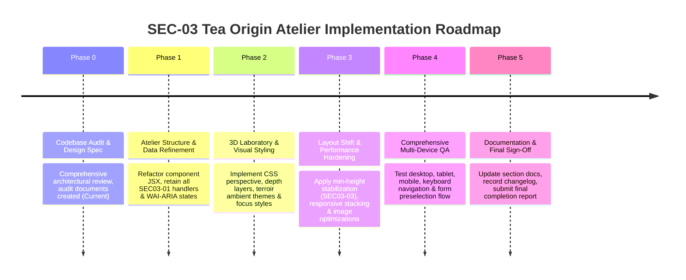

# SEC-03 Tea Origin Atelier — Technical Design Specification

**Document Type**: Technical Specification & Implementation Architecture  
**Target Section**: Section 03 / `#our-teas` (`<section id="our-teas" className="tea-categories-section">`)  
**Design Concept**: **TEA ORIGIN ATELIER**  
**Pillars**: Editorial Atelier Storytelling • 3D Tea Laboratory • Geographic Origin Map • B2B Procurement Console  
**Date**: 2026-11-03  
**Status**: APPROVED DESIGN SPECIFICATION (Audit Phase 0 Complete)  

---

## 1. Design Vision & Concept Architecture

The **Tea Origin Atelier** elevates SHIVOM GLOBAL's product showcase from a standard electronic catalog into an authoritative digital atelier. It reflects the meticulous craftsmanship, estate lineage, and sensory precision of Indian tea export.

```
+---------------------------------------------------------------------------------------------------------+
|                                    PART 1: ATELIER PROLOGUE & PROTOCOL                                  |
|   [Gold Badge: THE SOURCING SPECTRUM] • High-Authority H2 • Lead Sourcing Doctrine • Verified Protocol   |
+---------------------------------------------------------------------------------------------------------+
|                                  PART 2: INTERACTIVE ORIGIN ATELIER                                     |
|  [Tab 1: Brahmaputra CTC]   [Tab 2: Upper Assam Orthodox]   [Tab 3: Darjeeling Single]   [Tab 4: Green]  |
|                                                                                                         |
|  +---------------------------------------------------+  +--------------------------------------------+  |
|  |     3D TEA LABORATORY & SENSORY THEATRE           |  |        B2B SOURCING CONSOLE                |  |
|  |                                                   |  |                                            |  |
|  |  [Layer 1: Topographic Terroir Canvas]            |  |  [Category Header & Estate Origin]         |  |
|  |  [Layer 2: 3D Leaf Plate with Perspective Lift]   |  |  [Export Grade Radiogroup (BOP, BP, etc)]  |  |
|  |  [Layer 3: Refractive Liquor Glass Swatch]        |  |  [Target Application Callout Card]         |  |
|  |  [Layer 4: Indicative Cupping Sensory Matrix]     |  |  [Sourcing & Maritime Packaging Specs]     |  |
|  |           (Liquor, Body, Aroma, Milk)             |  |  [Dual Action: Request Samples + WhatsApp] |  |
|  +---------------------------------------------------+  +--------------------------------------------+  |
+---------------------------------------------------------------------------------------------------------+
|                                  PART 3: SPECIFICATION ANCHOR CUE                                       |
|                  Direct Link to Full Grade Specification Table (#tea-by-grade)                          |
+---------------------------------------------------------------------------------------------------------+
```

---

## 2. Section Hierarchy & Information Architecture

The redesigned section is structured into three continuous visual movements:

### Movement 1: The Atelier Prologue (Editorial Introduction)
1. **Eyebrow Seal**: `INDIAN TEA SOURCING SPECTRUM` (Warm gold metallic badge).
2. **Authority Title**: `Tea Categories Sourced to Your Requirement`.
3. **Lead Doctrine**: Articulates SHIVOM GLOBAL's role matching international buyer specifications with estate lots across primary Indian growing regions.
4. **Availability Disclaimer**: Explicitly states that grades represent active sourcing capabilities rather than speculative standing stock.
5. **3-Stage Export Protocol**:
   - `01 Specification Matching` (particle cut, mesh sieve sizing, liquor targets).
   - `02 Pre-Shipment Cupping` (counter-sample dispatch and buyer sign-off).
   - `03 Container Export Dispatch` (maritime export coordination and phytosanitary clearance).
6. **Scroll Cue Anchor**: Navigates smoothly to `#tea-catalog-console`.

### Movement 2: The Interactive Origin Atelier
1. **Terroir Navigation Bar (`role="tablist"`)**:
   - 4 Interactive Terroir Tabs:
     - `Assam CTC` (Brahmaputra Valley)
     - `Assam Orthodox` (Upper Assam Terroirs)
     - `Darjeeling Single Origin` (Himalayan Foothills)
     - `Green & Specialty` (High-Elevation Terroirs)
   - Features active gold indicator dot, terroir icons (`Flame`, `Award`, `Sparkles`, `Leaf`), and WAI-ARIA roving tabindex.
2. **The 3D Tea Laboratory (Left Column)**:
   - **Multi-Planar Perspective Container**: CSS 3D perspective (`perspective: 1200px`) creating tactile depth.
   - **Ground Layer**: Subtle topographic contour lines and ambient terroir backlight glow.
   - **Focal Leaf Plate**: High-resolution authentic Indian tea photography housed within a beveled framing border with subtle perspective tilt.
   - **Floating Sensory Badges**:
     - Origin Compass Pill (`Compass` icon + Geographical Terroir Name).
     - Refractive Liquor Swatch: Glassmorphic capsule with glowing liquor core hex and descriptive cup tone.
   - **Indicative Organoleptic Sensory Matrix**:
     - 4-parameter cupping evaluation: Liquor Depth, Body & Texture, Aroma Profile, Milk Affinity.
     - Formatted as high-contrast sensory tiles with Space Grotesk technical labels.
3. **The B2B Sourcing Console (Right Column)**:
   - **Header & Heritage Statement**: Sourcing category name, punchy buyer tagline, and terroir narrative.
   - **Interactive Grade Radiogroup (`role="radiogroup"`)**:
     - Mutually exclusive grade selection chips with `role="radio"` and roving tabindex.
     - Live application callout with animated cross-fade displaying target commercial blend application (e.g., Karak Chai, Single-serve tea bags, Boutique retail tins).
   - **Sourcing & Packaging Specifications**:
     - Estate lot-matching protocol.
     - Bulk packaging standards (multi-wall kraft paper sacks, aluminum moisture barriers).
     - Palletized FCL / LCL container export coordination.
     - Statutory export certification (Certificate of Origin, Phytosanitary, lab residue testing).
   - **Conversion Hub (Dual CTAs)**:
     - Primary: `Request [Grade] Counter-Samples` (injects preselected category/grade into `#requirement-form` and scrolls smoothly).
     - Secondary: `Discuss on WhatsApp ([Grade])` (launches customized WhatsApp deep-link).

### Movement 3: Single Grade Table Cue
- High-efficiency transition bridge providing one-click access to the full particle size mesh table in Section 04 (`#tea-by-grade`).

---

## 3. Visual Surface System, Tokens & Aesthetics

### 3.1 65-25-10 Visual Weight Distribution
- **65% Dominant Canvas (Warm Light Substrate)**:
  - Base canvas: `var(--bg-page)` (`#FDFCFA` / `#FBFBFA`).
  - Card surfaces: `var(--bg-surface)` (`#FFFFFF`) with subtle warm ivory tinting (`#FFFDF9`).
  - Reduces eye fatigue for procurement managers reviewing extensive specification sheets.
- **25% Structural Foundation (Deep Estate Green & Charcoal Slate)**:
  - Primary text: `var(--text-main)` (`#0F1412` / `#111827`).
  - Major headings & active tabs: `var(--color-primary-dark)` (`#061811` / `#072218`) and `var(--color-primary-green)` (`#0A281E` / `#0D3829`).
  - Frame borders: `1.5px solid rgba(var(--primitive-green-900-rgb), 0.12)`.
- **10% High-Intent Accents (Champagne Gold & Terroir Ambers)**:
  - Sourcing eyebrow seals: `var(--color-accent-gold)` (`#D4AF37` / `#C59B27`).
  - Active grade focus rings & borders: `var(--color-accent-gold)` (`#D4AF37`).
  - Conversion CTA buttons and liquor indicators: Specific liquor swatches.

### 3.2 Terroir-Specific Color Identity Matrix

| Origin Terroir | Liquor Swatch | Ambient Glow Accent | Dominant Sensory Note | Visual Mood |
|---|---|---|---|---|
| **Assam CTC** | `#8B2500` (Deep Amber) | `rgba(217, 119, 6, 0.16)` | Bold, Malty, Heavy Body | Rich autumnal warmth, terracotta and burnt amber depth |
| **Assam Orthodox** | `#C27803` (Golden Amber) | `rgba(212, 175, 55, 0.18)` | Sweet Caramel Malt, Golden Tips | Golden harvest luxury, polished brass, royal estate tippy character |
| **Darjeeling** | `#D99B26` (Muscatel Gold) | `rgba(180, 83, 9, 0.14)` | Muscatel Grape, Alpine Floral | Crisp Himalayan morning light, pale honeyed amber clarity |
| **Green & Specialty** | `#4E8A3C` (Jade Green) | `rgba(22, 163, 74, 0.16)` | Clean Vegetal, Fresh Herbaceous | Pristine mountain dew, unoxidized chlorophyll jade clarity |

---

## 4. 3D-Inspired Visual Effects & Technical Architecture

### 4.1 CSS-Native 3D Laboratory (No External WebGL Dependencies)
To guarantee 60fps performance and zero bundle bloat, all 3D effects are engineered using pure CSS transforms and modern compositing:

```css
/* Container 3D Perspective Context */
.tea-atelier-laboratory {
  perspective: 1200px;
  perspective-origin: 50% 40%;
}

/* 3D Multi-Plane Stacking Wrapper */
.tea-atelier-stage {
  transform-style: preserve-3d;
  transition: transform 0.4s cubic-bezier(0.16, 1, 0.3, 1);
}

/* Elevation Plane 1: Topographic Ground Canvas */
.tea-stage-ground {
  transform: translateZ(0px);
}

/* Elevation Plane 2: Photographic Leaf Subject Plate */
.tea-stage-leaf-plate {
  transform: translateZ(24px);
  box-shadow: 0 16px 36px -12px rgba(var(--primitive-green-950-rgb), 0.14),
              0 2px 8px rgba(0, 0, 0, 0.04);
}

/* Elevation Plane 3: Floating Origin & Glassmorphic Liquor Badge */
.tea-stage-liquor-badge {
  transform: translateZ(48px);
  backdrop-filter: blur(8px);
  -webkit-backdrop-filter: blur(8px);
}

/* Interactive Desktop Hover Tilt (Disabled on reduced-motion) */
@media (hover: hover) and (min-width: 1025px) {
  .tea-atelier-stage:hover {
    transform: rotateX(2deg) rotateY(-2deg) translateY(-2px);
  }
}
```

### 4.2 Topographic Contour Pattern Generation
- Rendered via a lightweight inline SVG background or CSS layered radial gradient.
- Pattern mimics Assam riverbed contours and Darjeeling elevation ridges.
- Kept at `opacity: 0.06` to avoid visual distraction or text legibility issues.

---

## 5. Responsive Layout Recommendations

### 5.1 Desktop (>= 1440px)
- **Container**: Max width `1240px`, centered with `var(--space-8)` lateral padding.
- **Split Ratio**: Left column (3D Laboratory & Cupping Matrix) 48% width; Right column (Specifications & Grade Conversion) 52% width.
- **Console Gap**: `var(--space-8)` (32px) to `44px`.
- **Grade Chips**: Horizontal inline flex wrap with generous tap targets (minimum 40px height).

### 5.2 Laptop (1024px – 1439px)
- **Container**: Balanced proportions with left column 46%, right column 54%.
- **Sensory Grid**: 2x2 grid for cupping parameters.
- **Topographic Canvas**: Maintained at subtle 4% opacity.

### 5.3 Tablet (768px – 1023px)
- **Layout Shift**: Stacks into a unified vertical flow when viewport width <= 960px.
- **Visual Presentation**: 3D leaf frame scales to 16:9 aspect ratio; organoleptic matrix displays as a 2x2 grid directly underneath.
- **Tabs**: Horizontal navigation bar tightens padding (`8px 16px`) with wrap or scroll.

### 5.4 Mobile (< 768px & < 480px)
- **Layout**: Single vertical stream.
- **Navigation**: Origin tabs convert into an edge-to-edge horizontally scrollable tabstrip with touch momentum (`-webkit-overflow-scrolling: touch`, `scrollbar-width: none`).
- **3D Transform Degradation**: 3D perspective transforms flatten to 2D transforms (`transform: none`) to optimize mobile GPU battery life and ensure zero layout shifting.
- **Touch Targets**: All grade chips and action buttons expand to minimum 44px height (WCAG 2.5.5 touch target compliance).
- **Actions**: CTAs stack vertically with full width (`width: 100%`).

---

## 6. Accessibility & WAI-ARIA Specifications

The Atelier redesign strictly maintains the verified SEC03-01 accessibility baseline:

| Control Group | Role | Keyboard Shortcuts | ARIA State Attributes | Focus Indicator |
|---|---|---|---|---|
| **Origin Selector Tabs** | `tablist` / `tab` | `ArrowRight`, `ArrowLeft`, `Home`, `End` | `aria-selected={true/false}`, `aria-controls="panel-id"`, roving `tabIndex={0/-1}` | `outline: 2px solid var(--color-accent-gold); outline-offset: 2px;` |
| **Origin Panel** | `tabpanel` | `Tab` enters active panel controls | `aria-labelledby="tab-id"`, stable ID | Standard focus handling |
| **Grade Radiogroup** | `radiogroup` / `radio` | `ArrowRight`/`ArrowDown`, `ArrowLeft`/`ArrowUp`, `Home`, `End` | `aria-checked={true/false}`, roving `tabIndex={0/-1}` | `outline: 2px solid var(--color-accent-gold); outline-offset: 2px;` |
| **Sample Request CTA** | Native `<button>` | `Enter`, `Space` | `aria-label="Request [Grade] Counter-Samples"` | `outline: 2px solid var(--color-accent-gold); outline-offset: 2px;` |

### Reduced Motion Strategy
Under `@media (prefers-reduced-motion: reduce)`:
- All 3D transforms (`rotateX`, `rotateY`, `perspective`) are disabled.
- Motion transitions default to immediate opacity swaps (`duration: 0`).
- Background glow animations are rendered static.

---

## 7. Performance & Core Web Vitals Budget

- **Target LCP (Largest Contentful Paint)**: < 1.4 seconds.
  - Active category image includes explicit `width={640}` and `height={420}` to prevent layout shifts.
  - Initial category image (`assam-ctc-spotlight.jpg`) preloaded or prioritized; remaining category images lazy-loaded on demand.
- **Target CLS (Cumulative Layout Shift)**: < 0.02.
  - Grade application callout (`.tea-active-grade-callout`) is assigned a `min-height: 80px` (or equivalent) so toggling between grades with differing description lengths does not push down the specifications list or CTA buttons.
  - Organoleptic matrix container has fixed minimum height.
- **Target Interaction Latency (INP)**: < 50ms.
  - All category switching and grade selection operations are executed synchronously in local state without blocking network requests.

---

## 8. Implementation Strategy & File Modification Plan

### 8.1 Files to Modify During Implementation (Phases 1–3)
1. **`src/features/tea-catalog/components/TeaCategoriesSection.tsx`**:
   - Refactor visual JSX to implement the Tea Origin Atelier layout.
   - Integrate 3D laboratory perspective container and topographic background layer.
   - Refine sensory cupping matrix with enhanced visual hierarchy.
   - Retain existing data structures (`TEA_CATEGORIES`), state handlers, ref management, and form dispatch logic.
2. **`src/styles/index.css`**:
   - Update `.tea-sourcing-console` and related classes into the `.tea-atelier-*` design rules.
   - Implement CSS 3D perspective, depth layers, glassmorphism, and ambient terroir glow effects.
   - Set layout stabilization rules (`min-height` on grade callout and sensory grid).
   - Ensure complete responsive breakpoint styling across 1440px, 1024px, 768px, and 480px.
3. **`docs/website-sections/03_TEA_CATEGORIES.md`**:
   - Update documentation to reflect the Atelier architecture, new class mappings, and testing results.

### 8.2 Proposed Phase-by-Phase Roadmap



---

## 9. Open Decisions Requiring User Approval

Before proceeding to **Phase 1 (Implementation)**, the following design and functional questions are submitted for user review:

1. **Topographic Motif Style**:
   - *Option A*: Subtle CSS-generated topographic contour lines embedded directly in CSS (zero network payload).
   - *Option B*: Crisp vector SVG contour overlay of the Brahmaputra / Himalayan ridgelines.
   - *Recommendation*: **Option A** for optimal performance, zero asset requests, and clean aesthetic.

2. **Tea Origin Map Integration**:
   - *Option A*: Integrated geographic origin badge with coordinates and region highlights on the 3D leaf card.
   - *Option B*: A dedicated interactive mini SVG map of India showing plotted estate regions side-by-side.
   - *Recommendation*: **Option A** maintains tight focus on the tea leaf, liquor, and commercial specifications without adding layout clutter.

3. **Grade Callout Height Stabilization (`SEC03-03`)**:
   - Incorporate the `min-height: 82px` stabilization rule during Phase 2 to close out backlog item `SEC03-03` simultaneously with the Atelier redesign.

