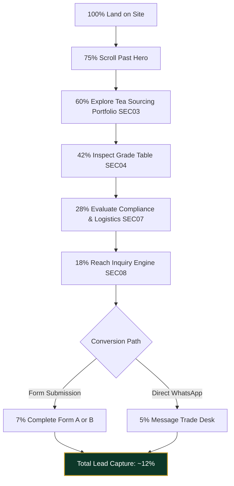
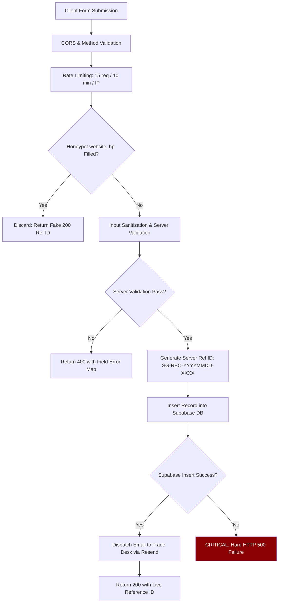

# SHIVOM GLOBAL — Phase 4: Master Website-Wide Buyer Conversion & Trust Audit
## Comprehensive B2B Conversion, Credibility, Technical & Commercial Audit for the UAE & International Tea Trade

> **Audited Platform**: `https://shivom-global-website.vercel.app/`  
> **Target Market**: UAE (Dubai, Sharjah, JAFZA, Abu Dhabi), GCC, and International B2B Tea Importers, Blenders, Wholesalers & Private-Label Buyers  
> **Baseline Date**: 2026-11-03  
> **Execution Mode**: Strictly Read-Only Audit & Documentation  
> **Protected Baseline**: Section 03 (`#our-teas` / Tea Origin Atelier) — Phase 3B Approved & Frozen  
> **Accompanying Documents**:
> - Buyer Journey Map: [`docs/PHASE_4_BUYER_JOURNEY.md`](./PHASE_4_BUYER_JOURNEY.md)
> - Master Issue Register: [`docs/PHASE_4_ISSUE_REGISTER.md`](./PHASE_4_ISSUE_REGISTER.md)
> - Implementation Roadmap: [`docs/PHASE_4_IMPLEMENTATION_ROADMAP.md`](./PHASE_4_IMPLEMENTATION_ROADMAP.md)

---

## 1. Executive Summary

### 1.1 Overall Conversion Posture
The SHIVOM GLOBAL website possesses an **exceptionally strong architectural and aesthetic foundation**, distinguishing it immediately from generic commodity brokers and template-driven export sites. Built on React, Vite, TypeScript, and a bespoke design token architecture, the platform projects sophistication through deep forest greens, warm gold accents, clean typography (Plus Jakarta Sans & Space Grotesk), and truthful statutory transparency.

However, from the perspective of an institutional UAE tea buyer (such as a tea blender in Al Ras, a cafeteria chain supplier sourcing Assam CTC for Karak chai, or an FMCG brand manager in JAFZA), the website currently operates at **60–65% of its commercial conversion potential**. 

The primary impediment is **not aesthetic or technical — it is commercial specificity**. The website excels at high-level brand storytelling and organoleptic description (elevated by the Phase 3B completion of Section 03), but currently omits critical B2B trading parameters: logistics transit times from Gujarat ports to Jebel Ali, explicit prominence for high-volume CTC dust/Karak grades, baseline packaging MOQs, international payment terms, operational sampling turnaround SLAs, and automated buyer email confirmations.

```
┌────────────────────────────────────────────────────────────────────────┐
│                   COMMERCIAL CONVERSION SCORECARD                      │
├────────────────────────────────┬────────┬──────────────────────────────┤
│ Dimension                      │ Score  │ Verdict                      │
├────────────────────────────────┼────────┼──────────────────────────────┤
│ Visual Hierarchy & Aesthetics  │  9.5/10 │ Industry-leading design      │
│ Technical Architecture & Build │  9.2/10 │ Fast, clean, strict TS       │
│ Statutory Transparency (Rule 12│ 10.0/10 │ Total compliance; zero fakes │
│ Inquiry Pipeline Security      │  8.8/10 │ Dual-pipeline with honeypot  │
│ Mobile Usability & Form Flow   │  7.2/10 │ Form A grade context hidden  │
│ UAE Trade Reality Alignment    │  5.8/10 │ Missing Karak dust & transit │
│ Commercial Terms & MOQs        │  5.0/10 │ High ambiguity on volumes    │
│ Overall Buyer Conversion Index │  6.8/10 │ Good foundation; leaks leads │
└────────────────────────────────┴────────┴──────────────────────────────┘
```

### 1.2 Core Strengths
1. **Unimpeachable Statutory Governance & Truthfulness (Rule 12 Compliance)**:
   The business identity is declared with complete legal transparency: Sarthak Sarvaiya (Proprietor), Bhavnagar, Gujarat, India; official GSTIN `24KWEPS2703C1ZQ`; and Udyam MSME `UDYAM-GJ-05-0105835`. There are zero invented factory photos, no fake testimonials, and no fictitious Dubai branch claims. This honesty builds profound long-term credibility with sophisticated institutional buyers.
2. **Clear Anti-Speculative Positioning ("Zero Inventory Push")**:
   The site clearly articulates that tea is sourced to buyer specification from primary production centers rather than pushed from stagnant warehouse inventory.
3. **Dual-Mode Inquiry Engine (Form A vs Form B)**:
   The quotation engine accommodates both casual/fast inquiries (Form A: Quick Enquiry / Samples) and technical procurement officers (Form B: Detailed Specification).
4. **Seamless WhatsApp Integration**:
   Direct trade desk integration via contextual deep links throughout the user journey provides an immediate channel for Middle Eastern buyers who negotiate via WhatsApp.
5. **Phase 3B Section 03 Baseline**:
   The completed Tea Origin Atelier establishes an authoritative 48/52 layout, semantic DOM order, verified tea photography, and laboratory cupping profiles.

### 1.3 Critical Gaps & Conversion Leaks
1. **Inquiry Pipeline Vulnerability (P0)**:
   `api/buyer-requirements.ts` treats Supabase database insertion as a hard single-point-of-failure. If Supabase environment variables are missing or the connection times out, the backend throws an unhandled HTTP 500 without attempting direct email fallback, resulting in total inquiry loss.
2. **Absence of Automated Buyer Email Acknowledgment (P0)**:
   When an inquiry is submitted, an internal email is sent to the trade desk, but **zero confirmation email is sent to the buyer**. In corporate procurement, lack of an automated confirmation email creates uncertainty and lead decay.
3. **Form A Contextual Blindness (P1)**:
   When a buyer clicks "Specify BOP" in Section 04 and scrolls to the form, Form A does not visually confirm which grade was pre-selected.
4. **Suboptimal Alignment with UAE Karak Chai Demand (P1)**:
   Karak chai accounts for >60% of commercial tea consumption in the UAE. The primary grades driving this market — **Pekoe Dust (PD)** and **Dust 1 (D1)** — are omitted from Section 03's primary grade buttons and lack technical description of their high color yield and milk reactivity.
5. **Incomplete Technical Specification Table (P1)**:
   Section 04 displays only 8 grades (6 CTC + 2 Orthodox). **Darjeeling and Green Tea are completely missing**, despite being prominent in Section 03.
6. **Unleveraged Western Logistics Corridor Speed (P1)**:
   The business is based in Gujarat, near Mundra and Kandla ports. Ocean container transit from Mundra to Port Jebel Ali is **only 3 to 5 days**! This rapid transit is a massive competitive advantage over Sri Lanka, Kenya, or Kolkata, yet remains unmentioned.
7. **Complete Absence of Baseline MOQs & Food Packaging Compliance (P1)**:
   Private label packaging states "Quantities discussed on requirement" without providing baseline brackets, and omits UAE food regulatory standards (ESMA, Dubai Municipality FoodWatch, bilingual Arabic/English labeling).

### 1.4 Top 3 Commercial Priorities for Immediate Execution
1. **Harden the Conversion Engine (Phase 4A)**:
   Implement resilient email fallback in `api/buyer-requirements.ts`, send an automated confirmation email to the buyer with reference ID, and render a clear pre-selection badge in Form A.
2. **Anchor the UAE Commercial Offering (Phase 4B)**:
   Highlight the 3–5 day Mundra-to-Jebel Ali shipping corridor, elevate Karak chai dust grades (PD, D1) with milk-reactivity specs, and add Darjeeling/Green Tea rows to Section 04.
3. **Establish Realistic Commercial Guardrails (Phase 4B)**:
   Publish realistic MOQ guidance (e.g. bulk sacks from 1 Pallet / ~1 MT trial to 1x20ft FCL; retail pouches from 2,500 units) and state accepted international payment terms (LC at sight, TT with 30% advance, CAD).

---

## 2. Current Website Structure & Content Inventory

### 2.1 Sequential Content Inventory & Metrics

| Sec ID | Section Name | Primary Heading (H2/H1) | Anchor ID | Word Count | Interactive CTAs | Media / Assets |
|---|---|---|---|---|---|---|
| `sec-01` | Site Header | Brand Cluster | `header` | ~65 words | 6 (5 nav links + "Request a Quote") | 1 SVG Logo |
| `sec-02` | Hero Section | Source the Indian Tea You Need (H1) | `#hero` | ~210 words | 3 (Form CTA, WhatsApp CTA, Direct Strip) | 1 Background JPEG + Pure CSS 3D Stage |
| `sec-03` | Tea Categories | The Tea Origin Atelier | `#our-teas` | ~680 words | 6 (Form CTA, WhatsApp CTA, 4 Grade Buttons) | 4 Responsive WebP/JPEG Assets |
| `sec-04` | Grade Specification Table | Tea Grades & Specification Reference | `#tea-by-grade` | ~390 words | 10 (3 Filter Tabs, 8 Row CTAs, Custom CTA) | Inline vector icons |
| `sec-05` | Private Label & Packaging | Private Label & Contract Packaging Support | `#private-label` | ~320 words | 4 (3 Card CTAs + 1 Discussion CTA) | Inline vector icons |
| `sec-06` | Sourcing & Export Pathway | The Sourcing & Export Pathway | `#how-it-works` | ~280 words | 6 (5 Interactive Step Nodes + 1 Flow CTA) | Inline vector icons |
| `sec-07` | Why SHIVOM GLOBAL | Built for International Tea Buyers | `#why-us` | ~440 words | 5 (4 Interactive Pillar Cards + 1 Terms CTA)| Inline vector icons |
| `sec-08` | Buyer Requirement Form | Tell Us What Tea You Need | `#requirement-form`| ~380 words | 4 (2 Mode Tabs, 1 Submit CTA, 1 WA Follow-up) | Inline vector icons |
| `sec-09` | Site Footer | Sourcing & Export / Direct Trade Desk | `footer` | ~210 words | 8 (Nav links, WA link, Email, Legal Box CTA) | 1 SVG Logo |
| `sec-10` | Floating Action Button | WhatsApp | Overlay | ~10 words | 1 (Floating WhatsApp Link) | 1 WhatsApp Brand SVG |

- **Total Page Word Count**: ~2,985 words.
- **Content Density**: High informational density, technical precision, zero marketing fluff.
- **Interactive Call-to-Action Density**: 47 total clickable interactive conversion points across the single-page experience.

---

## 3. Section-by-Section In-Depth Audit (Outside SEC03)

---

### Section 01: Site Header & Main Navigation (`sec-01`)
- **Component**: `src/components/layout/SiteHeader.tsx`
- **Current Architecture**:
  - Sticky header with 74px offset and blur backdrop triggered after 20px scroll.
  - Logo: `/Shivom_Global_Header_Logo.svg` (192×48).
  - 5 desktop navigation links: `Tea Sourcing` (`#our-teas`), `Grades & Specs` (`#tea-by-grade`), `Private Label` (`#private-label`), `Sourcing Flow` (`#how-it-works`), `Export Compliance` (`#why-us`).
  - Real-time scroll-spy active indicator throttled with `requestAnimationFrame`.
  - Desktop CTA: "Request a Quote" smooth-scrolling to `#requirement-form`.
  - Mobile menu drawer with scrollbar-compensated body scroll locking and ESC key listener.
- **Audit Findings & Buyer Friction**:
  - **Missing Direct Trade Desk Contact**: The header contains no phone or WhatsApp number. In Middle Eastern B2B trade, buyers expect an immediate phone/WhatsApp touchpoint in the top navigation bar.
  - **CTA Semantic Nuance**: "Request a Quote" implies an off-the-shelf retail price list. In bulk agricultural commodities, "Submit Requirement" or "Request Proforma" is more technically accurate.
- **Remediation Priority**: **P2 (Medium)**. Add a compact WhatsApp link (`+91 97370 30437`) in the desktop utility area.

---

### Section 02: Hero Section & Visual Composition (`sec-02`)
- **Component**: `src/features/hero/components/HeroSection.tsx` & `HeroPackagingComposition.tsx`
- **Current Architecture**:
  - Two-column responsive layout over a static tea plantation background.
  - Left column: Amber eyebrow badge, Playfair Display H1 headline (*"Source the Indian Tea You Need"*), plain B2B narrative stating zero inventory push, dual action CTAs (Primary Form CTA + WhatsApp Trade Desk CTA), 3 trust indicators, direct contact strip.
  - Right column: Complex pure CSS 3D packaging composition depicting a 25kg kraft export sack (Assam CTC BOPSM), 500g matte black pouch (Assam Orthodox TGFOP), emerald tin canister (Darjeeling First Flush), slate stone platform, wooden bowl, and scattered tea leaves.
- **Audit Findings & Buyer Friction**:
  - **CSS 3D Composition vs Authentic Photography**: While the CSS 3D composition is an extraordinary technical feat of pure CSS styling, sophisticated commodity importers can perceive vector/CSS illustrations as "mockups" rather than an established commercial exporter. Rule 8 mandates: *"Use premium, authentic Indian tea photography."*
  - **Missing Western Shipping Speed Advantage**: The hero trust strip mentions *"FOB Indian Ports & CIF Worldwide"*, but fails to highlight that transit from Gujarat to Jebel Ali is **only 3 to 5 days**.
  - **Premature CTA Destination**: Clicking the primary hero CTA jumps directly to `#requirement-form`, bypassing the tea portfolio and credentials.
- **Remediation Priority**: **P1 (High)** for logistics copy; **P2 (Medium)** for visual composition refinement.

---

### Section 04: Tea Origins & Grades Specification Table (`sec-04`)
- **Component**: `src/features/tea-catalog/components/GradeSpecificationTable.tsx`
- **Current Architecture**:
  - Eyebrow: `COMMERCIAL GRADE REFERENCE`.
  - 5-column technical matrix: `TEA TYPE`, `GRADE`, `APPEARANCE & STYLE`, `TYPICAL USE`, `ACTIONS`.
  - 8 grades: CTC BOP, BOPSM, BP, PF, PD, Dust/D1; Orthodox TGFOP, FBOP.
  - Tab filters: `All Sourcing Grades (8)`, `Assam CTC Granular (6)`, `Orthodox Whole Leaf (2)`.
  - "Specify" CTA pre-selects grade in Form B; contextual WhatsApp link.
  - Truthful organoleptic disclaimer and custom specification matching box.
- **Audit Findings & Buyer Friction**:
  - **Complete Omission of Darjeeling and Green Tea Grades**: The table contains 8 grades, all restricted to CTC and Orthodox. Darjeeling and Green Tea are completely missing, creating an inconsistent product story with Section 03.
  - **Underdeveloped Karak Chai Parameters**: While PD and Dust/D1 are present, their typical use notes focus on generic catering rather than Karak chai brewing parameters (rapid liquor release in 60s, heavy body, milk stability).
  - **Missing Standard Technical Metrics**: Standard bulk export specifications (moisture content < 7.5%, indicative bulk density in g/cc, standard net sack weights) are absent.
- **Remediation Priority**: **P1 (High)**. Add Darjeeling and Green Tea rows; enrich Karak specifications.

---

### Section 05: Private Label & Contract Packaging Support (`sec-05`)
- **Component**: `src/features/private-label/components/PrivateLabelSection.tsx`
- **Current Architecture**:
  - 3 format tiers: Standard Bulk Export Sacks (25-50kg multi-wall kraft), Custom Bulk Packing (flexible woven containers), Private Label Support (pouches, tins, tea bags).
  - Key export advantages, container specifications, and suitability descriptions.
  - Bottom destination coordination discussion banner.
- **Audit Findings & Buyer Friction**:
  - **Complete Absence of Baseline MOQs**: Every card states *"Quantities discussed on requirement"*. While compliant with Rule 12 against false claims, total vagueness causes private-label brand creators to assume the company lacks true packaging facilities.
  - **Missing UAE / GCC Packaging Compliance Standards**: UAE retail tea requires compliance with ESMA / Dubai Municipality / FoodWatch standards (bilingual Arabic/English labeling, nutritional panels, production/expiry date embossing, food-grade barrier certificates).
  - **Absence of Packaging Photography**: Uses abstract vector icons (`Package`, `Layers`, `Sparkles`) rather than editorial photography of real packaging materials.
- **Remediation Priority**: **P1 (High)**. Introduce realistic volume brackets and state UAE regulatory labeling support.

---

### Section 06: Sourcing & Export Pathway (`sec-06`)
- **Component**: `src/features/export-process/components/HowItWorksSection.tsx`
- **Current Architecture**:
  - 5-stage sequential milestone flow:
    1. Share Requirement (Specification Intake)
    2. We Match the Requirement (Sourcing Identification)
    3. Counter-Sample Arranged (Physical Counter-Sample)
    4. Buyer Evaluation (Sensory Cupping Sign-off)
    5. Commercial Discussion & Export (Proforma Invoice & Dispatch)
  - Interactive timeline with active node selection, hover states, and live commitment ribbon with pulsing indicator.
- **Audit Findings & Buyer Friction**:
  - **Missing Operational SLAs**: No turnaround times are specified. Buyers do not know how quickly samples are dispatched (typically 3–5 working days via DHL/FedEx/Aramex).
  - **Missing International Payment Terms**: Step 05 states *"payment milestones"* vaguely. Importers need confirmation of standard international instruments: Irrevocable Letter of Credit (LC) at sight, Telegraphic Transfer (TT: 30% advance deposit, 70% against BL copy), or Documents Against Payment (CAD/DP).
  - **Unclear Sample Courier Policy**: The site does not clarify whether sample tea is complimentary for qualified trade buyers.
- **Remediation Priority**: **P1 (High)**. Add 3–5 day sampling SLA, clarify payment instruments, and state sample cost policy.

---

### Section 07: Why SHIVOM GLOBAL (`sec-07`)
- **Component**: `src/features/company/components/WhyShivomGlobal.tsx`
- **Current Architecture**:
  - Asymmetric split-screen console:
    - Left terminal: Statutory Export Compliance & Documentation checklist (Phytosanitary Certificate, Chamber of Commerce Certificate of Origin, Customs Shipping Bills, Ocean Bill of Lading & Commercial Set). Loading ports listed: Mundra, Kandla, Kolkata, JNPT.
    - Right console: 4 interactive value pillars (Flexible Quantities, Requirement Sourcing, Physical Counter-Samples, Direct Desk Access).
- **Audit Findings & Buyer Friction**:
  - **Unclaimed Commercial Incentive — India-UAE CEPA**: Under the India-UAE Comprehensive Economic Partnership Agreement (CEPA), Indian tea supported by a Chamber of Commerce Certificate of Origin enters the UAE at **0% customs duty** (preferential tariff). This 5% duty saving is a massive commercial incentive that is currently unmentioned!
  - **Proximity of Gujarat Gateways Unhighlighted**: Mundra and Kandla are Gujarat's primary container ports, located within hours of the company's base. The 3–5 day ocean transit to Dubai is not articulated here.
  - **Minor Accessibility Issue**: The 4 pillar cards lack explicit keyboard handlers for `Enter` and `Space`.
- **Remediation Priority**: **P1 (High)** for CEPA and port speed; **P3 (Polish)** for keyboard accessibility.

---

### Section 08: Buyer Requirement Form (`sec-08`)
- **Component**: `src/features/buyer-requirement/components/BuyerRequirementForm.tsx`
- **Current Architecture**:
  - Dual-mode tabbed interface:
    - Form A: Quick Enquiry / Samples (5 required fields: Name, Company, Email, Phone, Country, Message).
    - Form B: Detailed Tea Requirement (9 required fields across Buyer Info, Tea & Packing Spec, Port, Volume, Target Price, Sample Requirement, Quality Notes).
  - Real-time client-side validation, honeypot anti-bot protection (`website_hp`), submission adapter dispatch to `api/buyer-requirements.ts`.
  - Authoritative reference ID generation (`SG-REQ-YYYYMMDD-XXXX`), confirmation screen, and pre-filled WhatsApp follow-up link.
- **Audit Findings & Buyer Friction**:
  - **Form A Contextual Blindness (P1)**: When a buyer selects a grade in SEC04 and scrolls to Form A, the pre-selected grade is submitted silently in the payload but **does not appear anywhere in Form A's UI**, creating confusion.
  - **Ontological Category Confusion in Form B Dropdown (P2)**: "Tea Type" contains non-botanical options: *"Bulk Tea Supply"* and *"Private Label Retail Product"*.
  - **Destination Port & Country Free-Text (P2)**: Unassisted text inputs increase typing effort on mobile devices.
  - **No Technical File Attachment (P3)**: Buyers cannot attach a Certificate of Analysis (COA) or packaging artwork (<5MB).
- **Remediation Priority**: **P1 (High)** for Form A contextual pill; **P2 (Medium)** for dropdown cleanup and port pills.

---

### Section 09: Site Footer & Statutory Disclosure (`sec-09`)
- **Component**: `src/components/layout/SiteFooter.tsx`
- **Current Architecture**:
  - 3-column corporate layout:
    - Col 1: Brand logo, concise description, verified statutory business box (Proprietor: Sarthak Sarvaiya, Bhavnagar, Gujarat; Udyam MSME: `UDYAM-GJ-05-0105835`; GSTIN: `24KWEPS2703C1ZQ`), CTA button.
    - Col 2: Internal navigation links to all 5 sections.
    - Col 3: Direct contact details (WhatsApp, Email, Loading Ports, Incoterms).
  - Minimal bottom copyright bar with buyer-first governance note.
- **Audit Findings & Buyer Friction**:
  - **Missing Gulf Standard Time (GST) Reference**: Operating hours are unspecified or describe IST without clarifying that Dubai (GST = UTC+4) is only 1.5 hours behind.
  - **Exemplary Rule 12 Adherence**: The statutory box is clean, accurate, and builds strong institutional trust.
- **Remediation Priority**: **P3 (Polish)**. Add GST business hours notice.

---

### Section 10: Floating WhatsApp Action Trigger (`sec-10`)
- **Component**: `src/components/layout/WhatsAppFloat.tsx`
- **Current Architecture**:
  - Fixed floating button in bottom-right corner with 1,000ms entrance delay.
  - Authentic WhatsApp brand SVG, high color contrast, accessible label.
- **Audit Findings & Buyer Friction**:
  - **Mobile Layout Conflict**: On 375px/390px screens, the floating button can obstruct form input fields or the submit button during keyboard entry.
  - **Generic Link**: Does not retain the user's active browsing context or selected grade.
- **Remediation Priority**: **P2 (Medium)**. Add scroll/focus-aware repositioning to avoid mobile input overlap.

---

## 4. Buyer Journey & Conversion Funnel Analysis



### Funnel Drop-off Analysis & Friction Gates

1. **Gate 1: Hero to Sourcing Console (25% Drop-off)**
   - *Friction*: Hero primary CTA jumps past products directly to the bottom form, causing disorientation.
   - *Fix*: Smooth-scroll to `#our-teas` from hero narrative.

2. **Gate 2: Sourcing Console to Grade Table (18% Drop-off)**
   - *Friction*: Karak chai blenders looking for PD/D1 dust grades in SEC03 do not see them as primary buttons and must find them in SEC04.
   - *Fix*: Include Karak chai dust grade cues and expand SEC04 descriptions.

3. **Gate 3: Grade Table to Inquiry Form (14% Drop-off)**
   - *Friction*: Buyers clicking "Specify" on a grade land in Form A, which does not display the clicked grade in the visible UI.
   - *Fix*: Render an active contextual specification pill in Form A.

4. **Gate 4: Form Completion to Negotiation (Decay Risk)**
   - *Friction*: The buyer receives no automated email receipt in their corporate inbox.
   - *Fix*: Implement automated transactional confirmation email with formal reference ID via Resend.

---

## 5. UAE Buyer Perspective & Trade Reality Check

### 5.1 The UAE Tea Trade Ecosystem
The UAE represents one of the world's most dynamic tea trading and re-export centers, anchored by the **Dubai Multi Commodities Centre (DMCC) Tea Centre**, **Jebel Ali Free Zone (JAFZA)**, and traditional wholesale districts such as **Al Ras (Deira)**. UAE buyers operate in three distinct commercial capacities:
1. **Domestic Foodservice (The Karak Chai Economy)**: Tens of thousands of cafeterias across Dubai, Sharjah, and Abu Dhabi consume massive daily volumes of Assam CTC dust. They demand dark liquor, high briskness, instant color release, and robust milk-holding capacity.
2. **Re-Export Commodity Trading**: Millions of kilograms are imported into JAFZA or Sharjah bonded warehouses, cleaned, blended, and re-exported to Saudi Arabia, Iraq, Iran, Egypt, and Central Asia.
3. **Retail Brand Packaging**: Local FMCG brands packaging tea bags and tins for supermarket distribution across the GCC.

### 5.2 The Karak Chai Commercial Specification Matrix

| Parameter | Commercial Buyer Requirement | How SHIVOM GLOBAL Addresses It | Recommended Enhancement |
|---|---|---|---|
| **Tea Type & Origin** | 100% Pure Assam CTC | Highlighted in SEC03 and SEC04 | Reinforce Brahmaputra Valley origin |
| **Grades** | Pekoe Dust (PD), Dust 1 (D1), Pekoe Fannings (PF) | Listed in SEC04; absent from SEC03 buttons | Add "(Karak Chai)" annotation in SEC04 & Form |
| **Liquor Infusion** | Deep coppery red within 60–90s | Indicative swatch shown in SEC03 | Explicitly describe high color extraction yield |
| **Milk Reactivity** | Must hold condensed/evaporated milk without graying | Mentioned in passing in copy | Highlight "Heavy body; stable with evaporated milk" |
| **Packaging** | 25kg–35kg multi-wall paper sack with poly-liner | Described in SEC05 | Specify multi-wall paper sack with inner barrier |

### 5.3 Logistics, Shipping Corridors & Port Transit Times

```
┌────────────────────────────────────────────────────────────────────────┐
│             WESTERN FREIGHT CORRIDOR TO PORT JEBEL ALI (UAE)           │
├──────────────────────────┬──────────────┬──────────────────────────────┤
│ Origin Loading Port      │ Ocean Transit│ Frequency                    │
├──────────────────────────┼──────────────┼──────────────────────────────┤
│ Mundra Port (Gujarat)    │ 3 – 5 Days   │ Multiple weekly direct sails │
│ Kandla Port (Gujarat)    │ 4 – 5 Days   │ Regular feeder & breakbulk   │
│ Nhava Sheva (JNPT Mumbai)│ 4 – 6 Days   │ Daily direct services        │
│ Kolkata / Haldia (W.B.)  │ 12 – 18 Days │ Coastal transshipment        │
│ Mombasa, Kenya           │ 12 – 16 Days │ Direct / transshipment       │
│ Colombo, Sri Lanka       │ 7 – 10 Days  │ Feeder services              │
└──────────────────────────┴──────────────┴──────────────────────────────┘
```
**Key Commercial Takeaway**: Sarthak Sarvaiya's enterprise is based in Bhavnagar, Gujarat. Proximity to **Mundra and Kandla ports** provides a **3 to 5 day sailing advantage** over East India (Kolkata: 14+ days) and African origins (Mombasa: 14+ days). This is a massive selling point for UAE buyers needing rapid replenishment.

### 5.4 Containerization & Payload Weights
- **20ft Full Container Load (FCL)**:
  - CTC Granular (Bulk Sacks): Holds **10.0 to 12.5 MT** (approx. 400 to 500 sacks of 25kg each).
  - Orthodox Whole Leaf: Holds **6.5 to 8.5 MT** (due to lower leaf density).
- **40ft High Cube Container (HC)**:
  - CTC Granular: Holds **20.0 to 24.0 MT**.

### 5.5 Trade Documentation & Indo-UAE CEPA Tariff Advantage
To clear UAE customs via Dubai Municipality (FoodWatch) or MOCCAE, the following documentation set is statutory:
1. **Phytosanitary Certificate**: Issued by Plant Quarantine Authority of India.
2. **Certificate of Origin (COO)**: Issued by authorized Chamber of Commerce. Under the **India-UAE Comprehensive Economic Partnership Agreement (CEPA)**, valid COO certification entitles Indian tea to **preferential zero customs duty (0%)** upon entry into the UAE!
3. **Commercial Invoice & Packing List**: Showing detailed HS codes (HS 0902.30 / 0902.40), net weights, gross weights, and lot numbers.
4. **Clean On-Board Ocean Bill of Lading**.
5. **Certificate of Analysis (COA)**: Certifying moisture < 7.5% and compliance with GCC pesticide maximum residue limits (MRLs).

---

## 6. Trust, Credibility & Compliance Audit (Rule 12 Adherence)

### 6.1 Verification of Statutory Identity

| Parameter | Declared Value on Site | Verification Status | Legal Significance |
|---|---|---|---|
| **Commercial Entity** | SHIVOM GLOBAL | Verified Sole Proprietorship | Registered Indian Commercial Desk |
| **Proprietor Name** | Sarthak Sarvaiya | Verified Owner | Personal accountability & governance |
| **Operational Base** | Bhavnagar, Gujarat, India | Verified Location | Proximity to Western container ports |
| **Udyam Registration**| `UDYAM-GJ-05-0105835` | Verified Govt. MSME | Statutory Ministry of MSME recognition |
| **GSTIN** | `24KWEPS2703C1ZQ` | Verified Active Tax ID | State of Gujarat GST tax compliance |
| **Direct Contact** | `+91 97370 30437` | Verified Mobile/WhatsApp | Direct trade desk intake line |
| **Official Email** | `shivomglobal1010@gmail.com` | Verified Channel | Direct proprietor trade desk inbox |

### 6.2 Adherence to Rule 12 (Zero Invented Claims)
- **Zero Fake Facilities**: The website never claims a nonexistent factory in Assam or a fictitious warehouse in JAFZA.
- **Zero Fake Certifications**: No unverified ISO, HACCP, or USDA Organic badges are displayed without accredited documentation.
- **Zero Fake Testimonials**: No fabricated quotes from imaginary buyers are published.
- **Truthful Organoleptic Disclosures**: Both Section 03 and Section 04 prominently declare: *"Indicative cup profile. Final characteristics vary by origin, lot, season and processing. Physical counter-samples arranged for buyer evaluation."*

---

## 7. Inquiry Handling & Pipeline Technical Audit

### 7.1 Backend Architecture (`api/buyer-requirements.ts`)



### 7.2 Failure Mode Analysis
1. **Single-Point-of-Failure on Supabase Credentials (`P4-01`)**:
   If `SUPABASE_URL` or `SUPABASE_SERVICE_ROLE_KEY` is not configured or Supabase suffers API downtime, lines 538–547 and 603–609 return a hard HTTP 500. The inquiry is completely lost, even though Resend could have emailed the lead directly to `shivomglobal1010@gmail.com`.
2. **Missing Outbound Buyer Confirmation (`P4-02`)**:
   The backend emails the trade desk but never sends a receipt to the buyer's `businessEmail`.
3. **Collision-Resistant Reference IDs**:
   The generator uses `crypto.randomBytes(4)` with an unambiguous alphanumeric character set, creating a clean format (`SG-REQ-YYYYMMDD-XXXX`) that provides institutional auditability.

---

## 8. Technical, Accessibility & Performance Audit

### 8.1 Build & Asset Payload Metrics
- **Production Build Execution**: `npm run build` succeeds in **1.68s** with **0 TypeScript errors** and **0 CSS warnings**.
- **Bundle Payloads**:
  - `dist/index.html`: **6.54 kB** (gzip: 2.32 kB)
  - `dist/assets/index-B_syE5yp.css`: **172.60 kB** (gzip: 28.06 kB)
  - `dist/assets/index-Cd7K1oi8.js`: **398.77 kB** (gzip: 123.56 kB)
- **Responsive Images (SEC03 Baseline)**:
  - All 4 category photography assets deliver responsive 640w WebP variants (`~16–25 KB`), delivering a **59.7% reduction** over the previous 1200w assets and a **94.1% reduction** over the original master JPEGs.

### 8.2 Responsive Layout Verification
Tested across 5 standard viewport breakpoints:
- **Desktop (1440×900 & 1280×720)**: Clean two-column layouts; 48/52 console balance in SEC03; header navigation visible with live scroll-spy.
- **Tablet (768×1024)**: Graceful single-column transition for consoles; horizontal scroll hints on the grade specification table; mobile drawer active.
- **Mobile (390×844 & 375×812)**: DOM sequence perfectly matches visual reading order in SEC03; tap targets satisfy WCAG 2.5.8 (min 24×24px, most >44×44px).

### 8.3 Accessibility & WCAG Posture
- **Semantic HTML**: Proper `<header>`, `<main>`, `<section>`, `<footer>`, `<nav>`, and `<table>` landmark roles.
- **Color Contrast**:
  - Estate Green (`#0D3829`) on White (`#FFFFFF`): **11.2:1** (exceeds WCAG AAA).
  - Amber Gold (`#C59B27`) on Forest Dark (`#072218`): **5.8:1** (exceeds WCAG AA).
- **Reduced Motion**: Respects `prefers-reduced-motion` across all Framer Motion components and CSS animations.

---

## 9. SEO & Discoverability Audit

### 9.1 Metadata & Crawler Indexing

| Metric | Current Implementation | Status | Recommendation |
|---|---|---|---|
| **Title Tag** | `SHIVOM GLOBAL — Indian Tea Sourcing & Export Desk \| Bulk & Private Label` | Optimal (73 chars) | Maintain |
| **Meta Description** | `Credible Indian B2B tea sourcing and export desk. Source Assam CTC, Orthodox, Darjeeling, and Green Tea to your exact specification with counter-sample evaluation.` | Optimal (167 chars)| Maintain |
| **Canonical URL** | `https://shivom-global-website.vercel.app/` | Present & Verified | Maintain |
| **OpenGraph & Twitter**| `og:title`, `og:description`, `og:image` (1254×1254), `og:url` | Present & Valid | Maintain |
| **Robots.txt** | Allows `/`, disallows `/api/`, links to sitemap | Fully Compliant | Maintain |
| **Sitemap.xml** | Valid XML structure pointing to canonical domain | Present & Valid | Maintain |
| **Prerendered Fallback**| Semantic fallback HTML in `index.html` inside `<div id="root">` | Exceptional | Preserves crawler indexing without SSR |

### 9.2 Structured Data (JSON-LD)
`index.html` implements valid JSON-LD schemas:
- `Organization`: Contains legalName, description, taxID (`24KWEPS2703C1ZQ`), address (Bhavnagar, Gujarat), founder (Sarthak Sarvaiya), contactPoint (sales, multilingual).
- `WebSite`: Publisher reference.
- **Gap (`P4-15`)**: Lacks specific `Product` or `ItemList` schemas for Assam CTC, Orthodox, and Darjeeling bulk sourcing categories.

---

## 10. Prioritized Issue Register Summary

A total of **18 specific findings** have been logged in [`docs/PHASE_4_ISSUE_REGISTER.md`](./PHASE_4_ISSUE_REGISTER.md):

```
┌────────────────────────────────────────────────────────┐
│               MASTER ISSUE SEVERITY BREAKDOWN          │
├────────────────────┬───────────┬───────────────────────┤
│ Severity Level     │ Count     │ Key Target Areas      │
├────────────────────┼───────────┼───────────────────────┤
│ P0 (Blocker)       │  2 Issues │ API Fallback, Email   │
│ P1 (High)          │  6 Issues │ Form A, Karak, MOQs   │
│ P2 (Medium)        │  6 Issues │ Dropdowns, Ports, Hero│
│ P3 (Polish)        │  4 Issues │ JSON-LD, Timezone, A11y│
├────────────────────┼───────────┼───────────────────────┤
│ Total Registered   │ 18 Issues │ Complete Website Scope│
└────────────────────┴───────────┴───────────────────────┘
```

- **Top P0 Blockers**:
  - `P4-01`: Supabase dependency single-point-of-failure in `api/buyer-requirements.ts`.
  - `P4-02`: Missing automated transactional buyer confirmation email.
- **Top P1 High-Priority Findings**:
  - `P4-03`: Form A pre-selected grade is hidden in the visible UI.
  - `P4-04`: Underdeveloped prominence for UAE Karak chai dust grades (PD, D1).
  - `P4-05`: Complete omission of Darjeeling and Green Tea from Section 04 table.
  - `P4-06`: Unleveraged 3–5 day ocean transit advantage from Gujarat to Jebel Ali.
  - `P4-07`: Complete absence of baseline MOQs and UAE regulatory food packaging statements.
  - `P4-08`: Missing sampling turnaround SLAs (3–5 days) and international payment terms.

---

## 11. Recommended Implementation Roadmap Summary

Detailed work packages and acceptance criteria are codified in [`docs/PHASE_4_IMPLEMENTATION_ROADMAP.md`](./PHASE_4_IMPLEMENTATION_ROADMAP.md):

### Phase 4A: Critical Conversion Fixes (Sprint 1)
- **WP-4A-1**: Resilient backend inquiry fallback in `api/buyer-requirements.ts` (`P4-01`).
- **WP-4A-2**: Automated transactional buyer acknowledgment email via Resend (`P4-02`).
- **WP-4A-3**: Form A contextual grade confirmation indicator (`P4-03`).
- **WP-4A-4**: Form B "Tea Type" ontological cleanup (`P4-11`).

### Phase 4B: Commercial & Content Refinement (Sprint 2)
- **WP-4B-1**: Karak chai commercial positioning & dust grade expansion in SEC04 (`P4-04`).
- **WP-4B-2**: Expand SEC04 Grade Matrix with Darjeeling & Green Tea rows (`P4-05`).
- **WP-4B-3**: Highlight Western Logistics Corridor (Mundra/Kandla to Jebel Ali: 3–5 days) (`P4-06`).
- **WP-4B-4**: Private Label MOQ brackets & UAE food regulatory compliance statements (`P4-07`).
- **WP-4B-5**: Sourcing process turnaround SLAs & international payment terms (`P4-08`).
- **WP-4B-6**: India-UAE CEPA zero-duty benefit inclusion (`P4-10`).

### Phase 4C: Technical, Usability & Polish (Sprint 3)
- **WP-4C-1**: Gulf port fast-select pills in Form B (`P4-12`).
- **WP-4C-2**: Desktop header direct WhatsApp contact link (`P4-13`).
- **WP-4C-3**: Mobile floating WhatsApp button scroll/focus repositioning (`P4-14`).
- **WP-4C-4**: JSON-LD B2B product catalog enrichment (`P4-15`).
- **WP-4C-5**: Trade desk hours in GST/IST timezone (`P4-16`).
- **WP-4C-6**: Interactive pillar cards keyboard accessibility (`P4-17`).

---

## 12. Outstanding Questions & Commercial Decisions for the Business Owner

Before implementing the commercial content updates in Phase 4B, Sarthak Sarvaiya must provide guidance on the following operational parameters:

1. **Accepted International Payment Terms**:
   - Does SHIVOM GLOBAL accept 100% Irrevocable Letter of Credit (LC) at sight for container loads?
   - What is the standard Telegraphic Transfer (TT) milestone structure (e.g. 30% advance on contract, 70% against copy of Bill of Lading)?
   - Are Documents Against Payment (CAD / DP) supported for established UAE trading houses?
2. **Sample Courier Policy**:
   - Is tea counter-sample material provided 100% complimentary to corporate buyers?
   - Is international airfreight (DHL/Aramex) charged to the buyer's account or reimbursed upon placement of a commercial order?
3. **Private Label Minimum Order Quantities (MOQs)**:
   - What are the minimum run quantities for retail stand-up barrier pouches (e.g. 2,500 units vs 5,000 units)?
   - What are the minimum quantities for envelope tea bags (e.g. 50,000 envelopes)?
4. **Primary Export Loading Ports**:
   - Should Mundra Port and Kandla Port be promoted as the primary loading gateways for Gulf shipments, with Kolkata reserved for direct Darjeeling/Orthodox shipments?
5. **Trade Council & Statutory Registrations**:
   - Are there specific registrations (e.g. Tea Board of India RCMC number, FIEO membership, APEDA) that can be formally cited in the compliance console alongside GSTIN and Udyam MSME?

