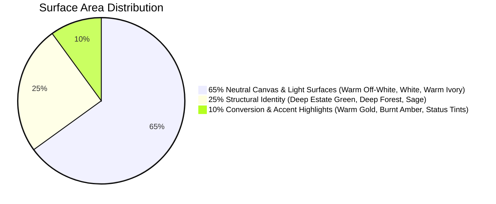

# SHIVOM GLOBAL — Colour Usage Guidelines

## 1. Document Overview

This document specifies the exact, authoritative colour assignments for every homepage section and reusable UI primitive across the SHIVOM GLOBAL website.

Its purpose is to:
1. Standardise how design tokens are applied across the entire site.
2. Prevent visual inconsistencies, contrast violations, and ad-hoc styling.
3. Serve as the strict design contract when refactoring or creating components.

---

## 2. Core 65-25-10 Visual Weight Hierarchy

Every page and section must maintain the following balanced surface ratio:



* **65% Canvas & Readability**:
  - Main page background: `var(--bg-page)` (`#FBFBFA`)
  - Card backings: `var(--bg-surface)` (`#FFFFFF`)
  - Alternating section substrates: `var(--color-tea-cream)` (`#F5F1E8`) or `var(--bg-surface-sunken)` (`#F4F5F3`)
* **25% Estate Identity & Structure**:
  - Header on scroll & sticky states: `rgba(7, 34, 24, 0.95)` with backdrop filter
  - Footer & Private Label high-contrast cards: `var(--bg-brand-dark)` (`#072218`)
  - Section titles, badges, primary button fills: `var(--color-primary-dark)` (`#0D3829`)
* **10% Action & Conversion**:
  - RFQ triggers, active navigation markers, key metrics: `var(--color-accent-gold)` (`#C59B27`)
  - Urgent inquiry chips, secondary highlights: `var(--color-accent-gold-dark)` (`#CC5500`)
  - Official WhatsApp links: `var(--color-whatsapp)` (`#25D366`)

---

## 3. UI Primitive Colour Allocations

### A. Typography Hierarchy

| Typographic Element | Target Background | Token Assignment | Hex Fallback | WCAG Contrast |
|---|---|---|---|---|
| **Primary Headings (H1, H2, H3)** | Light Canvas (`#FBFBFA` / `#FFFFFF`) | `var(--text-main)` | `#1A2E26` | 13.8:1 (AAA) |
| **Primary Headings (H1, H2, H3)** | Dark Canvas (`#072218` / `#0D3829`) | `var(--text-inverse)` | `#FFFFFF` | 15.4:1 (AAA) |
| **Body Paragraphs** | Light Canvas (`#FBFBFA` / `#FFFFFF`) | `var(--text-main)` | `#1A2E26` | 13.8:1 (AAA) |
| **Body Paragraphs (Muted)** | Light Canvas (`#FBFBFA` / `#FFFFFF`) | `var(--text-muted)` | `#4A5D4E` | 5.8:1 (AA) |
| **Body Paragraphs on Dark** | Dark Canvas (`#072218` / `#0D3829`) | `var(--text-inverse-muted)` | `#C8D6CC` | 8.2:1 (AAA) |
| **Category Overlines / Eyebrows** | Light Canvas | `var(--color-accent-gold)` | `#C59B27` | *Icons/bold tracking only* |
| **Category Overlines / Eyebrows** | Dark Canvas | `var(--color-accent-gold)` | `#C59B27` | 5.8:1 (AA) |
| **Captions, Disclaimers, Timestamps**| Light Canvas | `var(--text-subtle)` | `#7A8D7E` | 4.6:1 (AA) |

> [!WARNING]
> **Gold Text Rule**: Never render body paragraphs or unweighted small text in `var(--color-accent-gold)` on white or light backgrounds. Gold on `#FFFFFF` yields only a 2.1:1 contrast ratio, failing accessibility standards. Use gold typography exclusively on dark surfaces (`#072218` or `#0D3829`) or for bold uppercase section eyebrows.

---

### B. Interactive Buttons & Triggers

```
[ Primary CTA (Gold) ]   -> Fill: var(--color-accent-gold), Text: #072218 (Bold), Hover: var(--color-accent-gold-dark)
[ Corporate CTA (Green) ] -> Fill: var(--color-primary-dark), Text: #FFFFFF, Hover: #072218
[ Outline CTA ]          -> Fill: transparent, Border: var(--color-primary-dark), Text: var(--color-primary-dark)
[ WhatsApp CTA ]         -> Fill: #25D366, Text: #FFFFFF, Hover: #1DA851, Glow: rgba(37, 211, 102, 0.25)
```

#### Detailed Button Specifications:

1. **Primary Commercial CTA ("Request Export Quote" / "Submit RFQ")**:
   - Background: `var(--color-accent-gold)` (`#C59B27`)
   - Text: `var(--color-primary-forest)` (`#072218`), font-weight: `700`
   - Border: None
   - Hover Background: `var(--color-accent-gold-dark)` (`#CC5500`)
   - Hover Text: `var(--text-inverse)` (`#FFFFFF`)
   - Focus Ring: `0 0 0 3px rgba(197, 155, 39, 0.4)`

2. **Secondary Corporate CTA ("Explore Origins" / "View Specifications")**:
   - Background: `var(--color-primary-dark)` (`#0D3829`)
   - Text: `var(--text-inverse)` (`#FFFFFF`)
   - Hover Background: `var(--color-primary-forest)` (`#072218`)
   - Focus Ring: `0 0 0 3px rgba(13, 56, 41, 0.3)`

3. **Outline / Ghost Button**:
   - Background: `transparent`
   - Border: `1.5px solid var(--border-default)` (`#CBD5CE`)
   - Text: `var(--text-main)` (`#1A2E26`)
   - Hover Background: `rgba(13, 56, 41, 0.05)`
   - Hover Border: `var(--color-primary-dark)` (`#0D3829`)

4. **Direct WhatsApp Inquiry Button**:
   - Background: `#25D366`
   - Text: `#FFFFFF`, font-weight: `600`
   - Hover Background: `#1EB754`
   - Shadow: `0 4px 14px rgba(37, 211, 102, 0.3)`

---

### C. Cards & Containers

1. **Standard Elevated Card (White)**:
   - Background: `var(--bg-surface)` (`#FFFFFF`)
   - Border: `1px solid var(--border-subtle)` (`#E2E8E4`)
   - Shadow: `var(--shadow-sm)` (`0 1px 3px rgba(13, 56, 41, 0.08)`)
   - Hover State: Border transitions to `rgba(197, 155, 39, 0.4)`, shadow elevates to `var(--shadow-md)`.

2. **Subtle Cream Card (Ivory Alternate)**:
   - Background: `var(--color-tea-cream)` (`#F5F1E8`)
   - Border: `1px solid var(--border-subtle)` (`#E2E8E4`)
   - Shadow: None (flat structural card).

3. **High-Contrast Dark Showcase Card (Private Label & Dark Modules)**:
   - Background: `linear-gradient(145deg, var(--color-primary-forest) 0%, var(--color-primary-dark) 100%)`
   - Border: `1px solid rgba(197, 155, 39, 0.35)` (`var(--border-gold)`)
   - Text: `var(--text-inverse)` (`#FFFFFF`)
   - Shadow: `var(--shadow-xl)` (`0 20px 48px rgba(7, 34, 24, 0.25)`)

---

### D. Form Controls & Validation States

1. **Input / Select Fields (Resting)**:
   - Background: `var(--bg-surface)` (`#FFFFFF`)
   - Border: `1px solid var(--border-default)` (`#CBD5CE`)
   - Text: `var(--text-main)` (`#1A2E26`)
   - Placeholder: `var(--text-subtle)` (`#7A8D7E`)

2. **Input / Select Fields (Focus)**:
   - Border: `1.5px solid var(--color-primary-dark)` (`#0D3829`)
   - Focus Ring: `0 0 0 3px rgba(13, 56, 41, 0.15)`
   - Background: `var(--bg-surface)`

3. **Input Validation States**:
   - **Error**: Border `var(--color-error)` (`#B91C1C`), Focus Ring `rgba(185, 28, 28, 0.2)`, Error Text `var(--color-error)`
   - **Success**: Border `var(--color-success)` (`#15803D`), Focus Ring `rgba(21, 128, 61, 0.2)`
   - **Warning**: Border `var(--color-warning)` (`#B45309`), Focus Ring `rgba(180, 83, 9, 0.2)`

---

## 4. Section-by-Section Colour Assignment

### Section 01: Site Header (`01_HEADER.md`)
- **Initial Top State (Over Hero)**:
  - Background: `var(--header-bg-initial)` (`rgba(var(--primitive-green-950-rgb), 0.65)` with `backdrop-filter: blur(12px)`)
  - Border Bottom: `var(--header-border-initial)` (`1px solid rgba(var(--primitive-white-rgb), 0.12)`)
  - Nav Links: `rgba(var(--primitive-white-rgb), 0.90)`
  - Nav Links (Hover): `var(--header-link-hover)` (`var(--color-accent-gold)`)
  - Active Section Indicator: `var(--color-accent-gold)`
  - CTA Button: `var(--button-primary-bg)` (`var(--color-accent-gold)`) with dark text
- **Scrolled State**:
  - Background: `var(--header-bg-scrolled)` (`rgba(var(--primitive-green-950-rgb), 0.95)` with `backdrop-filter: blur(16px)`)
  - Border Bottom: `var(--header-border-scrolled)` (`1px solid rgba(var(--primitive-gold-500-rgb), 0.25)`)
  - Shadow: `0 4px 20px rgba(0, 0, 0, 0.25)`
- **Mobile Menu Drawer**:
  - Background: `var(--color-primary-forest)` (`#072218`)
  - Drawer Links: `var(--text-inverse)` (`#FFFFFF`) with gold active pills

### Section 02: Hero Section (`02_HERO_SECTION.md`)
- **Backdrop Overlay**:
  - Multi-directional atmospheric overlay:
    - 90deg: `linear-gradient(90deg, rgba(var(--primitive-green-950-rgb), 0.90) 0%, rgba(var(--primitive-green-950-rgb), 0.80) 40%, rgba(var(--primitive-green-950-rgb), 0.40) 65%, rgba(var(--primitive-green-950-rgb), 0.10) 85%, rgba(var(--primitive-green-950-rgb), 0.0) 100%)`
    - 180deg: `linear-gradient(180deg, rgba(var(--primitive-green-950-rgb), 0.40) 0%, rgba(var(--primitive-green-950-rgb), 0.0) 25%, rgba(var(--primitive-green-950-rgb), 0.0) 75%, rgba(var(--primitive-green-950-rgb), 0.60) 100%)`
- **Headline**: `var(--text-inverse)` (`#FFFFFF`)
- **Subheadline**: `rgba(var(--primitive-white-rgb), 0.92)`
- **Trust Badges / Chips**: Background `rgba(var(--primitive-white-rgb), 0.10)`, Border `rgba(var(--primitive-white-rgb), 0.25)`, Text `#FFFFFF`
- **Primary CTA**: `var(--button-primary-bg)` (`var(--color-accent-gold)`)
- **Secondary CTA**: `transparent` with `1.5px solid rgba(var(--primitive-white-rgb), 0.40)`, Text `#FFFFFF`
- **Direct Trade Desk WhatsApp**: `var(--color-whatsapp)` (`#25D366`)
- **Scroll Progress Track**: Track `rgba(var(--primitive-white-rgb), var(--alpha-08))`, Bar `var(--color-accent-gold)` with glow `rgba(var(--primitive-gold-500-rgb), var(--alpha-50))`

### Section 03: Tea Categories Section (`03_TEA_CATEGORIES.md`)
- **Section Canvas**: `var(--bg-page)` (`#FBFBFA`)
- **Card Surfaces**: `var(--bg-surface)` (`#FFFFFF`)
- **Category Liquor Indicators**:
  - Assam CTC: `var(--color-liquor-ctc)` (`#8B2500` rich copper red)
  - Assam Orthodox: `var(--color-liquor-orthodox)` (`#C27803` golden amber)
  - Darjeeling: `var(--color-liquor-darjeeling)` (`#D99B26` bright Muscatel gold)
  - Green Tea: `var(--color-liquor-green)` (`#4E8A3C` vibrant jade green)
- **Grade Chips**: Background `var(--bg-badge)` (`#E8F0EB`), Text `var(--color-primary-green)` (`#0D3829`)
- **Discuss on WhatsApp CTA**: `var(--color-whatsapp)` (`#25D366`)

### Section 04: Tea Origins & Grades Table (`04_TEA_ORIGINS_AND_GRADES.md`)
- **Section Canvas**: `var(--color-tea-cream)` (`#F5F1E8` warm alternating section)
- **Tab Filter Bar**:
  - Inactive Tabs: Background `transparent`, Text `var(--text-muted)` (`#4B5563`)
  - Active Tab: Background `var(--color-primary-green)` (`#0D3829`), Text `#FFFFFF`, Border `1px solid var(--color-primary-green)`
- **Data Table**:
  - Table Header (`<th>`): Background `var(--table-header-bg)` (`var(--color-primary)`), Text `var(--table-header-text)` (`#FFFFFF`)
  - Alternating Rows: Row 1 `var(--table-row-even)` (`#FFFFFF`), Row 2 `var(--table-row-odd)` (`#F4F5F3`)
  - Row Hover: `var(--table-row-hover)` (`rgba(var(--primitive-gold-500-rgb), 0.08)`)
  - Table Borders: `1px solid var(--border-subtle)` (`#E5E7EB`) and `var(--border-subtle-warm)` (`#E5E0D5`)
  - WhatsApp Row Action Button: Background `rgba(var(--primitive-whatsapp-rgb), 0.12)`, Border `rgba(var(--primitive-whatsapp-rgb), 0.3)`, Text `var(--color-success-text)` (`#15803D`), Icon `var(--color-whatsapp)` (`#25D366`)

### Section 05: Private Label Section (`05_PRIVATE_LABEL.md`)
- **Section Canvas**: `var(--bg-brand-dark)` (`#072218` theatrical deep dark section)
- **Card Container**: `linear-gradient(135deg, rgba(13, 56, 41, 0.6) 0%, rgba(7, 34, 24, 0.9) 100%)`
- **Border**: `1px solid var(--border-gold)` (`rgba(197, 155, 39, 0.35)`)
- **Feature Icons**: `var(--color-accent-gold)` (`#C59B27`)
- **Accreditations / Compliance Badges**: Border `1px solid rgba(255, 255, 255, 0.15)`, Text `var(--text-inverse-muted)` (`#C8D6CC`)

### Section 06: Export Process Section (`06_EXPORT_PROCESS.md`)
- **Section Canvas**: `var(--bg-page)` (`#FBFBFA`)
- **Step Process Cards**:
  - Card Backing: `var(--bg-surface)` (`#FFFFFF`)
  - Step Number Badge: Background `var(--color-primary-dark)` (`#0D3829`), Text `var(--color-accent-gold)` (`#C59B27`)
  - Connecting Timeline Line: `var(--color-tea-green)` (`#9CAF88`) with gold pulse points
  - Card Border: `1px solid var(--border-subtle)` (`#E2E8E4`)

### Section 07: Why Shivom Global Section (`07_WHY_SHIVOM_GLOBAL.md`)
- **Section Canvas**: `var(--color-tea-cream)` (`#F5F1E8`)
- **Differentiator Metric Cards**:
  - Metric Numbers: `var(--color-primary-dark)` (`#0D3829`)
  - Metric Icons: `var(--color-accent-gold)` (`#C59B27`)
  - Metric Labels: `var(--text-muted)` (`#4A5D4E`)
  - Card Border: `1px solid rgba(13, 56, 41, 0.12)`

### Section 08: Buyer Requirement Form (`08_BUYER_REQUIREMENT_FORM.md`)
- **Section Canvas**: `var(--bg-page)` (`#FBFBFA`)
- **Card Enclosure**: `var(--bg-surface)` (`#FFFFFF`), Border `1px solid var(--border-default)` (`#CBD5CE`), Shadow `var(--shadow-lg)`
- **Header Banner**: `var(--color-primary-dark)` (`#0D3829`) with gold subtitle
- **Step Indicators**:
  - Inactive Step: Background `#E5E7EB`, Text `#6B7280`
  - Active Step: Background `var(--color-accent-gold)` (`#C59B27`), Text `#072218`
  - Completed Step: Background `var(--color-primary-dark)` (`#0D3829`), Text `#FFFFFF`
- **Interactive Radio / Checkbox Pills**:
  - Unselected: Background `var(--bg-surface)`, Border `1px solid var(--border-default)`, Text `var(--text-main)`
  - Selected: Background `var(--bg-badge)` (`#E8F0EB`), Border `1.5px solid var(--color-primary-dark)`, Text `var(--color-primary-dark)`
- **Submit RFQ Button**: `var(--color-accent-gold)` with dark text
- **Direct WhatsApp Submit Button**: `#25D366` with white text

### Section 09: Site Footer (`09_FOOTER.md`)
- **Section Canvas**: `var(--bg-brand-dark)` (`#072218`)
- **Divider Rules**: `1px solid rgba(255, 255, 255, 0.10)`
- **Brand Description**: `var(--text-inverse-muted)` (`#C8D6CC`)
- **Navigation Links**:
  - Rest: `rgba(255, 255, 255, 0.75)`
  - Hover: `var(--color-accent-gold)` (`#C59B27`)
- **Newsletter Box**: Background `rgba(255, 255, 255, 0.04)`, Border `1px solid rgba(255, 255, 255, 0.12)`, Text `#FFFFFF`
- **Copyright Bar**: `rgba(255, 255, 255, 0.50)`

### Section 10: Floating WhatsApp Widget (`10_WHATSAPP_FLOAT.md`)
- **Float Button**: Background `#25D366`, Icon `#FFFFFF`
- **Halo Pulse**: `0 0 0 4px rgba(37, 211, 102, 0.35)`
- **Tooltip Chip**: Background `var(--color-primary-forest)` (`#072218`), Text `#FFFFFF`, Border `1px solid var(--color-accent-gold)`

