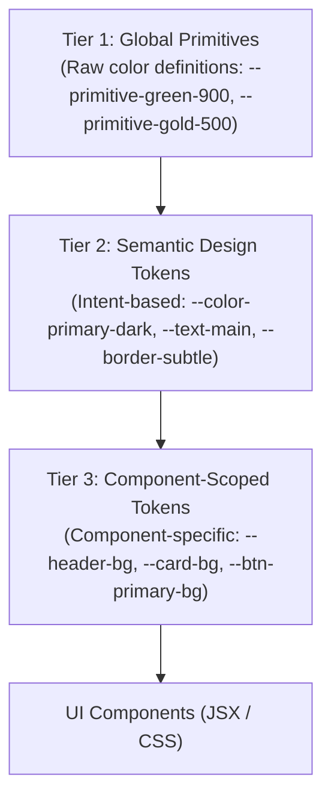

# SHIVOM GLOBAL — Centralised Colour Management System

## 1. System Overview

The **SHIVOM GLOBAL Centralised Colour Management System** establishes a single, authoritative reference and architectural framework for all colours used across the SHIVOM GLOBAL B2B digital platform.

Prior to the creation of this system, colour values were distributed across CSS tokens (`src/styles/tokens.css`), global stylesheet rules (`src/styles/index.css`), component inline styles (`*.tsx`), and static SVG assets (`public/`). This fragmentation created visual drift, impeded rapid palette experimentation, and made site-wide theme adjustments high-risk.

This documentation suite audits the current production implementation, categorises all baseline and hardcoded colour values, defines strict usage guidelines for every website section, and provides a structured evaluation framework for exploring new brand colour directions without endangering website stability or B2B conversions.

---

## 2. Directory Structure & Manifest

The colour management documentation is organised into five dedicated records within `docs/design-system/`:

```
docs/design-system/
├── README.md                     # System overview, governance rules, and developer onboarding
├── COLOR_SYSTEM.md               # Production audit, baseline tokens, hardcoded inventory & root causes
├── COLOR_PALETTE_OPTIONS.md      # Evaluation framework & 5 prospective brand palette directions
├── COLOR_USAGE_GUIDELINES.md     # Section-by-section and UI primitive colour allocation rules
└── COLOR_CHANGELOG.md            # Immutable audit trail for colour changes and migrations
```

### Document Roles

| File | Purpose | Primary Audience | When to Consult |
|---|---|---|---|
| **`README.md`** | High-level index, core governance principles, and token consumption rules. | All Developers, Designers | When onboarding or reviewing colour contribution policies. |
| **`COLOR_SYSTEM.md`** | Comprehensive technical audit of current tokens (`tokens.css`), 84 hardcoded hex colors, 110 rgba values, and component leaks. | Frontend Engineers | When refactoring hardcoded styles or auditing token coverage. |
| **`COLOR_PALETTE_OPTIONS.md`** | Evaluation rubric and 5 prospective brand palettes (Heritage, Modern Luxury, Organic, B2B Export, Minimal). | Creative Director, Stakeholders | When evaluating new brand colour directions for A/B testing. |
| **`COLOR_USAGE_GUIDELINES.md`** | Exact color allocations for all 10 homepage sections, cards, buttons, forms, and typography. | UI Developers | When building or styling any UI component or section. |
| **`COLOR_CHANGELOG.md`** | Versioned log of all color modifications, token additions, and migrations. | Tech Lead | Before releasing any style or token updates. |

---

## 3. Core Principles & Governance Rules

All developers and designers working on the SHIVOM GLOBAL codebase must adhere to the following mandatory rules:

### Principle 1: The 65-25-10 Visual Weight Distribution
The visual architecture of the website must strictly follow the enterprise B2B tea export ratio:
* **65% Canvas & Background (Neutral Warm Whites)**: `--bg-page` (`#FBFBFA`), `--bg-surface` (`#FFFFFF`), and ivory section backings (`#F5F1E8`, `#F4F5F3`). This ensures maximum readability, airiness, and a clean reading canvas for international buyers.
* **25% Structural Identity (Deep Estate Greens)**: `--color-primary-dark` (`#0D3829`), `--color-primary-forest` (`#072218`), and botanical sage accents (`#9CAF88`). Used for headers, footers, high-impact dark cards, and major section backdrops.
* **10% Conversion & Terroir Accents (Warm Gold & Burnt Amber)**: `--color-accent-gold` (`#C59B27`) and `--color-accent-gold-dark` (`#CC5500`). Reserved strictly for RFQ triggers, active navigation indicators, key metrics, and grade highlights.

### Principle 2: Zero Hardcoding Policy
* **Never write hex (`#HEX`), raw `rgb()`, or raw `hsl()` inside component CSS or JSX inline styles.**
* Every visual property must reference a CSS custom property defined in the token hierarchy (e.g. `color: var(--text-main);`, `background: var(--bg-surface);`).
* If a new tint or opacity is required, it must be codified as a functional semantic token in `src/styles/tokens.css` before use.

### Principle 3: Accessibility & Contrast (WCAG 2.1 AA Compliance)
* Body text (`--text-main` on `--bg-page`) must achieve a minimum contrast ratio of **4.5:1**.
* Large headings (18pt+ or 14pt bold) must achieve a minimum contrast ratio of **3.0:1**.
* Interactive controls, borders, and focus rings must achieve at least **3.0:1** against adjacent backgrounds.
* Gold accents (`--color-accent-gold` `#C59B27`) must never be used for small body text on light backgrounds due to insufficient contrast (2.1:1). Gold text is permitted only on deep dark surfaces (`#0D3829` or `#072218`, achieving 5.8:1 contrast) or as icons and border accents.

### Principle 4: Terroir Authenticity & B2B Trust
* Colors must evoke authentic Indian tea heritage (Assam Brahmaputra valley deep evergreen estates, Darjeeling high-elevation mist, orthodox amber liquors, and natural jute sack packaging).
* Avoid electric, neon, or generic SaaS palette choices (e.g. vibrant tech blues, saturated purples, flat greys).

---

## 4. How Developers Should Consume Colours

When writing CSS or TSX components, follow the three-tier token consumption model:



### Correct Usage Example
```css
/* ✅ CORRECT: Referencing Semantic Tokens */
.quote-card {
  background-color: var(--bg-surface);
  color: var(--text-main);
  border: 1px solid var(--border-subtle);
}

/* ✅ CORRECT: Referencing Dynamic Opacity via Primitive RGB Channels & Alpha Tokens */
.quote-card__glow {
  box-shadow: 0 4px 20px rgba(var(--primitive-gold-500-rgb), var(--alpha-25));
  border: 1px solid rgba(var(--primitive-green-900-rgb), var(--alpha-12));
}

.quote-card__badge {
  background-color: var(--color-primary-green);
  color: var(--text-inverse);
  border: 1px solid var(--color-accent-gold);
}
```

### Incorrect Usage Example
```css
/* ❌ FORBIDDEN: Hardcoded hex and raw rgba */
.quote-card {
  background-color: #ffffff; /* Use var(--bg-surface) */
  color: #1a1a1a;            /* Use var(--text-main) */
  border: 1px solid rgba(13, 56, 41, 0.1); /* Use var(--border-subtle) */
}
```

---

## 5. Integration with Section Documentation

This Colour Management System directly governs the 10 homepage sections documented in `docs/website-sections/`:

1. [01_HEADER.md](../website-sections/01_HEADER.md) — Sticky glassmorphism header, active links, quote CTA.
2. [02_HERO_SECTION.md](../website-sections/02_HERO_SECTION.md) — Multi-gradient atmospheric tea garden backdrop, typography, CTA buttons.
3. [03_TEA_CATEGORIES.md](../website-sections/03_TEA_CATEGORIES.md) — CTC, Orthodox, Darjeeling, and Green tea liquor tints and badges.
4. [04_TEA_ORIGINS_AND_GRADES.md](../website-sections/04_TEA_ORIGINS_AND_GRADES.md) — Tabbed grade tables, leaf elevation badges, data rows.
5. [05_PRIVATE_LABEL.md](../website-sections/05_PRIVATE_LABEL.md) — High-contrast dark showcase card, foil stamping gold accents.
6. [06_EXPORT_PROCESS.md](../website-sections/06_EXPORT_PROCESS.md) — 5-step numbered workflow cards, connectors, tracking indicators.
7. [07_WHY_SHIVOM_GLOBAL.md](../website-sections/07_WHY_SHIVOM_GLOBAL.md) — Strategic differentiators, metric counters, compliance badges.
8. [08_BUYER_REQUIREMENT_FORM.md](../website-sections/08_BUYER_REQUIREMENT_FORM.md) — Form controls, focus rings, validation error states, WhatsApp RFQ button.
9. [09_FOOTER.md](../website-sections/09_FOOTER.md) — High-contrast Deep Forest backing, amber accents, legal links.
10. [10_WHATSAPP_FLOAT.md](../website-sections/10_WHATSAPP_FLOAT.md) — Official WhatsApp green `#25D366` compliance with gold branding halo.

---

## 6. Review & Maintenance Cycle

* Any addition or refactor of colour tokens must be recorded in [COLOR_CHANGELOG.md](COLOR_CHANGELOG.md).
* No changes to live visual appearance or existing color values may be deployed without stakeholder sign-off on the evaluation criteria outlined in [COLOR_PALETTE_OPTIONS.md](COLOR_PALETTE_OPTIONS.md).

