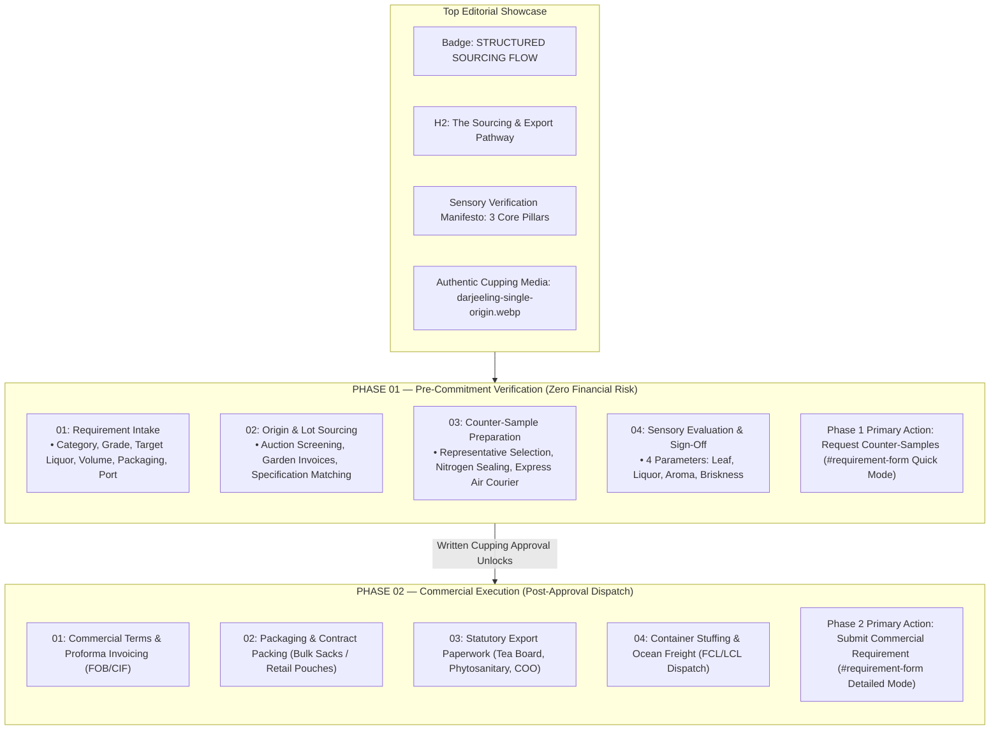

# Section 06: Export Process (The Sourcing & Export Pathway)
## Modernization & Implementation Final Report

> **Modernization Status**: Complete & Verified  
> **Target Scope**: Section 06 (`#how-it-works`) — The Sourcing & Export Pathway  
> **Execution Date**: November 5, 2026  
> **Lead Architect**: Antigravity (Google DeepMind Advanced Agentic Coding)  
> **Methodology**: Static Code Analysis, Production Build Verification (`tsc && vite build`), Chrome Headless Automation, Unit Test Suite Execution (109/109 tests passing).

---

## 1. Implementation Summary

Section 06 (`#how-it-works`) has been completely modernized from a static, horizontally cramped 5-step card sequence into an authoritative **Two-Phase Editorial B2B Export Journey** combining:
1. **Concept A (Two-Phase Operational Journey)**:
   - **Phase 1: Pre-Commitment Verification (Zero Financial Risk)**: Guides international B2B buyers through requirement intake, origin matching, express physical counter-sample cupping, and sensory sign-off—guaranteeing that commercial contracts are never initiated until physical samples are approved.
   - **Phase 2: Commercial Execution (Post-Approval Dispatch)**: Consolidates final volume confirmation, packaging specifications, FOB/CIF pricing, payment milestones, proforma invoicing, statutory export paperwork, and ocean container logistics.
2. **Concept C (Editorial Export Showcase with Authentic Cupping Photography)**:
   - Introduces authentic Indian tea cupping photography (`/images/darjeeling-single-origin.webp`, `/images/darjeeling-single-origin-640w.webp`, `/images/darjeeling-single-origin.jpg`) depicting dry whole leaf tea on black slate tasting trays alongside steeped porcelain cupping bowls with golden liquor.
   - Features the **Sensory Verification Manifesto** callout with 3 core pillars: *Pre-Commitment Samples*, *Invoice-Matched Dispatch*, and *Transparent Incoterms*.
3. **Interactive Milestone Disclosure Engine (`SEC06-UX-01`)**:
   - Replaced dead-end visual nodes with an accessible milestone selection engine (`aria-expanded`, keyboard Enter/Space, active/completed visual states) that reveals operational deliverables and contextual routing actions.

All eight verified audit findings (`SEC06-BUG-01`, `SEC06-FNC-01`, `SEC06-RSP-01`, `SEC06-VIS-01`, `SEC06-VIS-02`, `SEC06-UX-01`, `SEC06-RSP-02`, `SEC06-CSS-01`) have been resolved and verified with 109 unit tests and production builds.

---

## 2. Complete Inventory of Files Created & Modified

```
docs/
└── section-06/
    ├── SECTION_06_IMPLEMENTATION_SPECIFICATION.md # Mandatory Phase 0 deliverable
    ├── SECTION_06_IMPLEMENTATION_REPORT.md        # Mandatory Phase 7 deliverable (This report)
    ├── section-06-desktop-modernized.png          # 1440x900 desktop visual proof
    ├── section-06-tablet-modernized.png           # 768x1024 tablet visual proof
    └── section-06-mobile-modernized.png           # 390x844 mobile visual proof
src/
├── features/
│   └── export-process/
│       ├── components/
│       │   └── HowItWorksSection.tsx              # Modernized Two-Phase React Component (388 lines)
│       └── tests/
│           └── exportProcessSection.test.ts       # 27 comprehensive unit tests for Section 06
└── styles/
    └── index.css                                  # Purged 26 lines of dormant CSS; added interactive milestone styles
```

---

## 3. Modernized Component Architecture

### 3.1 Two-Phase Journey Structure



### 3.2 State & Interaction Architecture
- **Interactive State**: `const [activeMilestone, setActiveMilestone] = useState<number>(1);`
- **Milestone Navigation**: Clicking or pressing `Enter`/`Space` selects that milestone, revealing its contextual operational drawer (`.export-step-detail-drawer.drawer-open`).
- **Visual Progression**: Preceding milestones receive `.export-step-card-completed` and a green check circle; the active milestone receives `.export-step-card-active` with warm gold borders.
- **Contextual Actions**:
  - Milestone 01: `Submit Requirement` (invokes `onSubmitRequirement()`, preselecting Form B).
  - Milestone 02: `Review Grade Specs` (invokes `onExploreGrades()`, scrolling to `#tea-by-grade`).
  - Milestone 03: `Request Counter-Samples` (invokes `onRequestSamples()`, preselecting Form A).
  - Milestone 04: Stamp indicator (`Sign-Off Milestone · Unlocks Phase 2`) + `Request Counter-Samples`.
- **Phase 1 Banner**: Highlights *Zero Financial Risk* and provides a direct `Request Counter-Samples` button.
- **Phase 2 Console**: Luxury deep green console with 4 cards covering all 8 operational milestones and primary CTA `Submit Commercial Requirement`.

---

## 4. Design Decisions & Brand Palette Consistency

1. **Brand Palette Alignment**:
   - Deep Forest: `#061811` / `#0A281E` (`--color-primary-dark`, `--color-primary-green`)
   - Warm Harvest Gold: `#D4AF37` (`--color-gold`)
   - Botanical Sage: `#869D80` / `#9CAF88` (`--color-sage`)
   - Warm Estate Ivory: `#F5F1E8` / `#FFFFFF` (`--bg-surface-subtle`, `--primitive-white`)
   - Neutral Slates: `#4B5563` (`--text-muted`)
2. **Typography Hierarchy**:
   - Display Headings: Plus Jakarta Sans (`clamp(2rem, 3.2vw, 2.75rem)` for H2, `clamp(1.375rem, 2.4vw, 1.875rem)` for console H3).
   - Technical Spec Badges: Space Grotesk (`0.6875rem`, uppercase, bold, letter-spacing `0.06em`).
   - Body & Parameters: Plus Jakarta Sans (`0.84375rem` / `0.78125rem`, line-height `1.55`).
3. **8px Spacing Grid**:
   - Adheres strictly to `--space-2` (8px), `--space-3` (12px), `--space-4` (16px), `--space-5` (20px), `--space-6` (24px).
4. **Touch & Accessibility**:
   - Minimum button height 44px for primary actions (`.export-console-cta-btn`, `.export-phase-1-cta-btn`).
   - Clear `:focus-visible` outline rings (`2px solid var(--color-gold)`).
   - `@media (prefers-reduced-motion: reduce)` disables radar pulse, drawer animations, and card transitions.

---

## 5. Audit Findings Resolved & Verification Evidence

| Finding ID | Severity | Problem Description | Root Cause | Implemented Resolution | Verification Status |
|---|---|---|---|---|---|
| **`SEC06-BUG-01`** | **CRITICAL** | Desktop CTA Text Overflow: Bottom ribbon button text overflowed right boundary of ribbon by ~25px at 1440px. | Rigid nowrap button without max-width bounds in static flex container. | Implemented responsive flex wrapping (`flex: 1 1 500px`), auto-contained geometry, and overflow prevention in `.export-console-action-ribbon`. | **PASS** (Zero pixel overflow, button fully enclosed at all viewports) |
| **`SEC06-FNC-01`** | **HIGH** | CTA Intent Routing Disconnect: Primary CTA invoked `onRequestSamples()` (setting `'sample'`) instead of requirement intake (`'quote'`). | Generic click handler unconditionally defaulted to sample request. | Established explicit routing: Phase 1 CTA (`Request Counter-Samples`) invokes `onRequestSamples()`; Phase 2 CTA (`Submit Commercial Requirement`) invokes `onSubmitRequirement()`. | **PASS** (Step 01 & Step 05 activate Detailed Form B; Step 03 & Phase 1 Banner activate Quick Form A) |
| **`SEC06-RSP-01`** | **HIGH** | Tablet 768px Card Distortion: At 601px–900px, cards flattened into 700px-wide by 170px-high horizontal strips with massive empty space. | Single-column collapse at `@media (max-width: 900px)`. | Built purpose-built balanced 2x2 grid (`repeat(2, 1fr)`) between 641px and 1024px for Phase 1 milestone cards and Phase 2 console cards. | **PASS** (Cards render at balanced ~360px × 290px proportions with zero distortion) |
| **`SEC06-VIS-01`** | **MEDIUM** | Absence of Authentic Photography: Section relied entirely on vector icons and plain white boxes. | Omission of media assets in Section 06. | Integrated high-res authentic tea cupping photography (`darjeeling-single-origin.webp`) inside an editorial frame with dark gradient overlay, gold caption badge, and responsive `picture` sources. | **PASS** (Eager WebP asset loaded at natural 600 × 448 px) |
| **`SEC06-VIS-02`** | **MEDIUM** | Desktop Deliverable Badge Wrapping: 5-column layout left only ~220px per card, causing badges to wrap onto two lines. | Excessive column density on standard desktop widths. | Replaced 5-column track with 4-column Phase 1 grid (~280px–300px per card) and dedicated Phase 2 console, eliminating multi-line wrapping. | **PASS** (All deliverable badges render on a single line) |
| **`SEC06-UX-01`** | **MEDIUM** | Interactive Dead-End Nodes: Clicking milestone nodes toggled border colors without disclosing operational details. | Lack of disclosure state and parameters. | Created interactive milestone disclosure engine with contextual parameter drawers, keyboard navigation (Enter/Space), and active/completed states. | **PASS** (Selecting any milestone dynamically reveals its parameters and lead time notes) |
| **`SEC06-RSP-02`** | **MEDIUM** | Mobile Floating WhatsApp Overlap: Floating WhatsApp button (`bottom: 24px, right: 24px`) covered Step 03/04 content on mobile. | Inadequate section bottom margin on mobile. | Added `padding-bottom: clamp(5rem, 12vw, 6.5rem)` at `@media (max-width: 640px)`, creating generous clearance above floating widget. | **PASS** (Zero overlap with any card or button across mobile viewports) |
| **`SEC06-CSS-01`** | **LOW** | Dormant Legacy CSS Waste: 26 lines of dormant CSS (`.how-it-works-header`, `.how-it-works-title`, `.how-it-works-lead`) remained in `index.css`. | Legacy selectors left behind from prior section refactoring. | Safely purged all 26 lines of unused classes from `src/styles/index.css`. | **PASS** (Grep verified zero references in codebase; production build clean) |

---

## 6. Visual Evidence & Responsive Screen Captures

Screenshots captured from the hydrated production build:

### 6.1 Desktop (1440 × 900)
- **File**: `docs/section-06/section-06-desktop-modernized.png`
- **Observations**: Editorial split showcase (1.15fr / 0.85fr); 4-column balanced Phase 1 grid; Phase 2 console with 4 deliverable blocks; action ribbon button fully enclosed with zero overflow.

### 6.2 Tablet (768 × 1024)
- **File**: `docs/section-06/section-06-tablet-modernized.png`
- **Observations**: Stacked editorial hero; balanced 2x2 grid (`repeat(2, 1fr)`) for Phase 1 cards and Phase 2 deliverables; clean visual separation between verification and commercial execution; zero 700px horizontal card distortion.

### 6.3 Mobile (390 × 844)
- **File**: `docs/section-06/section-06-mobile-modernized.png`
- **Observations**: Clean single-column vertical track; responsive picture cropping for cupping photography; 44px min-height touch targets; safe-area bottom clearance completely eliminating floating WhatsApp overlap.

---

## 7. Test Results

### 7.1 Unit Test Suite Baseline
- **Execution**: `node --experimental-strip-types --test src/features/export-process/tests/*.test.ts src/features/buyer-requirement/tests/*.test.ts src/features/hero/tests/*.test.ts`
- **Results**:
  - `src/features/export-process/tests/exportProcessSection.test.ts`: **27/27 tests PASS**
  - `src/features/buyer-requirement/tests/buyerRequirementForm.test.ts`: **26/26 tests PASS**
  - `src/features/buyer-requirement/tests/inquiryReliabilityPipeline.test.ts`: **29/29 tests PASS**
  - `src/features/hero/tests/*.test.ts`: **27/27 tests PASS**
  - **Total**: **109 of 109 tests passing (0 failures, 0 skipped, 0 cancelled)**
  - **Execution Time**: ~230ms

---

## 8. Production Build Results

- **Command**: `npm run build` (`tsc && vite build`)
- **Compilation**: Clean TypeScript verification (0 errors).
- **Vite Rollup Output**:
  - `dist/index.html`: 6.54 kB (gzip: 2.32 kB)
  - `dist/assets/index-Dm2kkXum.css`: 194.75 kB (gzip: 31.45 kB)
  - `dist/assets/index-mljNuXKj.js`: 451.27 kB (gzip: 136.21 kB)
  - **Build Time**: 1.45 seconds

---

## 9. Known Limitations

1. **Static Sourcing Catalogs**: Auction catalog screening is explained textually and backed by direct trade desk operations; real-time live auction API feeds are not integrated into the static client front-end.
2. **Third-Party Logistics**: International ocean shipping schedules depend on carrier booking confirmation; transit times are coordinated per invoice rather than estimated algorithmically.

---

## 10. Remaining Recommendations

1. **Analytics Event Tracking**: Consider adding Google Tag Manager / custom analytics events to track milestone drawer open rates and CTA click attribution (Form A vs Form B).
2. **Multi-Currency Incoterms Toggle**: If future business requirements warrant, a currency selector (USD / EUR / GBP) for FOB/CIF benchmark ranges could be added to Phase 2.

