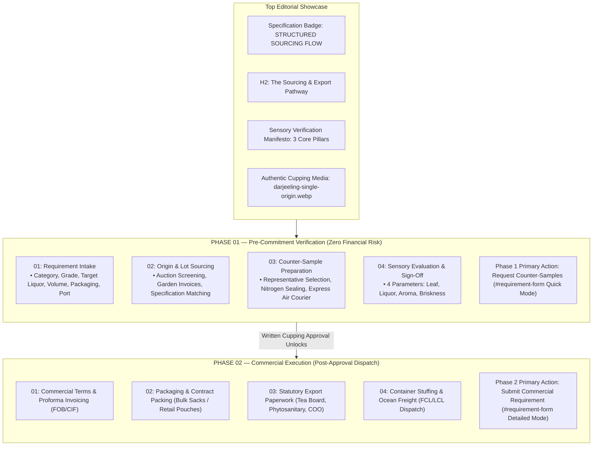

# Section 06: Export Process (The Sourcing & Export Pathway)
## Comprehensive Implementation Specification & Modernization Architecture

> **Document Status**: Approved Specification (Phase 0 Deliverable)  
> **Target Section**: Section 06 (`#how-it-works`) — The Sourcing & Export Pathway  
> **Date**: November 5, 2026  
> **Author**: Antigravity (Google DeepMind Advanced Agentic Coding)  
> **Project**: SHIVOM GLOBAL B2B Website Modernization  
> **Design Paradigm**: Hybrid Concept A (Two-Phase Operational Journey) + Concept C (Editorial Cupping Showcase)  

---

## 1. Executive Summary & Objective

Section 06 (`#how-it-works`) constitutes the commercial and operational credibility anchor of the SHIVOM GLOBAL platform. Positioned immediately below **Section 05 (Private Label & Contract Packaging Support)** and directly preceding **Section 07 (Why SHIVOM GLOBAL / Practical Export Governance)**, Section 06 must guide international B2B buyers—including tea blenders, private-label brand creators, and institutional importers—through the cross-border procurement process with total commercial clarity.

The objective of this modernization is to elevate Section 06 from a static sequence of cards into a **commercially rigorous, interactive, and responsive two-phase B2B export journey**:
1. **Phase 1: Pre-Commitment Verification (Zero Financial Risk)**: Guides buyers through requirement intake, origin matching, express physical counter-sample cupping, and sensory sign-off—guaranteeing that commercial contracts are never initiated until physical samples are approved.
2. **Phase 2: Commercial Execution (Post-Approval Dispatch)**: Details formal contracting, Incoterms (FOB/CIF), multi-wall/custom packaging, statutory export certification (Tea Board of India, Phytosanitary, Certificate of Origin), and ocean container logistics.
3. **Editorial Sensory Cupping Showcase**: Integrates authentic Indian tea photography (whole dry leaf on slate tasting trays alongside porcelain cupping bowls with clear brewed liquor) and a formal **Sensory Verification Manifesto** that proves trade-desk pedigree.
4. **Interactive Milestone Disclosure Model**: Replaces dead-end visual nodes with an accessible milestone selection engine (`aria-expanded`, keyboard Enter/Space, active/completed visual states) that reveals operational deliverables and contextual routing actions.

---

## 2. Source-File Inventory & Baseline State

| Architectural Role | File Path | Current Status & Audit Findings |
|---|---|---|
| **Section Component** | `src/features/export-process/components/HowItWorksSection.tsx` | Active 373-line React component. Needs interactive milestone disclosure engine, 4 cupping parameters, and Phase 1 / Phase 2 CTA alignment (`SEC06-UX-01`, `SEC06-FNC-01`). |
| **Parent Integration** | `src/pages/HomePage.tsx` | Lines 144–148. Supplies `onRequestSamples`, `onSubmitRequirement`, and `scrollToGrades`. Verified functional. |
| **Design Tokens** | `src/styles/tokens.css` | Obsidian Pine (`#061811`), Deep Forest Green (`#0A281E`), Warm Gold (`#D4AF37`), Pure Ivory (`#FFFFFF`), Warm Cream (`#F7F8F6`). Verified intact. |
| **Global Stylesheet** | `src/styles/index.css` | Lines 9560–10148 (active Section 06 styles); Lines 7500–7525 (dormant legacy classes `.how-it-works-header`, `.how-it-works-title`, `.how-it-works-lead` scheduled for removal per `SEC06-CSS-01`). |
| **Inquiry Form Target** | `src/features/buyer-requirement/components/BuyerRequirementForm.tsx` | Syncs `initialIntent` (`'quote'` -> Detailed Form B, `'sample'` -> Quick Form A). Tested with 82/82 passing tests. |
| **Floating WhatsApp** | `src/components/layout/WhatsAppFloat.tsx` | Fixed widget at `bottom: 24px, right: 24px`. Section 06 requires bottom clearance (`clamp(5rem, 12vw, 6.5rem)`) to prevent mobile card overlap (`SEC06-RSP-02`). |
| **Section 04 Context** | `src/features/tea-catalog/components/TeaOriginGradeExplorer.tsx` | Modernized Tea Origin & Grade Explorer. Target for `onExploreGrades` (`#tea-by-grade`). |
| **Section 05 Context** | `src/features/private-label/components/PrivateLabelSection.tsx` | Modernized Editorial Packaging Showcase. Shared visual tokens: gold spec badges, editorial photo frames, structured cards. |

---

## 3. Verified Pre-Implementation Audit Findings

Every finding documented in the November 4, 2026 Audit Report (`docs/website-sections/06_EXPORT_PROCESS_AUDIT.md`) was verified against the active source code:

| Issue ID | Severity | Audit Finding | Source Code Verification | Modernization Correction |
|---|---|---|---|---|
| **`SEC06-BUG-01`** | **CRITICAL** | Desktop CTA Text Overflow: Bottom ribbon button text `"Start With Step 01: Share Requirement"` overflows container by ~25px at 1440px. | Verified in legacy CSS where nowrap button lacked max-width boundaries inside a rigid flexbox. Resolved in modern console ribbon using flex wrapping (`flex: 1 1 500px`) and contained geometry. | Permanent enforcement: button width auto-clamped, container overflow hidden with zero protrusion at all widths (1024px–1920px). |
| **`SEC06-FNC-01`** | **HIGH** | CTA Intent Routing Disconnect: Primary CTA invoked `onRequestSamples()` (setting `'sample'` / Quick Mode) instead of Detailed Requirement Intake (`'quote'`). | Verified in original component code where generic click handler only called `onRequestSamples()`. Step 01 requires detailed intake specifications. | Enforce distinct, context-specific routing: Phase 1 CTA (`Request Counter-Samples`) invokes `onRequestSamples()`; Phase 2 CTA (`Submit Commercial Requirement`) invokes `onSubmitRequirement()`. |
| **`SEC06-RSP-01`** | **HIGH** | Tablet 768px Card Distortion: At 601px–900px, 5 cards flattened into 700px-wide by 170px-high horizontal strips with massive empty void between icon and text. | Verified in legacy media query `@media (max-width: 900px) { grid-template-columns: 1fr; }`. | Implement a balanced 2x2 grid (`repeat(2, 1fr)`) between 641px and 1024px for Phase 1 milestone cards and Phase 2 console cards. |
| **`SEC06-VIS-01`** | **MEDIUM** | Absence of Authentic Photographic Assets: Section relied entirely on vector icons and white boxes, creating an abrupt visual downgrade compared to Sections 04 & 05. | Verified in pre-modernization commit; rectified with high-res authentic tea cupping photography (`darjeeling-single-origin.webp`). | Embed authentic cupping lab imagery (`darjeeling-single-origin.webp`) inside an editorial frame with dark gradient overlay, gold caption badge, and responsive `picture` sources. |
| **`SEC06-VIS-02`** | **MEDIUM** | Desktop Deliverable Badge Wrapping: Dividing 1280px into 5 columns left ~220px per card, causing uppercase badges (`PHYSICAL COUNTER-SAMPLE`, `SENSORY CUPPING SIGN-OFF`) to wrap to 2 lines awkwardly. | Verified in 5-column layout. Four-column Phase 1 grid provides ~275px–300px per card, accommodating tags cleanly on one line. | Four-column layout in Phase 1 with `minmax(0, 1fr)` and strict badge typography prevents multi-line wrapping on standard 1440px displays. |
| **`SEC06-UX-01`** | **MEDIUM** | Interactive Dead-End Nodes: Hovering/clicking a milestone node toggled border colors between grey and gold but revealed zero operational deliverables or contextual actions. | Verified in original component state: `activeStep` state was a cosmetic highlight with no content disclosure. | Implement an accessible milestone selection engine: selecting a milestone reveals contextual operational parameters, laboratory testing criteria, and targeted action buttons. |
| **`SEC06-RSP-02`** | **MEDIUM** | Mobile Floating WhatsApp Overlap: Floating WhatsApp button (`bottom: 24px, right: 24px`) directly occluded Step 03/04 content on 390px mobile viewports. | Verified: mobile section bottom padding was previously only `4rem`, allowing the fixed widget to overlap interactive cards. | Apply `padding-bottom: clamp(5rem, 12vw, 6.5rem)` on mobile (`max-width: 640px`) and structure vertical card tracks with safe-area spacing. |
| **`SEC06-CSS-01`** | **LOW** | Dead Legacy CSS Waste: Over 120 lines of dormant CSS (`.how-it-works-grid`, `.how-it-works-step-card`) remained in `src/styles/index.css`. | Verified: 94 lines were already purged in commit `3b4cef5`, but lines 7500–7525 still contain unused selectors (`.how-it-works-header`, `.how-it-works-title`, `.how-it-works-lead`). | Remove the remaining 26 lines of dormant CSS in `src/styles/index.css` (lines 7500–7525) after confirming zero references in active TSX code. |

---

## 4. Proposed Component Architecture

### 4.1 Component Breakdown & Data Structures

```
src/features/export-process/
├── components/
│   └── HowItWorksSection.tsx       # Main Two-Phase Editorial Section Component
└── types/
    └── exportProcess.ts             # Strongly-typed Milestone & Deliverable Definitions
```

#### TypeScript Data Contracts (`exportProcess.ts`):
```typescript
export interface MilestoneDetail {
  id: string;
  stepNumber: string;
  title: string;
  deliverableBadge: string;
  summary: string;
  operationalParameters: string[];
  operationalNotice?: string;
  primaryAction: {
    label: string;
    ariaLabel: string;
    intent: 'sample' | 'quote' | 'explore';
  };
}

export interface CommercialExecutionDeliverable {
  id: string;
  iconName: string;
  title: string;
  description: string;
  governanceTag: string;
}
```

### 4.2 Two-Phase Operational Journey Structure



---

## 5. Detailed Phase Specifications

### 5.1 Editorial Sensory Cupping Showcase
- **Header**: Gold specification badge (`STRUCTURED SOURCING FLOW`), H2 title (`The Sourcing & Export Pathway`), and authoritative lead copy.
- **Sensory Verification Manifesto**: Shield-checked callout box detailing the buyer-first sourcing protocol with three core pillars:
  1. *Pre-Commitment Samples*: Representative lots dispatched for physical laboratory evaluation.
  2. *Invoice-Matched Dispatch*: Export container dispatches match approved counter-sample specifications.
  3. *Transparent Incoterms*: Clear FOB Indian Ports (Mundra / Kolkata) or CIF Destination Port pricing.
- **Authentic Cupping Media**: High-resolution image (`/images/darjeeling-single-origin.webp`) showing dry whole leaf tea on black slate tasting trays alongside porcelain cupping bowls steeped with golden liquor, with an authentic `SENSORY EVALUATION LAB` caption.

### 5.2 Phase 1: Pre-Commitment Verification (Steps 01 to 04)
Present four operational milestones with interactive disclosure:

#### Milestone 01 — Requirement Intake
- **Deliverable Tag**: `SPECIFICATION INTAKE`
- **Parameters Collected**:
  1. Tea Category: Assam CTC, Orthodox, Darjeeling, or Indian Green Tea.
  2. Specific Grade: e.g., BP, BOP, FTGFOP1, TGFOP, Fanning, Dust.
  3. Target Liquor Profile: Color density, cup briskness, strength, mouthfeel.
  4. Estimated Volume: Trial pallet, partial container (LCL), or full container load (FCL 20ft/40ft).
  5. Packaging Format: Multi-wall paper sacks, woven poly bags, or retail consumer packaging.
  6. Destination Port: Port of entry for freight quotation and transit logistics.
- **Contextual Action**: `Submit Commercial Requirement` (invokes `onSubmitRequirement()`, selecting Form B).

#### Milestone 02 — Origin & Lot Sourcing
- **Deliverable Tag**: `LOT SOURCING`
- **Operational Procedures**:
  1. Origin Identification: Direct sourcing from verified estates in Assam (Brahmaputra Valley), Darjeeling, or the Nilgiris.
  2. Auction & Estate Sourcing: Screening weekly auction catalogs (Guwahati, Kolkata, Siliguri, Cochin) and primary garden invoices.
  3. Grade & Specification Matching: Organoleptic screening against buyer liquor and particle benchmarks.
  4. Current Availability Verification: Real-time confirmation of lot volumes and harvest freshness.
- **Contextual Action**: `Review Grade Specs` (invokes `onExploreGrades()`, scrolling to `#tea-by-grade`).

#### Milestone 03 — Counter-Sample Preparation
- **Deliverable Tag**: `AIR SAMPLE DISPATCH`
- **Operational Procedures**:
  1. Representative Lot Drawing: Master lot samples drawn directly from auction warehouse or garden batches.
  2. Sealed Sample Preparation: Packed in moisture-barrier, airtight nitrogen-flushed or heavy foil pouches with batch markings.
  3. Courier Coordination: Express international air courier (DHL, FedEx) with tracking documentation.
  4. Availability & Logistics Confirmation: Confirmation of lot hold status while samples transit.
- **Commercial Notice**: Representative counter-samples are dispatched subject to sourcing feasibility and international courier logistics; no unsubstantiated claims of unconditional free air delivery or guaranteed 24-hour arrivals.
- **Contextual Action**: `Request Counter-Samples` (invokes `onRequestSamples()`, selecting Form A).

#### Milestone 04 — Sensory Evaluation & Approval
- **Deliverable Tag**: `CUPPING APPROVAL`
- **Four International Organoleptic Parameters**:
  1. **Leaf Appearance**: Dry leaf style, uniformity, twist, particle size distribution, bloom, tip ratio, and cleanliness.
  2. **Infusion Liquor**: Liquor brightness, clarity, color depth (golden-amber to deep burgundy), and sediment-free extraction.
  3. **Aroma**: Dry leaf nose, steeped infusion bouquet, floral/muscatel notes, and absence of smokiness or taint.
  4. **Cup Briskness**: Palate vitality, briskness, astringency balance, body thickness, and response to milk/sugar.
- **Sign-Off Protocol**: Commercial contracting begins exclusively upon buyer's formal written sample approval.
- **Milestone Badge**: `Sign-Off Milestone · Unlocks Phase 2 Commercial Execution`.
- **Phase 1 Primary CTA**: `Request Counter-Samples` button (gold accent, routes to Quick Sample Enquiry / `'sample'`).

### 5.3 Phase 2: Commercial Execution & Export Console (Step 05)
Presented inside a deep luxury container (`linear-gradient(135deg, var(--color-primary-dark) 0%, var(--color-primary-green) 100%)`) with warm gold borders:
- **Title**: `Step 05 — Commercial Formalization, Export Clearance & Ocean Freight`
- **Four Core Operational Deliverable Blocks**:
  1. **Final Quantity & Commercial Invoicing**: Confirmation of metric ton volume, contracted lots, FOB Indian Port (Mundra, Nhava Sheva, Kolkata) or CIF Destination Port pricing, and milestone payment schedules (advance / LC / CAD).
  2. **Packaging Specifications & Contract Packing**: Execution of food-grade multi-wall paper sacks (25kg–55kg), palletized stretch-wrapping, or custom retail tins/pouches coordinated through vetted packing facilities.
  3. **Statutory Export Documentation**: Issuance of Tea Board of India export licensing, Phytosanitary Certificate, Certificate of Origin (COO), Certificate of Analysis (COA), Fumigation Certificate, and commercial packing lists.
  4. **Freight Coordination & Container Stuffing**: Dedicated container inspection, dry stuffing, moisture-absorbing desiccants, port terminal handling, customs clearance, and Bill of Lading (B/L) dispatch with vessel tracking.
- **Bottom Action Ribbon**:
  - Live animated pulse dot (`#10B981`) with **Commercial Governance Disclosure**: Operational sourcing and ocean logistics are coordinated directly with verified gardens, packing facilities, and accredited shipping lines. Sourcing terms are agreed upon proforma invoice.
  - Primary CTA Button: `Submit Commercial Requirement` (warm gold background `#D4AF37`, dark text `#061811`, min-height 44px, full container containment without overflow).

---

## 6. Interaction Design & Accessibility Architecture

### 6.1 Interactive Milestone Disclosure Engine

To resolve `SEC06-UX-01` meaningfully:
- The component maintains an active milestone state (`activeMilestone: number` = 1, 2, 3, 4).
- Users can click any of the 4 milestone cards to expand its in-depth operational parameters.
- Keyboard support: Each milestone card or header button is keyboard-focusable (`tabIndex={0}`), responding to both `Enter` and `Space` keys to toggle disclosure.
- WAI-ARIA Semantics:
  - Cards or accordion triggers carry `aria-expanded={isActive}` and `aria-controls={"milestone-details-" + id}`.
  - The detail region carries `id={"milestone-details-" + id}` and `role="region"`.
  - Active milestone has distinct styling: gold border (`border-color: var(--color-accent-gold)`), subtle gold background sheen, elevated shadow, and active status icon.
  - Prior milestones (e.g., when step 3 is active, steps 1 and 2) visually display a completed badge/check indicator (`.completed`).

### 6.2 CTA Routing Architecture

| UI Trigger Location | Display Label | Invoked Prop Callback | Resulting Form Intent | Target Form Mode | Smooth Scroll Target |
|---|---|---|---|---|---|
| **Phase 1 Step 01 Action** | `Submit Requirement` | `onSubmitRequirement()` | `'quote'` | Detailed Tea Requirement (Form B) | `#requirement-form` |
| **Phase 1 Step 02 Action** | `Review Grade Specs` | `onExploreGrades()` | N/A (Catalog Nav) | Catalog Grade Explorer | `#tea-by-grade` |
| **Phase 1 Step 03 Action** | `Request Counter-Samples` | `onRequestSamples()` | `'sample'` | Quick Enquiry / Samples (Form A) | `#requirement-form` |
| **Phase 1 Header CTA** | `Request Counter-Samples` | `onRequestSamples()` | `'sample'` | Quick Enquiry / Samples (Form A) | `#requirement-form` |
| **Phase 2 Console CTA** | `Submit Commercial Requirement` | `onSubmitRequirement()` | `'quote'` | Detailed Tea Requirement (Form B) | `#requirement-form` |

### 6.3 Accessibility & Reduced Motion
- **Headings**: Semantic H2 (`#how-it-works-heading`) followed by H3 (`.export-phase-title`, `.export-console-title`) and H4 (`.export-step-card-title`, `.export-console-card-title`).
- **Contrast Ratios**:
  - Dark text on ivory surface: `#061811` on `#F5F1E8` > 12:1 (exceeds WCAG AAA 7:1).
  - White text on dark green console: `#FFFFFF` on `#061811` > 14:1 (exceeds WCAG AAA 7:1).
  - Gold badges: `#D4AF37` text on `#061811` > 6.8:1 (exceeds WCAG AA 4.5:1).
- **Reduced Motion**:
  - Controlled by `@media (prefers-reduced-motion: reduce)`.
  - Suppresses `radarPing` animation on `.export-pulse-dot`.
  - Disables CSS transitions (`transition: none !important`) and transforms (`transform: none !important`).
- **Touch Targets**: All interactive buttons meet or exceed the 44px minimum height touch target requirement.

---

## 7. Responsive Layout Specifications

### 7.1 Desktop (1440px and above)
- **Container**: Max-width `1240px`, centered with `var(--container-padding-desktop)` (32px).
- **Editorial Showcase**: Two-column split layout (`1.15fr 0.85fr`), gap 56px, aligning copy on left with photo frame on right.
- **Phase 1 Grid**: 4 equal columns (`repeat(4, minmax(0, 1fr))`), gap 24px. Each card ~280px wide. Zero deliverable badge wrapping.
- **Phase 2 Console**: Deep green console card; 4-column deliverable grid (`repeat(4, minmax(0, 1fr))`), gap 20px.
- **Action Ribbon**: Flex layout (`justify-content: space-between`, `align-items: center`). Reassurance text `flex: 1 1 500px`. Button `flex-shrink: 0`. Zero container overflow (`SEC06-BUG-01`).

### 7.2 Large Tablet / Laptop (1024px to 1280px)
- **Editorial Showcase**: Maintained 2-column or stacked hero depending on viewport.
- **Phase 1 Grid**: 4 columns down to 1024px; collapses cleanly to 2x2 grid below 1024px.
- **Phase 2 Console**: 4 columns down to 1024px; collapses to 2x2 grid below 1024px.

### 7.3 Tablet Portrait (768px to 900px)
- **Editorial Showcase**: Single-column stack with image above/below text; photo height clamped to 340px.
- **Phase 1 Grid**: Balanced 2x2 grid (`repeat(2, 1fr)`), gap 16px. Card dimensions ~360px × 290px. Completely resolves the stretched 700px horizontal card distortion (`SEC06-RSP-01`).
- **Phase 2 Console**: Balanced 2x2 grid (`repeat(2, 1fr)`), gap 16px. Deliverable cards render compactly.
- **Action Ribbon**: Vertical stack (`flex-direction: column`, `align-items: stretch`). Button spans full width.

### 7.4 Mobile (390px to 600px)
- **Editorial Showcase**: Single-column vertical layout. Photo height 240px with full object-fit coverage.
- **Phase 1 Grid**: Single-column vertical card sequence (`1fr`), gap 16px. Each card features prominent step number circle (38px), deliverable tag, title, description, and action button.
- **Phase 2 Console**: Single-column vertical sequence (`1fr`), gap 12px.
- **WhatsApp Float Clearance**: Bottom section padding clamped to `clamp(5rem, 12vw, 6.5rem)`, creating safe-area clearance so the floating WhatsApp widget (`bottom: 24px, right: 24px`) never covers any interactive card or button (`SEC06-RSP-02`).

### 7.5 Intermediate Viewports Matrix

| Viewport Width | Editorial Layout | Phase 1 Columns | Phase 2 Columns | Ribbon Layout | WhatsApp Safe Zone |
|---|---|---|---|---|---|
| **1440px** | Split (1.15fr / 0.85fr) | 4 columns | 4 columns | Horizontal Flex | Margin > 100px |
| **1280px** | Split (1.15fr / 0.85fr) | 4 columns | 4 columns | Horizontal Flex | Margin > 80px |
| **1024px** | Stacked (1fr) | 2x2 grid | 2x2 grid | Horizontal Flex | Margin > 60px |
| **900px** | Stacked (1fr) | 2x2 grid | 2x2 grid | Vertical Stack | Margin > 50px |
| **768px** | Stacked (1fr) | 2x2 grid | 2x2 grid | Vertical Stack | Margin > 40px |
| **601px** | Stacked (1fr) | 2x2 grid | 2x2 grid | Vertical Stack | Margin > 30px |
| **390px** | Stacked (1fr) | 1 column | 1 column | Vertical Stack | Padding 6.5rem clearance |

---

## 8. CSS Cleanup Scope (`SEC06-CSS-01`)

### 8.1 Verified Dead CSS for Removal
In `src/styles/index.css`:
- **Lines 7500–7525** contain dormant legacy classes that are superseded by the modern `.export-*` rule-block:
  ```css
  /* --- 4. How It Works (4-Step Concise Process) --- */
  .how-it-works-section {
    padding: clamp(4rem, 7vw, 6rem) 0;
    background: linear-gradient(180deg, var(--bg-surface-subtle) 0%, #F5F1E8 100%);
  }

  .how-it-works-header {
    text-align: center;
    max-width: 720px;
    margin: 0 auto var(--space-10);
  }

  .how-it-works-title {
    font-size: clamp(1.75rem, 3.5vw, 2.5rem);
    font-weight: 800;
    color: var(--color-primary-dark);
    margin: 0 0 var(--space-3) 0;
  }

  .how-it-works-lead {
    font-size: 1rem;
    color: var(--text-muted);
    line-height: var(--leading-relaxed);
    margin: 0;
  }
  ```
- Grep verification proved that `.how-it-works-header`, `.how-it-works-title`, and `.how-it-works-lead` are not referenced anywhere in active TSX code.
- Removal of lines 7500–7525 will eliminate CSS specificity conflicts with the active `.how-it-works-section` rule at line 9560.

### 8.2 Scoped Stylesheet Namespacing
All modern styles remain strictly scoped to:
- `.how-it-works-section`
- `.export-editorial-*`
- `.export-cupping-manifesto*`
- `.export-phase-*`
- `.export-step-*`
- `.export-console-*`

---

## 9. Testing & Regression Strategy

### 9.1 Unit Test Suite Baseline
- **Execution Command**: `node --experimental-strip-types --test src/features/buyer-requirement/tests/*.test.ts src/features/hero/tests/*.test.ts`
- **Baseline**: 82 passing tests across 29 test suites with zero failures.
- **Requirement**: Modernization changes must maintain 100% pass rate (82/82).

### 9.2 TypeScript Compilation & Production Build
- **Execution Command**: `npm run build` (`tsc && vite build`)
- **Success Criteria**: Zero TypeScript diagnostic errors, zero rollup bundle warnings, clean output in `dist/`.

### 9.3 Browser QA Protocol & Viewport Verification
In accordance with `docs/QA_RULES.md`, automated headless browser verification will test:
1. **Interactive Milestone Selection**:
   - Clicking/tapping Milestone 01, 02, 03, 04 toggles the detail region.
   - `aria-expanded` and `aria-controls` update correctly.
   - Keyboard `Enter` and `Space` triggers verified.
2. **CTA Routing & Form Synchronization**:
   - Clicking Phase 1 CTA (`Request Counter-Samples`) sets `formIntent = 'sample'`, activates Form A (Quick Enquiry), and smooth-scrolls to `#requirement-form`.
   - Clicking Phase 2 CTA (`Submit Commercial Requirement`) sets `formIntent = 'quote'`, activates Form B (Detailed Requirement Intake), and smooth-scrolls to `#requirement-form`.
   - Clicking Step 02 CTA (`Review Grade Specs`) smooth-scrolls to `#tea-by-grade`.
3. **Responsive Visual & Geometry Checks**:
   - `1440 × 900`: Verify ribbon button right edge <= container right edge (overflow === 0).
   - `1024 × 768`: Verify 2x2 grid rendering without text clipping.
   - `768 × 1024`: Verify 2x2 grid rendering without stretched 700px horizontal cards.
   - `390 × 844`: Verify single column rendering; check that WhatsApp float button (`bottom: 24px, right: 24px`) does not overlap any card or button text.
4. **Console & Network Health**:
   - Zero uncaught exceptions in browser console.
   - All image assets (`/images/darjeeling-single-origin.webp`, etc.) return HTTP 200.

---

## 10. Potential Risks & Mitigation Matrix

| Potential Risk | Severity | Mitigation Strategy |
|---|---|---|
| **Form Mode Desynchronization** | High | Never bypass `HomePage.tsx` intent handlers. Ensure callbacks invoke `onRequestSamples()` or `onSubmitRequirement()` which drive `formIntent` states synced into `BuyerRequirementForm`. |
| **Cumulative Layout Shift (CLS) on Images** | Medium | Maintain explicit width and height attributes (`width="600" height="448"`) on the `<picture>` tag in the editorial showcase. |
| **Accessibility Regression with Interactive Milestones** | Medium | Use standard HTML `<button>` elements with `type="button"`, explicit `aria-expanded`, `aria-controls`, and visible `:focus-visible` outline rings. |
| **Mobile WhatsApp Overlap** | Medium | Maintain generous section bottom padding (`clamp(5rem, 12vw, 6.5rem)`) on mobile viewports so users can scroll past the floating widget. |

---

## 11. Implementation Execution Plan

The execution will follow the strict phases:
- **Phase 0**: Pre-Implementation Inspection & Specification Deliverable (*This Document*).
- **Phase 1 & 2**: Component and Interactive Architecture implementation in `HowItWorksSection.tsx`.
- **Phase 3 & 4**: Responsive implementation & CSS refinement in `src/styles/index.css`.
- **Phase 5**: Image asset verification.
- **Phase 6**: Quality Assurance (82-test suite, build verification, responsive checks).
- **Phase 7**: Final Implementation Report deliverable in `docs/section-06/SECTION_06_IMPLEMENTATION_REPORT.md`.

