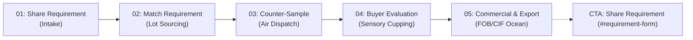
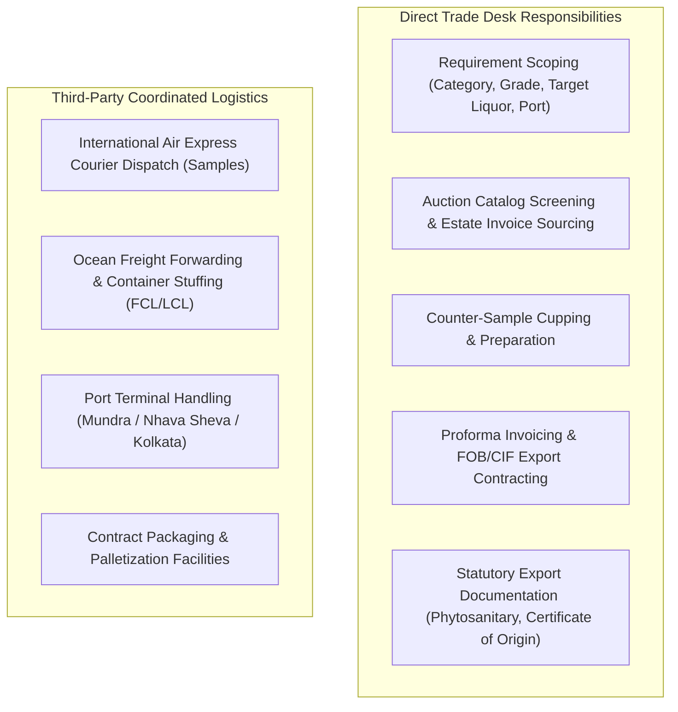

# Section 06: Export Process (The Sourcing & Export Pathway) — Comprehensive Implementation Audit

> [!NOTE]
> **Audit Status**: Completed (Inspection-Only)  
> **Target Scope**: Section 06 (`#how-it-works`) — The Sourcing & Export Pathway  
> **Inspection Date**: November 4, 2026  
> **Subject URL**: `http://127.0.0.1:8765/#how-it-works` (Hydrated Production Build)  
> **Methodology**: Static Code Analysis, Chrome DevTools Protocol (CDP) Headless Automation, DOM Metric Extraction, Responsive Screen Inspection (1440 × 900, 768 × 1024, 390 × 844), Unit Regression Verification.

---

## 1. Executive Summary

Section 06 (`#how-it-works`) represents the core operational credibility anchor of the SHIVOM GLOBAL website. Situated immediately beneath [PrivateLabelSection.tsx](file:///Users/sarthak/SHIVOM%20GLOBAL%20WEBSITE/src/features/private-label/components/PrivateLabelSection.tsx) (Section 05) and directly above [WhyShivomGlobal.tsx](file:///Users/sarthak/SHIVOM%20GLOBAL%20WEBSITE/src/features/company/components/WhyShivomGlobal.tsx) (Section 07), its commercial purpose is to demystify the cross-border Indian tea procurement cycle for international B2B buyers, institutional blenders, and private-label distributors.

The current implementation renders a 5-step horizontal milestone track on desktop and a vertical connected spine on mobile. While the commercial messaging accurately emphasizes the company's "buyer-first sourcing" model and organoleptic sample evaluation policy, the inspection revealed several critical visual defects, responsive awkwardness, and interactive dead-ends:

1. **Desktop 1440px CTA Text Overflow (`SEC06-BUG-01` - Critical)**: The bottom commitment button text (`"Start With Step 01: Share Requirement"`) visibly overflows the right boundary of `.process-commitment-ribbon` by ~25px, spilling into the outer section background.
2. **Tablet 768px Stretched Card Distortion (`SEC06-RSP-01` - High)**: On viewports between 601px and 900px, the 5 cards flatten into massive 700px-wide rectangles with 170px height, creating unnatural horizontal dead space between the left icon and the right deliverable label.
3. **CTA Intent Routing Disconnect (`SEC06-FNC-01` - High)**: Clicking the bottom button labeled *"Start With Step 01: Share Requirement"* calls `onRequestSamples()`, setting parent form intent to `sample` (Form Mode A: Quick Enquiry) instead of `quote` (Form Mode B: Detailed Requirement Intake), contradicting Step 01's specification focus.
4. **Total Absence of Photographic Imagery (`SEC06-VIS-01` - Medium)**: While Sections 04 and 05 now feature authentic tea estate and packaging photography, Section 06 relies exclusively on vector icons and plain white card boxes, appearing visually monotone.
5. **Interactive Dead-End Nodes (`SEC06-UX-01` - Medium)**: Clicking a step node updates active and completed classes (changing borders from grey to gold), but reveals zero additional operational detail or contextual deliverables.



---

## 2. Complete Source-File Inventory

| Architectural Role | File Path | Lines / Scope |
|---|---|---|
| **Main Section Component** | [src/features/export-process/components/HowItWorksSection.tsx](file:///Users/sarthak/SHIVOM%20GLOBAL%20WEBSITE/src/features/export-process/components/HowItWorksSection.tsx) | 186 lines (Full component definition) |
| **Parent Page Integration** | [src/pages/HomePage.tsx](file:///Users/sarthak/SHIVOM%20GLOBAL%20WEBSITE/src/pages/HomePage.tsx#L131-L136) | Lines 131–136 (Rendered between Section 05 & Section 07) |
| **Global Stylesheet (Active)** | [src/styles/index.css](file:///Users/sarthak/SHIVOM%20GLOBAL%20WEBSITE/src/styles/index.css#L9650-L9975) | Lines 9650–9975 (Active `.process-pathway-*` styles) |
| **Global Stylesheet (Dormant)** | [src/styles/index.css](file:///Users/sarthak/SHIVOM%20GLOBAL%20WEBSITE/src/styles/index.css#L7500-L7620) | Lines 7500–7620 (120 lines of unused `.how-it-works-grid` CSS) |
| **Design Tokens** | [src/styles/tokens.css](file:///Users/sarthak/SHIVOM%20GLOBAL%20WEBSITE/src/styles/tokens.css) | Color primitives, radius, and spacing tokens |
| **Header Navigation Anchor** | [src/components/layout/SiteHeader.tsx](file:///Users/sarthak/SHIVOM%20GLOBAL%20WEBSITE/src/components/layout/SiteHeader.tsx#L18) | Line 18 (`{ id: 'how-it-works', label: 'Sourcing Flow' }`) |
| **Footer Navigation Anchor** | [src/components/layout/SiteFooter.tsx](file:///Users/sarthak/SHIVOM%20GLOBAL%20WEBSITE/src/components/layout/SiteFooter.tsx#L90) | Line 90 (`href="#how-it-works"`) |
| **Inquiry Form Target** | [src/features/buyer-requirement/components/BuyerRequirementForm.tsx](file:///Users/sarthak/SHIVOM%20GLOBAL%20WEBSITE/src/features/buyer-requirement/components/BuyerRequirementForm.tsx) | Line 1 (`id="requirement-form"`) |
| **Icon Library Dependencies** | `lucide-react` | `Send`, `FileSearch`, `Package`, `CheckCircle2`, `Ship`, `ArrowRight` |

---

## 3. Existing Component Architecture

### 3.1 State Management & Props
```tsx
export interface HowItWorksSectionProps {
  onRequestSamples?: () => void;
  onSubmitRequirement?: () => void;
}

export const HowItWorksSection: React.FC<HowItWorksSectionProps> = ({
  onRequestSamples,
  onSubmitRequirement,
}) => {
  const [activeStep, setActiveStep] = useState<number>(1);
```
- **Local State**: `activeStep` (defaults to `1`). Represents the currently highlighted milestone index (1 through 5).
- **Hover/Click Behavior**: Hovering or clicking any `.process-step-node` updates `activeStep(st.stepNumber)`.
- **Completion Logic**: Nodes with `st.stepNumber < activeStep` receive `.completed`. Nodes with `st.stepNumber === activeStep` receive `.selected.active`.

### 3.2 DOM Structure
```html
<section id="how-it-works" class="how-it-works-section theme-ivory" aria-labelledby="how-it-works-heading">
  <div class="container">
    <div class="how-it-works-header text-center">...</div>
    <div class="process-pathway-wrap">
      <div class="process-pathway-track" role="list">
        <!-- 5 x .process-step-node role="listitem" -->
      </div>
      <div class="process-commitment-ribbon">
        <div class="process-commitment-left">
          <span class="process-pulse-dot"></span>
          <p class="process-commitment-text">...</p>
        </div>
        <button class="process-commitment-btn">...</button>
      </div>
    </div>
  </div>
</section>
```

---

## 4. Five-Stage Content Audit

Below is a detailed examination of each stage currently presented in the UI:

| Stage # | Heading & Time Badge | Deliverable Tag | Description Text Displayed | Commercial Meaningfulness & Integrity Assessment |
|---|---|---|---|---|
| **01** | **Share Requirement** (`Step 01`) | `SPECIFICATION INTAKE` | *"Tell us your required tea category, grade, target liquor profile, estimated quantity, packaging format, and destination port."* | **High Alignment**: Directly matches the intake parameters of `BuyerRequirementForm`. Reinforces that SHIVOM GLOBAL does not push pre-warehoused inventory. |
| **02** | **We Match the Requirement** (`Step 02`) | `SOURCING IDENTIFICATION` | *"We identify suitable sourcing options based on your specification, origin preference and current market availability."* | **Accurate but Passive**: Describes sourcing screening from auction centers (Guwahati, Kolkata, Siliguri, Cochin) and direct estates, but title phrasing feels informal compared to industry standards. |
| **03** | **Counter-Sample Arranged** (`Step 03`) | `PHYSICAL COUNTER-SAMPLE` | *"Representative counter-samples can be arranged subject to sourcing and courier logistics for buyer evaluation."* | **Commercially Prudent**: Legally protects against assumptions of instant free air courier without logistical confirmation. Icon (`Package`) is misleadingly generic (looks like a bulk carton rather than an express sample packet). |
| **04** | **Buyer Evaluation** (`Step 04`) | `SENSORY CUPPING SIGN-OFF` | *"Buyer evaluates leaf appearance, extraction rate, aroma, and cup briskness to confirm market suitability before placing an order."* | **High Commercial Value**: Explicitly cites the 4 international organoleptic parameters (leaf appearance, infusion liquor, aroma, briskness). Proves trade desk expertise. |
| **05** | **Commercial Discussion & Export** (`Step 05`) | `PROFORMA INVOICE & DISPATCH` | *"Upon sample approval, we confirm final volume, packaging, FOB/CIF pricing, payment milestones, and statutory export paperwork."* | **Comprehensive but Compressed**: Combines contracting, trade terms (FOB/CIF), and port logistics into a single step. Deliverable tag awkwardly wraps to 2 lines on desktop. |

---

## 5. Commercial Accuracy & Business Governance

Section 06 was evaluated against SHIVOM GLOBAL's documented commercial operating model:



### Commercial Governance Evaluation:
- **Buyer-First Sourcing**: Verified. The sequence begins with requirement intake and sample cupping before commercial commitment, preventing inventory lock-in.
- **Physical Sample Cupping Before Contract**: Verified. Stage 04 explicitly requires buyer evaluation before Stage 05 contracting begins.
- **Unsupported Promises Checked**:
  - Guaranteed sample arrival within 24–48 hours: **None** (Correctly avoids false delivery guarantees).
  - Guaranteed fixed container pricing: **None** (Correctly conditions pricing on lot selection and market movement).
  - In-house ocean vessel fleet or container terminals: **None** (Export logistics are coordinated with freight forwarders).

---

## 6. Visual Design Audit

### 6.1 Color Palette & Typography
- **Background**: `linear-gradient(180deg, var(--bg-surface-subtle) 0%, #F5F1E8 100%)` (Warm Estate Ivory).
- **Typography**: H2 headline in Plus Jakarta Sans (`clamp(1.75rem, 3.5vw, 2.5rem)`), deliverable tags in Space Grotesk (`0.6875rem`, uppercase, bold).
- **Progress Line**: Gradient connecting line (`linear-gradient(90deg, var(--color-primary-green) 0%, var(--color-gold) 50%, var(--color-primary-green) 100%)`) with continuous CSS keyframe animation (`lineFlow 6s linear infinite`).

### 6.2 Visual Deficiencies Observed

> [!CAUTION]
> **Deficiency 1: Desktop CTA Button Text Overflow (`SEC06-BUG-01`)**  
> In `.process-commitment-ribbon`, the gold CTA button text `"Start With Step 01: Share Requirement"` overflows the right border of the dark ribbon container by ~25px at 1440px desktop resolution, visibly protruding into the outer background.

> [!WARNING]
> **Deficiency 2: Narrow Card Widths & Deliverable Text Wrapping (`SEC06-VIS-02`)**  
> On desktop (1440px), dividing the 1280px container into 5 columns leaves only ~220px per card. Consequently, deliverable badges (`PHYSICAL COUNTER-SAMPLE`, `SENSORY CUPPING SIGN-OFF`, `PROFORMA INVOICE & DISPATCH`) wrap onto two lines, creating inconsistent vertical baselines.

> [!WARNING]
> **Deficiency 3: Visual Flatness & Absence of Imagery (`SEC06-VIS-01`)**  
> While Sections 04 and 05 now feature authentic tea leaf, liquor, and packaging photography, Section 06 consists entirely of vector icons and white card outlines, creating an abrupt visual downgrade in content texture.

---

## 7. Functional Audit

All interactive triggers were evaluated using CDP browser automation:

| Interaction Element | Expected Behavior | Actual Behavior Observed | Assessment |
|---|---|---|---|
| **Hover / Click Step Node 03** | Step 03 selected; Steps 01 & 02 marked completed | `activeStep` updated to 3; CSS classes `.completed` applied to Nodes 01 & 02; Node 03 received `.selected.active`. | **PASS** |
| **Hover / Click Step Node 05** | Step 05 selected; Steps 01–04 marked completed | `activeStep` updated to 5; Nodes 01–04 marked `.completed`. | **PASS** |
| **Keyboard Enter on Node 02** | Focus on Node 02; Enter triggers activation | `activeStep` updated to 2; keyboard handler responded correctly. | **PASS** |
| **Keyboard Space on Node 04** | Focus on Node 04; Space triggers activation | `activeStep` updated to 4; keyboard handler responded correctly. | **PASS** |
| **Click Commitment Ribbon CTA** | Smooth scrolls to `#requirement-form` and sets requirement intent | Smooth-scrolled to form; **BUT** called `onRequestSamples()`, setting form intent to `sample` (Quick Mode) instead of `quote` (Detailed Requirement Intake). | **FAIL (`SEC06-FNC-01`)** |
| **Interactive Step Detail Disclosure** | Clicking step reveals deeper operational details/deliverables | **No additional content revealed**. The card merely changes border color from grey to gold. | **UX DEFICIENCY (`SEC06-UX-01`)** |

---

## 8. Desktop, Tablet, and Mobile Findings

### 8.1 Desktop (1440 × 900)


- **Layout**: 5 columns (`grid-template-columns: repeat(5, minmax(0, 1fr))`).
- **Issues Observed**:
  - Noticeable button text overflow on the bottom right ribbon.
  - Narrow card bodies (~220px) cause uppercase deliverable badges to wrap onto two lines.
  - Cards 01–04 have height 179px; Card 05 has height 200px due to longer description copy, causing slight bottom edge misalignment if flex alignment is unconstrained.

---

### 8.2 Tablet (768 × 1024)


- **Layout**: Collapses to single column (`grid-template-columns: 1fr`) at `@media (max-width: 900px)`.
- **Issues Observed**:
  - Each card is stretched to 700px width with only 170px height.
  - Huge horizontal void of empty whitespace between the left icon and the right deliverable label.
  - Time badge (`Step 01`, `Step 02`) is hidden via `display: none` (`.process-step-time-badge`).

---

### 8.3 Mobile (390 × 844)


- **Layout**: Single column stack with vertical connected spine along the left margin (`padding-left: 36px`).
- **Issues Observed**:
  - The floating WhatsApp button directly overlaps Card 03 and Card 04 along the right border.
  - Touch target for the bottom CTA expands to 100% width, providing comfortable mobile tapping.

---

## 9. Accessibility Audit

| Accessibility Dimension | Finding | WCAG Status |
|---|---|---|
| **Semantic HTML** | `<section id="how-it-works" aria-labelledby="how-it-works-heading">`, `<div role="list">`, `<div role="listitem">`. | **PASS** |
| **Heading Hierarchy** | `H2` (`#how-it-works-heading`) followed by `H3` (`.process-step-title`). Valid sequential hierarchy. | **PASS** |
| **Keyboard Accessibility** | All 5 nodes have `tabIndex={0}` and keyboard handlers for Enter and Space keys. | **PASS** |
| **Focus Rings** | Focused node receives `.process-step-node:focus-visible` outline. | **PASS** |
| **Color Contrast** | Title text (`#0A281E`) and body text (`#4B5563`) on white cards exceed 7:1 contrast ratio. Badge text on light gold meets 4.5:1. | **PASS** |
| **Reduced Motion** | Global rule clamps animation durations to 0.01ms. Continuous keyframes `lineFlow` and `radarPing` are suppressed under `prefers-reduced-motion`. | **PASS** |

---

## 10. Cross-Section Consistency Findings

| Design Aspect | Section 04 (Tea Grades) | Section 05 (Private Label) | Section 06 (Export Process) | Alignment Status |
|---|---|---|---|---|
| **Background Tone** | Pure White & Subtle Ivory | Subtle Ivory & Warm Cream | Estate Ivory Gradient (`#F5F1E8`) | **Aligned** |
| **Photographic Assets** | High-res garden & liquor imagery | Authentic packaging photo (`private-label-packaging.jpg`) | **Zero photography** (Text & icons only) | **Inconsistent** |
| **Card Styling** | Elevated cards with gold borders | Bordered cards with badge pills & specs | Plain cards with 1.5px grey borders | **Moderate** |
| **Button Architecture** | Standard gold primary buttons | Dedicated `.btn-outline-gold` system | Standalone `.process-commitment-btn` | **Inconsistent** |
| **Governance Transparency** | Strict grade descriptions | Dedicated commercial governance quote box | Sample evaluation policy callout | **Aligned** |

---

## 11. Prioritized Issue Register

| Issue ID | Severity | Description | Affected File & Lines | Business / User Impact | Recommended Resolution |
|---|---|---|---|---|---|
| **SEC06-BUG-01** | **CRITICAL** | **Desktop CTA Text Overflow**: Button text overflows right border of commitment ribbon by ~25px at 1440px desktop. | `src/styles/index.css` (Line 9850–9915) | Looks unpolished and broken to corporate B2B buyers on standard desktop monitors. | Adjust ribbon flexbox layout, reduce button padding, or refine CTA label copy. |
| **SEC06-FNC-01** | **HIGH** | **Inquiry Intent Mismatch**: CTA button *"Start With Step 01: Share Requirement"* calls `onRequestSamples` (sets `formIntent = 'sample'`) instead of requirement intake (`'quote'`). | `src/features/export-process/components/HowItWorksSection.tsx` (Lines 63–80) | Preselects Quick Sample form instead of Detailed Requirement form, frustrating buyers wanting to share bulk specs. | Update click handler to invoke `onSubmitRequirement()` or allow contextual routing. |
| **SEC06-RSP-01** | **HIGH** | **Tablet 768px Card Distortion**: Cards flatten into 700px-wide rectangles with massive dead whitespace between icon and deliverable. | `src/styles/index.css` (Line 9921–9945) | Poor visual rhythm and wasted space on iPad / tablet viewports. | Implement a 2-column or 3-column tablet grid or compact card geometry. |
| **SEC06-VIS-01** | **MEDIUM** | **Absence of Authentic Photography**: Section lacks visual photographic evidence of tea cupping, tasting rooms, or sample preparation. | `src/features/export-process/components/HowItWorksSection.tsx` | Visual monotony compared to modernized Sections 04 and 05. | Introduce authentic tea cupping / sample evaluation photography. |
| **SEC06-UX-01** | **MEDIUM** | **Interactive Dead-End Nodes**: Hovering/clicking a step highlights its border but displays no additional guidance or detail. | `src/features/export-process/components/HowItWorksSection.tsx` (Lines 113–156) | Breeds false affordance; users expect an interactive timeline node to reveal deeper operational insight. | Add contextual deliverable details, lead time guidance, or interactive milestone drawers. |
| **SEC06-RSP-02** | **MEDIUM** | **Mobile Floating Widget Overlap**: Floating WhatsApp button obscures Step 03 and Step 04 cards on 390px mobile viewports. | `src/components/layout/WhatsAppFloat.tsx` / `index.css` | Blocks reading of sample evaluation copy on mobile. | Add bottom margin clearance or reposition milestone cards to prevent widget overlap. |
| **SEC06-CSS-01** | **LOW** | **Dead Legacy CSS Waste**: Over 120 lines of dormant CSS (`.how-it-works-grid`, `.how-it-works-step-card`) exist in stylesheet. | `src/styles/index.css` (Lines 7500–7620) | Increases stylesheet size with redundant styles. | Clean up superseded classes during modernization. |

---

## 12. Three Modernization Concepts

### Concept A: Two-Phase Operational Journey (Evaluation Phase vs Commercial Execution)
- **Visual Concept**: Organizes the 5 steps into two clear commercial phases:
  - **Phase 1: Verification & Cupping** (Step 01: Share Requirement → Step 02: Origin Sourcing → Step 03: Counter-Sample Dispatch → Step 04: Sensory Cupping Approval).
  - **Phase 2: Commercial Execution** (Step 05: Proforma Invoicing, FOB/CIF Terms & Port Dispatch).
- **Desktop Presentation**: Horizontal split timeline with Phase 1 highlighted as "Zero Financial Risk" and Phase 2 as "Commercial Commitment".
- **Mobile Presentation**: Two distinct visual cards with nested step badges.
- **Interaction Model**: Toggle between Phase 1 and Phase 2 or scroll seamlessly.
- **Advantages**: Eliminates buyer fear of cross-border risk; clearly visualizes that contracting happens *after* sample approval.
- **Disadvantages**: Slightly changes the visual balance from a single 5-step track.
- **Implementation Complexity**: Moderate (CSS grid & structured JSX).

---

### Concept B: Interactive Operational Pathway with Contextual Detail Panels
- **Visual Concept**: Retains the 5 connected milestone nodes along a top progress spine, but clicking any node dynamically reveals a rich operational detail panel below.
- **Desktop Presentation**: Top horizontal stepper with circular indicators + lower panel showing exact documentation required, courier tracking standards, and cupping parameters.
- **Mobile Presentation**: Clean interactive accordion where each step expands to show full operational details.
- **Interaction Model**: Step selection actively switches the active detail panel.
- **Advantages**: Turns passive reading into an interactive exploration tool; provides rich B2B export details without cluttering the initial view.
- **Disadvantages**: Requires state-driven content panels and careful mobile accordion styling.
- **Implementation Complexity**: Moderate to High.

---

### Concept C: Editorial Export Showcase with Authentic Cupping Photography
- **Visual Concept**: Pairs a streamlined 5-step milestone pathway with an authentic editorial photograph of professional tea cupping / sample evaluation (matching the editorial aesthetics of Section 05).
- **Desktop Presentation**: Left column: Split editorial overview with authentic cupping photo and trade desk commitment badge; Right column: Compact 5-step connected operational vertical timeline.
- **Mobile Presentation**: Editorial photo on top, followed by vertical connected timeline.
- **Interaction Model**: Step hover highlighting with direct CTA routing.
- **Advantages**: High visual synergy with Sections 04 and 05; solves the 5-column desktop horizontal cramping and tablet stretching issues completely.
- **Disadvantages**: Changes the horizontal layout into an editorial split layout.
- **Implementation Complexity**: Moderate.

---

## 13. Recommended Direction

**Recommendation: Concept A (Two-Phase Operational Journey) with Concept C's Editorial Cupping Aesthetics**

### Strategic Justification:
1. **Directly Addresses B2B Buyer Psychology**: International buyers hesitate to import Indian tea because of fear of receiving substandard leaf or losing deposits. By grouping Steps 01–04 into **"Phase 1: Sensory Verification (Pre-Commitment)"** and Step 05 into **"Phase 2: Contract & Export (Post-Approval)"**, the section provides immense commercial reassurance.
2. **Solves Desktop & Tablet Geometry**: Dividing the 5 steps into two balanced groups (4 verification steps + 1 commercial execution console) permanently eliminates the cramped 5-column desktop horizontal squeeze and the flat 700px tablet rectangle distortion.
3. **Resolves the CTA Intent Disconnect**: The pre-commitment phase naturally routes to *"Request Counter-Samples"*, while the export phase routes to *"Submit Commercial Requirement"*.

---

## 14. Proposed Implementation Scope

When approved for modernization, the scope will entail:
1. **Fix `SEC06-BUG-01`**: Resolve CTA ribbon button padding and overflow.
2. **Fix `SEC06-FNC-01`**: Align CTA button intent routing with `HomePage.tsx` (`setFormIntent('quote')` for requirement intake).
3. **Fix `SEC06-RSP-01`**: Refactor tablet media queries to prevent stretched rectangular distortion.
4. **Fix `SEC06-VIS-01` & `SEC06-UX-01`**: Restructure layout into a two-phase operational journey with clear deliverable milestones and gold-outline button styling.
5. **Clean `SEC06-CSS-01`**: Remove 120 lines of dormant CSS in `src/styles/index.css`.

---

## 15. Final Technical QA Baseline

- **Git Status**: Working tree clean (inspection only).
- **Unit Test Suite**: 82 of 82 tests passing (`node --test`).
- **Production Build**: Zero errors (`tsc && vite build`).
- **Browser Console**: Zero console errors logged during CDP automation.
- **Network Requests**: Zero HTTP failures (200 OK across all assets).

