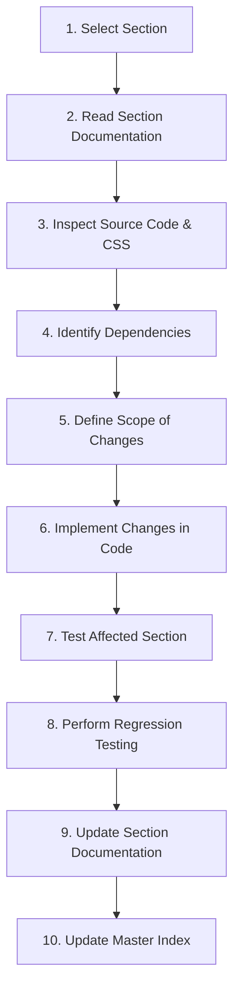

# Website Section Documentation System — SHIVOM GLOBAL

> **Directory**: `docs/website-sections/`  
> **System Scope**: Section-by-Section Architectural Specification & Development Guide  
> **Status**: Production Reference  
> **Last Verified**: 2026-11-02

---

## 1. Why This Documentation System Exists

The **SHIVOM GLOBAL** website is an institutional B2B tea sourcing and bulk export portal serving international buyers across the globe. 

To maintain strict visual consistency (Deep Forest, Warm Cream, Warm Gold), preserve mission-critical backend integrations (Supabase database, Resend email pipeline, dual-mode buyer requirement engine), and enable incremental development without regression, the website is partitioned into **individually documented sections**.

### Core Objectives
1. **Isolated Section Iteration**: Any developer, designer, or AI agent can inspect, refactor, or improve a single website section in complete isolation without risking unintended side effects on adjacent components.
2. **Technical Source of Truth**: Eliminates guesswork by mapping every visual element directly to its exact React component, CSS line numbers, asset files, and backend dependencies.
3. **Preservation of Business Integrity**: Enforces strict commercial positioning (buyer-first sourcing, counter-sample verification, statutory export compliance) and prevents unauthorized alterations to business claims or statutory credentials.
4. **Standardized Quality & Verification**: Provides reproducible testing and acceptance criteria for desktop, tablet, and mobile breakpoints before any code change is merged.

---

## 2. Directory Structure

```
docs/website-sections/
│
├── README.md                          # This system guide & developer workflow
├── 00_WEBSITE_SECTION_INDEX.md        # Master central control index & tracking table
├── 01_HEADER.md                       # Section 01: Site Header & sticky navigation
├── 02_HERO_SECTION.md                 # Section 02: Scroll-driven 40-frame hero canvas & H1
├── 03_TEA_CATEGORIES.md               # Section 03: Sourcing portfolio & interactive console
├── 04_TEA_ORIGINS_AND_GRADES.md       # Section 04: Grade specification reference table
├── 05_PRIVATE_LABEL.md                # Section 05: Private label & custom packing support
├── 06_EXPORT_PROCESS.md               # Section 06: 5-step sourcing pathway (How It Works)
├── 07_WHY_SHIVOM_GLOBAL.md            # Section 07: Compliance console & trading pillars
├── 08_BUYER_REQUIREMENT_FORM.md       # Section 08: Dual-mode requirement engine & API integration
├── 09_FOOTER.md                       # Section 09: Statutory transparency & footer navigation
├── 10_WHATSAPP_FLOAT.md               # Section 10: Persistent floating WhatsApp action trigger
│
└── SECTION_DOCUMENTATION_TEMPLATE.md  # Standardized 12-part reusable documentation template
```

---

## 3. What Each Documentation File Contains

Every numbered section file (`01` through `10`) strictly follows the **12-part technical documentation standard**:

1. **Section Overview**: Section ID, human-readable name, position on website, main purpose, target audience, and business objective.
2. **Current Implementation**: Existing design description, layout architecture, content structure, visual elements, and interactive functionality.
3. **Component Mapping**: Exact React component name, relative file paths, subcomponents, and shared dependencies.
4. **Styling Mapping**: CSS file paths, specific line numbers in `src/styles/index.css`, design tokens, typography, color palette, spacing, and layout behaviour.
5. **Asset Mapping**: File paths for all images, SVGs, video, Lucide vector icons, and typography.
6. **Functional Behaviour**: Click handlers, smooth scroll anchors, form behaviour, animations, API integrations, and WhatsApp links.
7. **Responsive Behaviour**: Detailed layout adaptation across Desktop (>= 1025px), Tablet (769px–1024px), and Mobile (<= 768px), noting any known responsive edge cases.
8. **SEO & Accessibility**: Heading hierarchy (H1–H4), semantic HTML tags, alt attributes, ARIA roles, keyboard navigation (Tab/Enter/Space/Escape), and search crawler considerations.
9. **Dependencies & Integration**: Cross-section state triggers, global CSS dependencies, API endpoints, and anchor targets.
10. **Current Issues & Improvement Backlog**: Verified issue tracker separating observations from recommendations with priorities (P0/P1/P2) and statuses.
11. **Testing & Acceptance Criteria**: Specific visual, functional, responsive, regression, and performance acceptance criteria.
12. **Change History**: Audit table recording date, description of changes, files modified, and verification status.

---

## 4. Master Website Index (`00_WEBSITE_SECTION_INDEX.md`)

The Master Index is the central control document for the entire website.

### How to Use the Master Index
- **Status Auditing**: Check the Section Tracking Table to see whether a section is *Implemented*, *Partially Implemented*, *Needs Investigation*, or *Not Implemented*.
- **Sequencing Reference**: View the exact rendering hierarchy of components within `src/pages/HomePage.tsx`.
- **Cross-Section Dependencies**: Identify shared utilities such as `src/constants/contact.ts`, centralized design tokens (`src/styles/tokens.css`), and the serverless backend (`api/buyer-requirements.ts`).
- **Consolidated Backlog**: Review pending improvements across all 10 sections sorted by priority.

---

## 5. Recommended Workflow for Future Development

When undertaking any redesign, feature enhancement, bug fix, or content update, follow this strict 10-step protocol:



### Detailed Step-by-Step Breakdown

1. **Select the Section**: Identify which numbered section governs the requested change (e.g., modifying packaging options corresponds to `05_PRIVATE_LABEL.md`).
2. **Read its Documentation**: Read the section's documentation file thoroughly to understand its existing layout, CSS classes, tokens, and functional behaviour.
3. **Inspect its Source Code**: Examine the actual React component in `src/` and the exact CSS rule block mapped in `src/styles/index.css`.
4. **Identify Dependencies**: Check Section 9 of the document to see if changes will affect other sections (e.g. modifying form preselection keys affects Section 08).
5. **Define the Scope of Changes**: Plan minimal, surgical modifications. Ensure that no unauthorized modifications are made to global tokens, typography, or backend services.
6. **Implement the Changes**: Write clean TypeScript and Vanilla CSS following the established 8px grid and token conventions.
7. **Test the Affected Section**: Execute visual, functional, and responsive checks on desktop, tablet, and mobile viewports in accordance with Section 11 of the documentation.
8. **Perform Regression Testing**: Verify that adjacent sections, smooth-scrolling anchors, and mobile drawer navigation remain unaffected.
9. **Update its Documentation**: Update the section document:
   - If design or layout changed, update Sections 2 and 4.
   - If issues were resolved, update the Backlog table in Section 10.
   - Record the change in the Change History table in Section 12.
10. **Update the Master Index**: Update `00_WEBSITE_SECTION_INDEX.md` with the new status, backlog updates, and last modified date.

---

## 6. How to Document a New Section

If an entirely new independent section is added to the website (e.g. a dedicated Certifications Carousel or Client FAQ Accordion):

1. **Copy the Template**: Make a copy of [`SECTION_DOCUMENTATION_TEMPLATE.md`](./SECTION_DOCUMENTATION_TEMPLATE.md) with a sequential number (e.g., `11_NEW_SECTION_NAME.md`).
2. **Fill in all 12 Sections**: Complete every field based on the actual implemented code. Never invent paths or functionality.
3. **Update the Master Index**:
   - Add the new section row to the Tracking Table in `00_WEBSITE_SECTION_INDEX.md`.
   - Update the Section Sequence flowchart and detailed sequential roster.
4. **Update Section 2 of this README**: Add the new file to the directory tree list.

---

## 7. Rules for Maintaining Documentation Accuracy

To ensure this documentation system remains a permanent, reliable engineering asset:

1. **Document Truth, Not Aspirations**: Document what is actually written in the code, not an imagined or hypothetical future design.
2. **Exact Paths Only**: Always use exact relative paths from the repository root (e.g., `src/features/hero/components/HeroSection.tsx`).
3. **Explicit Unknowns**: If an asset or integration is unverified, record it explicitly as `"Not Verified"`.
4. **Preserve Section Numbering**: Do not arbitrarily renumber existing sections; maintain stability across cross-document links.
5. **One Change at a Time**: Complete and verify documentation updates concurrently with code commits.

---

## 8. Integration with Design System & Colour Management

All visual styling, background colours, typography, borders, and accents documented across sections are strictly governed by the **Centralised Colour Management System**:

- **System Index & Governance**: [`docs/design-system/README.md`](../design-system/README.md)
- **Technical Colour Audit & Inventory**: [`docs/design-system/COLOR_SYSTEM.md`](../design-system/COLOR_SYSTEM.md)
- **Colour Palette Evaluation & Directions**: [`docs/design-system/COLOR_PALETTE_OPTIONS.md`](../design-system/COLOR_PALETTE_OPTIONS.md)
- **Section & Primitive Usage Guidelines**: [`docs/design-system/COLOR_USAGE_GUIDELINES.md`](../design-system/COLOR_USAGE_GUIDELINES.md)
- **Colour Changelog & History**: [`docs/design-system/COLOR_CHANGELOG.md`](../design-system/COLOR_CHANGELOG.md)

When refactoring or styling any section, consult `COLOR_USAGE_GUIDELINES.md` to ensure compliance with the 65-25-10 distribution rule, zero-hardcoding policy, and WCAG 2.1 AA contrast standards.

